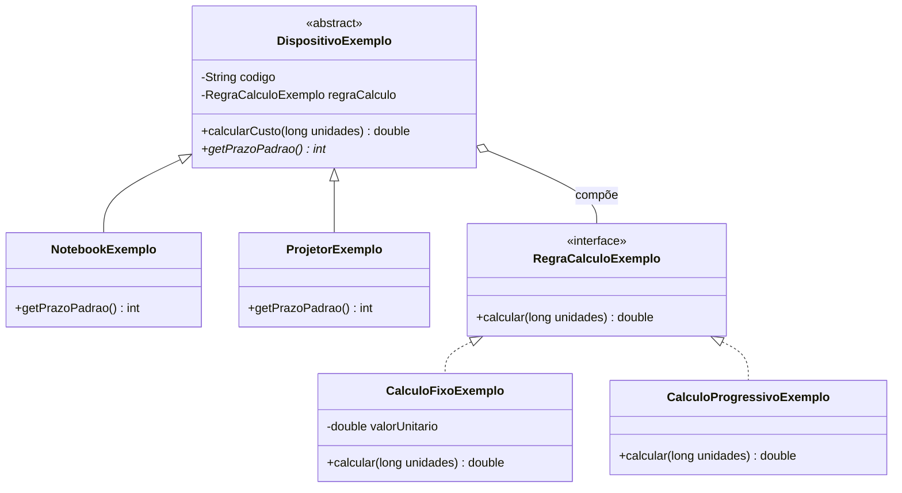

# Guia 02 — Herança, Polimorfismo e o Padrão Strategy

## 1. Herança e Classes Abstratas
A herança modela a relação **"é um"** (*is-a*). Uma classe abstrata (`abstract class`) define uma fundação comum para uma família de classes:
- Não pode ser instanciada diretamente (`new Superclasse()` gera erro de compilação).
- Pode conter tanto métodos concretos (comportamentos compartilhados) quanto métodos abstratos (`public abstract int obterDiasPrazo();`), forçando as subclasses a fornecerem sua própria implementação.

### Quando usar Classe Abstrata vs Interface?
- **Classe Abstrata:** Use quando as subclasses compartilham **estado** (atributos comuns como identificador, descrição e situação) e código compartilhado.
- **Interface:** Use para definir um **contrato de comportamento** (uma habilidade ou estratégia), sem guardar estado, permitindo que classes de origens diferentes implementem o mesmo método.

---

## 2. O Padrão de Projeto Strategy (GoF)
O padrão **Strategy** é utilizado para definir uma família de algoritmos, encapsular cada um deles em uma classe separada e torná-los intercambiáveis.

### O Problema do `if/else` e do `instanceof`
Sem o Strategy, o cálculo de regras variáveis normalmente cai nesta armadilha de código macarrônico:
```java
// ANTI-PATTERN: Violação gritante do OCP (Open/Closed Principle)
if (tipo.equals("NOTEBOOK")) {
    multa = dias * 5.0;
} else if (tipo.equals("PROJETOR")) {
    multa = 10.0 + (dias - 1) * 5.0;
} else if (tipo.equals("KIT")) {
    multa = 0.0;
}
```
Se amanhã surgir um novo equipamento (ex.: "Drone" ou "Mesa Digitalizadora"), você teria que caçar e modificar todos os `if/else` espalhados pelo sistema.

### A Solução com Strategy
1. Crie uma interface comum:
```java
public interface RegraCalculoExemplo {
    double calcular(long unidades);
}
```
2. Crie as implementações concretas:
```java
public class CalculoFixoExemplo implements RegraCalculoExemplo {
    private final double valorPorUnidade;
    public CalculoFixoExemplo(double valorPorUnidade) { this.valorPorUnidade = valorPorUnidade; }
    @Override
    public double calcular(long unidades) { return unidades * valorPorUnidade; }
}

public class CalculoIsentoExemplo implements RegraCalculoExemplo {
    @Override
    public double calcular(long unidades) { return 0.0; }
}
```
3. O item recebe a estratégia por **composição** e **injeção de dependência**:
```java
public abstract class DispositivoExemplo {
    private final RegraCalculoExemplo regraCalculo;

    protected DispositivoExemplo(RegraCalculoExemplo regra) {
        this.regraCalculo = Objects.requireNonNull(regra, "A regra de cálculo é obrigatória.");
    }

    public double calcularCusto(long unidades) {
        return this.regraCalculo.calcular(unidades); // Despacho Polimórfico!
    }
}
```

---

## 3. Diagrama Conceitual (Mermaid)



---

## 4. O que a Banca Avaliadora Procura?
- Você sabe explicar o que é **Despacho Dinâmico de Métodos** (*Dynamic Method Dispatch*)? 
  *R:* É a capacidade da Máquina Virtual Java (JVM) de decidir em tempo de execução qual implementação de método executar com base no tipo real da instância na memória Heap, e não no tipo da variável de referência.
- O código respeita o **Princípio do Aberto/Fechado (OCP)**?
  *R:* Sim. Para adicionar um novo tipo de cálculo de multa, basta criar uma nova classe que implementa `RegraMulta`, sem mexer em nenhuma linha das classes existentes.
