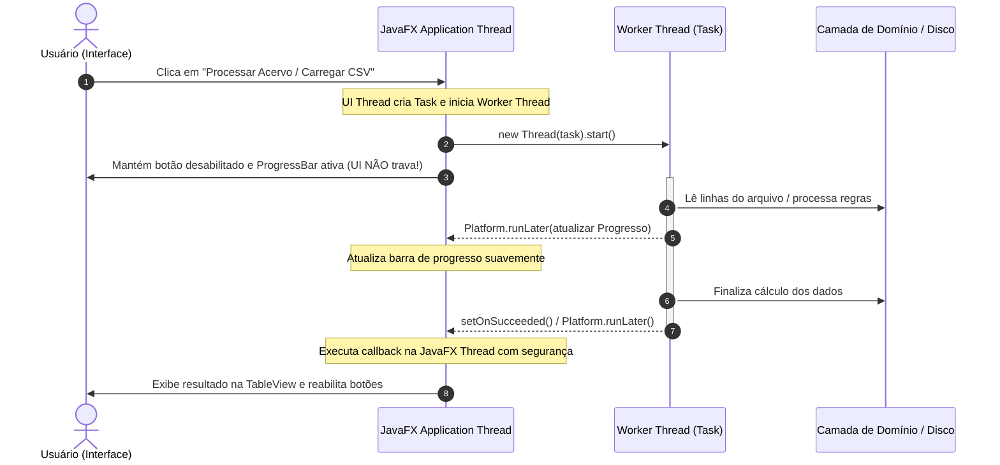

# Guia 09 — Concorrência em JavaFX, Tasks Assíncronas e Thread Safety

## 1. O Conceito em Linguagem Clara: A Regra de Ouro da UI

Imagine um restaurante com um único garçom atendendo todas as mesas do salão. Se esse garçom decidir ir até a cozinha e ficar 30 segundos picando cebola ou esperando uma panela ferver, nenhuma mesa receberá água, a conta ou o cardápio — **o salão inteiro congela**.

No JavaFX, acontece exatamente isso. A interface gráfica é gerenciada por uma única thread especializada chamada **JavaFX Application Thread** (ou UI Thread):
- Ela é a única responsável por: desenhar botões e janelas, processar cliques de mouse, tratar eventos de teclado, executar animações e repintar a tela a 60 quadros por segundo.
- **A Regra de Ouro:** **JAMAIS execute tarefas demoradas na JavaFX Application Thread.**
  - Operações que demorem mais de 16 milissegundos — como leitura/escrita de arquivos grandes (CSV/banco de dados), chamadas de rede ou processamentos pesados — devem rodar obrigatoriamente em **threads secundárias de segundo plano (Worker Threads)**.
  - Se você der `Thread.sleep()` ou ler um arquivo pesado dentro de um método `@FXML handleSalvar()`, a janela do sistema operacional para de responder, o cursor vira uma roda de espera (spinning wheel) e o sistema parece travado.

---

## 2. O Modelo Visual: Worker Thread vs. JavaFX Application Thread



---

## 3. O Código Prático e Didático

O JavaFX disponibiliza o pacote `javafx.concurrent`, com destaque absoluto para a classe `Task<V>`:

### 3.1 A Estrutura de uma `Task<V>`
Uma `Task<V>` representa uma unidade de trabalho em segundo plano que retorna um resultado do tipo `V`:

```java
import javafx.concurrent.Task;
import javafx.application.Platform;
import javafx.scene.control.ProgressBar;
import javafx.scene.control.Label;

public class ServicoCarregamentoAssincrono {

    public Task<List<Registro>> criarTarefaCarregamento(File arquivo) {
        return new Task<>() {
            @Override
            protected List<Registro> call() throws Exception {
                // ESTE MÉTODO RODA NA WORKER THREAD (FORA DA UI)!
                updateMessage("Iniciando leitura do arquivo...");
                updateProgress(0, 100);

                List<Registro> resultado = new ArrayList<>();
                List<String> linhas = Files.readAllLines(arquivo.toPath());
                int total = linhas.size();

                for (int i = 0; i < total; i++) {
                    // Simula processamento ou validação linha a linha
                    resultado.add(parseLinha(linhas.get(i)));

                    // Atualiza progresso e mensagem com segurança
                    updateProgress(i + 1, total);
                    updateMessage(String.format("Processando linha %d de %d...", (i + 1), total));
                }

                updateMessage("Processamento concluído com sucesso!");
                return resultado; // Retorno entregue à UI no onSuccess
            }
        };
    }
}
```

### 3.2 Vinculando a `Task` à Interface (Binding Reativo) e Tratando Ciclo de Vida

No controlador JavaFX, inicializamos a tarefa e amarramos o seu progresso aos nós da tela:

```java
@FXML private ProgressBar barraProgresso;
@FXML private Label labelStatus;
@FXML private Button btnCarregar;

@FXML
private void handleCarregar() {
    Task<List<Registro>> tarefa = servico.criarTarefaCarregamento(arquivoCSV);

    // 1. Data Binding reativo com a barra de progresso e texto
    barraProgresso.progressProperty().bind(tarefa.progressProperty());
    labelStatus.textProperty().bind(tarefa.messageProperty());

    // 2. Desabilitar o botão durante a execução para evitar duplo clique
    btnCarregar.disableProperty().bind(tarefa.runningProperty());

    // 3. Callback executado na JavaFX Thread quando terminar com SUCESSO
    tarefa.setOnSucceeded(evento -> {
        List<Registro> dadosCarregados = tarefa.getValue();
        tabela.getItems().setAll(dadosCarregados);
        AlertaUtil.mostrarSucesso("Dados carregados com sucesso!");
    });

    // 4. Callback executado na JavaFX Thread em caso de FALHA/ERRO
    tarefa.setOnFailed(evento -> {
        Throwable erro = tarefa.getException();
        AlertaUtil.mostrarErro("Falha no Processamento", erro.getMessage());
    });

    // 5. Dispara a tarefa em uma nova Thread de background
    Thread worker = new Thread(tarefa);
    worker.setDaemon(true); // Permite fechar o app mesmo se a thread estiver rodando
    worker.start();
}
```

### 3.3 Quando usar `Platform.runLater(() -> { ... })`?
Se você estiver executando uma thread manual ou recebendo um evento assíncrono externo (ex.: listener de socket ou timer de sistema), você **não pode tocar no Scene Graph diretamente**. Use `Platform.runLater`:

```java
// Código rodando em uma thread paralela qualquer:
new Thread(() -> {
    String novoStatus = operacaoPesada();

    // Despacha a atualização visual de volta para a fila da UI Thread:
    Platform.runLater(() -> {
        labelStatus.setText(novoStatus);
        botaoConfirmar.setDisable(false);
    });
}).start();
```

---

## 4. Armadilhas Comuns (*Common Pitfalls*)

1. **`IllegalStateException: Not on FX application thread`:**
   - *Causa:* Tentativa de atualizar um componente de UI (ex.: `label.setText()`, `tabela.getItems().add()`) de dentro de uma thread criada com `new Thread()` sem envolver no `Platform.runLater()`.
   - *Solução:* Use os métodos `updateProgress()` / `updateMessage()` da `Task` ou envolva o trecho visual em `Platform.runLater(() -> { ... })`.
2. **Esquecer de marcar Threads como Daemon (`worker.setDaemon(true)`):**
   - *Causa:* Ao fechar a janela principal (`Stage.close()`), o processo Java continua rodando no fundo consumindo CPU porque threads não-daemon continuam ativas.
   - *Solução:* Sempre configure `thread.setDaemon(true);` para que a JVM finalize imediatamente ao fechar a aplicação.
3. **Uso de `Thread.sleep()` em Controladores:**
   - *Causa:* Usar `Thread.sleep()` dentro de qualquer método anotado com `@FXML`. Isso suspende a thread que redesenha a tela, congelando todo o sistema operacional da janela.
