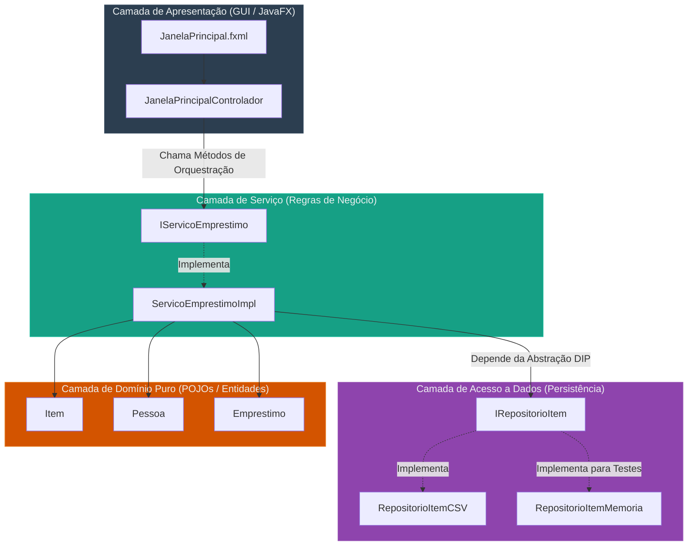

# Guia 10 — Arquitetura de Camadas Limpa e Injeção Manual de Dependências

## 1. O Conceito em Linguagem Clara: Por Que Camadas Desacopladas?

Imagine a construção de um edifício residencial:
- Os engenheiros civis projetam a estrutura física e as colunas (Regras de Domínio).
- Os encanadores e eletricistas instalam os tubos e a fiação de abastecimento (Persistência / Repositório).
- Os arquitetos de interiores cuidam da pintura, dos pisos e da mobília (Interface Gráfica / View).

Se o arquiteto de interiores cimentasse o sofá diretamente na tubulação de água principal, qualquer reforma na sala causaria um vazamento incontrolável em todo o prédio.

Em engenharia de software, a **Arquitetura em Camadas (Layered Architecture)** estabelece fronteiras claras de responsabilidade:
1. **Camada de Apresentação (GUI / FXML / Controllers):** Conhece apenas a experiência do usuário. Coleta entradas nos campos de texto, chama os métodos do serviço e desenha os dados na tela. **Não calcula multas, não valida prazos e não toca em arquivos de disco.**
2. **Camada de Serviço (Regras de Negócio e Orquestração):** O coração lógico do sistema. Valida se o usuário pode realizar a ação, executa os algoritmos de cálculo, orquestra as entidades e solicita a gravação aos repositórios.
3. **Camada de Persistência (Repositório / DAO):** Responsável estritamente pela leitura e escrita no meio físico (arquivos CSV, SQLite, memória). Não toma decisões de negócio sobre se uma operação é permitida ou não.
4. **Camada de Domínio (Entidades e Value Objects):** Representa os conceitos do negócio puro (`Item`, `Pessoa`, `Emprestimo`, `Multa`). É totalmente independente de telas e de bancos de dados.

### Injeção Manual de Dependências (Pure DI / Sem Frameworks)
Em projetos corporativos Spring Boot usa-se `@Autowired`, mas em Java puro desktop o padrão profissional é a **Injeção de Dependências por Construtor (Constructor Injection)**:
- Uma classe **recebe** tudo o que precisa para funcionar através dos parâmetros do seu construtor, em vez de dar `new` internamente.
- Isso torna o código 100% testável com testes unitários usando repositórios falsos em memória (*fakes*).

---

## 2. O Modelo Visual: Fluxo de Controle e Direção de Dependência



---

## 3. O Código Prático e Didático

### 3.1 Contrato da Abstração de Dados (Interface Repository)
```java
public interface IRepositorioExemplo<T> {
    void salvar(T entidade) throws IOException;
    Optional<T> buscarPorId(String id);
    List<T> listarTodos();
    void atualizar(T entidade) throws IOException;
}
```

### 3.2 A Camada de Serviço com Injeção por Construtor
O serviço depende exclusivamente da **interface**, nunca de classes concretas de arquivo:

```java
public class ServicoExemplo {

    private final IRepositorioExemplo<ItemExemplo> repositorio;

    // INJEÇÃO MANUAL DE DEPENDÊNCIA POR CONSTRUTOR:
    public ServicoExemplo(IRepositorioExemplo<ItemExemplo> repositorio) {
        this.repositorio = Objects.requireNonNull(repositorio, "O repositório é obrigatório.");
    }

    public void registrarItem(ItemExemplo item) throws RegraNegocioException, IOException {
        // 1. Regra de Negócio: Não permite itens com identificadores duplicados
        if (repositorio.buscarPorId(item.getCodigo()).isPresent()) {
            throw new RegraNegocioException("Já existe um item cadastrado com o código: " + item.getCodigo());
        }

        // 2. Persiste através do contrato
        repositorio.salvar(item);
    }

    public List<ItemExemplo> listarTodosItens() {
        return Collections.unmodifiableList(repositorio.listarTodos());
    }
}
```

### 3.3 A Raiz de Composição (`Composition Root`) no JavaFX
O ponto onde todas as peças são conectadas é na classe que estende `Application`:

```java
public class AppDesktopJavaFX extends Application {

    private ServicoExemplo servico;

    @Override
    public void init() throws Exception {
        // 1. Montagem das instâncias (Composition Root)
        // No sistema real: repositório CSV apontando para a pasta dados/
        IRepositorioExemplo<ItemExemplo> repoCSV = new RepositorioCSV(new File("dados/itens.csv"));
        
        // 2. Injeta o repositório dentro do serviço
        this.servico = new ServicoExemplo(repoCSV);
    }

    @Override
    public void start(Stage primaryStage) throws Exception {
        FXMLLoader loader = new FXMLLoader(getClass().getResource("/fxml/JanelaPrincipal.fxml"));
        Parent root = loader.load();

        // 3. Injeta o serviço dentro do controlador da tela
        JanelaPrincipalControlador controller = loader.getController();
        controller.setServico(this.servico);

        primaryStage.setScene(new Scene(root, 900, 600));
        primaryStage.setTitle("Gestão de Itens - Arquitetura Limpa");
        primaryStage.show();
    }
}
```

---

## 4. Como Isso Torna Seus Testes Unitários Triviais

Ao aplicar Inversão de Dependências, você pode testar toda a regra de negócio do seu serviço em nanossegundos sem precisar criar arquivos reais no disco:

```java
@Test
void deveImpedirCadastroDuplicadoComRepositorioEmMemoria() {
    // 1. Cria um repositório em memória falso (Fake)
    IRepositorioExemplo<ItemExemplo> fakeRepo = new RepositorioMemoriaFake();
    
    // 2. Injeta no serviço
    ServicoExemplo servico = new ServicoExemplo(fakeRepo);

    ItemExemplo item1 = new ItemExemplo("COD-01", "Equipamento Alpha");
    assertDoesNotThrow(() -> servico.registrarItem(item1));

    // 3. Tenta cadastrar outro item com o mesmo código
    ItemExemplo itemDuplicado = new ItemExemplo("COD-01", "Equipamento Beta");
    assertThrows(RegraNegocioException.class, () -> {
        servico.registrarItem(itemDuplicado);
    });
}
```

---

## 5. Armadilhas Comuns (*Common Pitfalls*)

1. **`new RepositorioCSV()` dentro do Serviço:**
   - *Causa:* Se a classe `ServicoEmprestimo` der `new RepositorioCSV()`, você nunca conseguirá testar o serviço sem criar arquivos no disco e violará o Princípio da Inversão de Dependência (DIP).
   - *Solução:* Exija sempre a interface `IRepositorio` no construtor do serviço.
2. **Consultar arquivos ou banco de dados direto no Controller FXML:**
   - *Causa:* Chamar métodos de leitura de arquivo dentro de um `@FXML handleSalvar()`.
   - *Solução:* O controlador deve apenas chamar métodos da camada de serviço.
3. **Entidades de domínio importando classes do JavaFX:**
   - *Causa:* Adicionar importações de `javafx.scene.control.*` ou `javafx.stage.*` nas classes de modelo (`Item`, `Pessoa`).
   - *Solução:* O modelo de domínio deve ser Java puro (POJO), completamente agnóstico à biblioteca de interface gráfica.
