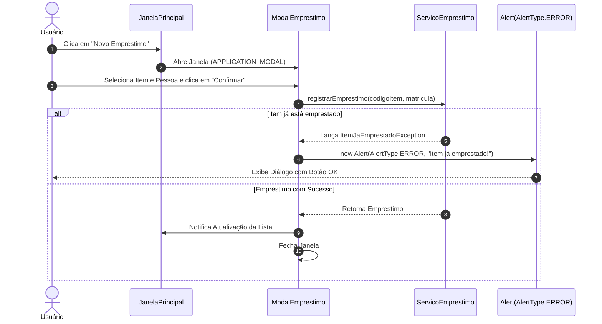

# Guia 10 — Tabelas (TableView), Janelas Modais e Captura Visual com Alert

## 1. O Conceito em Linguagem Clara

Uma interface desktop moderna exige três comportamentos fundamentais de experiência do usuário:
1. **Exibição Tabular dos Dados (`TableView`):** Os registros de itens e empréstimos devem ser apresentados em colunas limpas, com propriedades mapeadas via `CellValueFactory`.
2. **Janelas Modais de Ação (`Modality.APPLICATION_MODAL`):** Ao cadastrar um novo item ou registrar um empréstimo, abre-se uma janela auxiliar que bloqueia a interação com a janela principal até que a operação seja confirmada ou cancelada.
3. **Tratamento Visual de Erros (`Alert`):** Em aplicações profissionais de desktop, erros de negócio (como tentar emprestar um item ocupado) nunca devem ser impressos crús no console nem quebrar o programa. A camada visual captura a exceção de domínio (`ItemJaEmprestadoException`) e exibe uma caixa de diálogo nativa com mensagem amigável ao usuário.

---

## 2. O Modelo Visual: Fluxo de Ação e Captura de Exceção



---

## 3. Configuração de `TableView` com `PropertyValueFactory`

No controlador da janela principal, as colunas da tabela são vinculadas aos métodos *getters* dos objetos:

```java
import javafx.collections.FXCollections;
import javafx.collections.ObservableList;
import javafx.fxml.FXML;
import javafx.fxml.Initializable;
import javafx.scene.control.TableColumn;
import javafx.scene.control.TableView;
import javafx.scene.control.cell.PropertyValueFactory;
import java.net.URL;
import java.util.ResourceBundle;

public class JanelaPrincipalControlador implements Initializable {

    @FXML private TableView<ItemDTO> tabelaAcervo;
    @FXML private TableColumn<ItemDTO, String> colunaCodigo;
    @FXML private TableColumn<ItemDTO, String> colunaDescricao;
    @FXML private TableColumn<ItemDTO, String> colunaTipo;
    @FXML private TableColumn<ItemDTO, String> colunaSituacao;

    private final ObservableList<ItemDTO> itensObservaveis = FXCollections.observableArrayList();

    @Override
    public void initialize(URL location, ResourceBundle resources) {
        // Vincula as colunas às propriedades dos objetos (chama getCodigo(), getDescricao(), etc.)
        colunaCodigo.setCellValueFactory(new PropertyValueFactory<>("codigo"));
        colunaDescricao.setCellValueFactory(new PropertyValueFactory<>("descricao"));
        colunaTipo.setCellValueFactory(new PropertyValueFactory<>("tipo"));
        colunaSituacao.setCellValueFactory(new PropertyValueFactory<>("situacao"));

        tabelaAcervo.setItems(itensObservaveis);
    }

    public void recarregarTabela() {
        itensObservaveis.clear();
        // Busca a lista atualizada do servico e popula
        itensObservaveis.addAll(servico.listarTodos());
    }
}
```

---

## 4. Abertura de Janelas Modais Bloqueantes

Para abrir um formulário em uma nova janela bloqueando a tela de trás:

```java
@FXML
private void handleNovoEmprestimo(ActionEvent event) {
    try {
        FXMLLoader loader = new FXMLLoader(getClass().getResource("/fxml/ModalEmprestimo.fxml"));
        Parent raiz = loader.load();

        Stage modalStage = new Stage();
        modalStage.setTitle("Registrar Novo Empréstimo");
        // Bloqueia qualquer clique na janela de trás enquanto o modal estiver aberto
        modalStage.initModality(Modality.APPLICATION_MODAL);
        modalStage.initOwner(tabelaAcervo.getScene().getWindow());

        Scene cena = new Scene(raiz);
        modalStage.setScene(cena);
        modalStage.showAndWait(); // Pausa a execução do método até o modal ser fechado!

        // Após fechar o modal, atualiza a tabela principal
        recarregarTabela();

    } catch (IOException e) {
        exibirAlertaErro("Falha ao abrir tela", "Não foi possível carregar a janela modal: " + e.getMessage());
    }
}
```

---

## 5. Captura da Exceção de Domínio e Diálogo `Alert`

No controlador do modal, capture a exceção de negócio checada e exiba o alerta sem fechar a aplicação:

```java
import javafx.scene.control.Alert;
import javafx.scene.control.Alert.AlertType;

@FXML
private void handleConfirmarEmprestimo() {
    String codigo = campoCodigo.getText();
    String matricula = campoMatricula.getText();

    try {
        servico.registrarEmprestimo(codigo, matricula);
        
        // Sucesso: fecha a janela modal
        fecharJanela();

    } catch (ItemJaEmprestadoException e) {
        // Captura a exceção de regra de negócio e exibe modal visual
        Alert alerta = new Alert(AlertType.ERROR);
        alerta.setTitle("Item Indisponível");
        alerta.setHeaderText("Operação Não Permitida");
        alerta.setContentText("O item selecionado já está emprestado no momento.");
        alerta.showAndWait();

    } catch (IllegalArgumentException e) {
        Alert alerta = new Alert(AlertType.WARNING);
        alerta.setTitle("Dados Inválidos");
        alerta.setHeaderText("Preencha todos os campos obrigatórios");
        alerta.setContentText(e.getMessage());
        alerta.showAndWait();
    }
}
```

---

## 6. Checklist de Qualidade Visual da Etapa 2
- [x] O `TableView` inicializa e popula os dados sem lançar `NullPointerException`.
- [x] O modal de empréstimo usa `Modality.APPLICATION_MODAL` e bloqueia a janela principal.
- [x] Ao tentar emprestar um item ocupado, o diálogo `Alert(AlertType.ERROR)` é exibido na tela com mensagem clara.
- [x] O arquivo `styles.css` customiza as cores da tabela, dos botões e dos badges de situação.
- [x] O projeto é executável pelo script `./executar-etapa2.sh` (`mvn javafx:run`).
