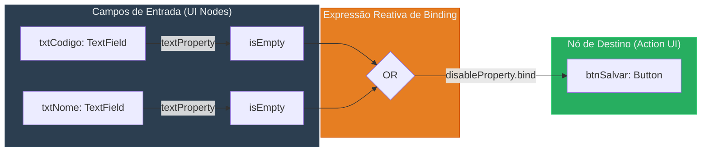

# Guia 11 — Propriedades Observáveis, Data Binding e Reatividade em JavaFX

## 1. O Conceito em Linguagem Clara: A Metáfora da Planilha Eletrônica

Pense em uma planilha do Excel:
- Na célula `A1`, você digita `10`.
- Na célula `A2`, você digita `20`.
- Na célula `A3`, você escreve a fórmula `=A1 + A2`.

No momento em que você altera o valor de `A1` para `50`, o valor de `A3` atualiza instantaneamente para `70` sem que você precise clicar em nenhum botão de "recalcular" ou disparar eventos manuais.

No **JavaFX**, o ecossistema de **Propriedades Observáveis (Observable Properties)** funciona exatamente assim:
- Em vez de tipos primitivos rígidos (`int`, `double`, `String`), o JavaFX disponibiliza wrappers observáveis: `IntegerProperty`, `DoubleProperty`, `StringProperty`, `BooleanProperty` e `ObjectProperty<T>`.
- **Data Binding (Ligação de Dados):** É o mecanismo que conecta uma propriedade a outra. Quando a propriedade de origem muda, a propriedade de destino reflete a mudança automaticamente.

---

## 2. O Modelo Visual: Fluxo de Propagação Reativa



---

## 3. O Código Prático e Didático

### 3.1 Desabilitar Botão Dinamicamente com Binding Declarativo
Em vez de criar tratadores de evento `onKeyReleased` cheios de `if` para cada campo de texto, você declara a regra em uma única linha no método `initialize()`:

```java
@FXML private TextField txtCodigo;
@FXML private TextField txtDescricao;
@FXML private Button btnCadastrar;

@FXML
public void initialize() {
    // O botão fica desabilitado se txtCodigo ESTIVER VAZIO OU txtDescricao ESTIVER VAZIA:
    btnCadastrar.disableProperty().bind(
        txtCodigo.textProperty().isEmpty()
            .or(txtDescricao.textProperty().isEmpty())
    );
}
```
**Resultado imediato:** Enquanto o usuário não digitar caracteres em ambos os campos, o botão permanece cinza e inclicável. Assim que ambos tiverem texto, o botão se torna ativo no mesmo milissegundo.

---

### 3.2 Binding Unidirecional vs. Bidirecional

#### Unidirecional (`bind`):
O destino reflete a origem, mas o destino não pode ser alterado diretamente.
```java
// O texto da etiqueta espelha o texto digitado no campo de busca em tempo real:
lblResultadoBusca.textProperty().bind(
    Bindings.concat("Pesquisando por: '", txtBusca.textProperty(), "'")
);
```

#### Bidirecional (`bindBidirectional`):
Alterações em qualquer um dos dois lados sincronizam ambos instantaneamente:
```java
// Se o slider andar, o campo de texto muda. Se o operador digitar no campo, o slider anda!
txtValor.textProperty().bindBidirectional(sliderValor.valueProperty(), new NumberStringConverter());
```

---

### 3.3 Escuta Ativa com `ChangeListener`
Quando você precisa disparar um efeito colateral (como carregar uma foto, consultar um serviço ou registrar log) sempre que um valor mudar:

```java
// Escuta a seleção de uma linha na TableView
tabelaItens.getSelectionModel().selectedItemProperty().addListener((obs, itemAnterior, itemSelecionado) -> {
    if (itemSelecionado != null) {
        lblDetalhesCodigo.setText(itemSelecionado.getCodigo());
        lblDetalhesDescricao.setText(itemSelecionado.getDescricao());
        btnExcluir.setDisable(false);
    } else {
        lblDetalhesCodigo.setText("-");
        lblDetalhesDescricao.setText("-");
        btnExcluir.setDisable(true);
    }
});
```

---

## 4. POJO Puro vs. JavaFX Properties na Camada de Domínio

Uma dúvida recorrente em projetos de arquitetura limpa:
> *Devo colocar `StringProperty` dentro das minhas entidades de domínio (`Item`, `Pessoa`)?*

### Veredito de Arquitetura:
1. **Abordagem Purista (Recomendada para POO & Desacoplamento):**
   - Mantenha suas entidades como POJOs puros (`private String codigo;`, `private double preco;`).
   - Isso garante que seu modelo possa ser usado no console, em testes unitários ou em APIs web sem carregar as dependências de interface gráfica do JavaFX.
   - Na camada de interface (`Controller`), use lambdas no `CellValueFactory` adaptando os dados para propriedades:
     ```java
     colunaCodigo.setCellValueFactory(cellData -> 
         new SimpleStringProperty(cellData.getValue().getCodigo()));
     ```
2. **Abordagem Reativa (Rich Desktop Model):**
   - Se o projeto for 100% desktop e demandar edição direta na tabela (*editable TableView*), usar JavaFX Properties nos modelos oferece reatividade bidirecional direta, com o custo de acoplar o modelo à biblioteca gráfica.

---

## 5. Armadilhas Comuns (*Common Pitfalls*)

1. **Tentativa de modificar manualmente uma propriedade amarrada por `bind()`:**
   - *Erro:* `label.textProperty().bind(...);` e em seguida tentar fazer `label.setText("Novo");`.
   - *Consequência:* Lança `java.lang.RuntimeException: A bound value cannot be set`.
   - *Solução:* Se precisa alterar o valor manualmente, desfaça o vínculo com `label.textProperty().unbind()`.
2. **Esquecer de limpar Listeners em componentes reciclados:**
   - *Causa:* Adicionar novos `ChangeListener` repetidamente dentro de loops ou métodos de refresh sem remover os anteriores.
   - *Consequência:* Vazamento de memória (Memory Leak) e múltiplos disparos do mesmo tratador de evento.
3. **Uso exagerado de listeners procedurais:**
   - Não escreva 20 linhas de código com `if/else` dentro de `setOnKeyTyped` para verificar validade de formulário. Use bindings fluentes (`isEmpty()`, `length().greaterThan(x)`).
