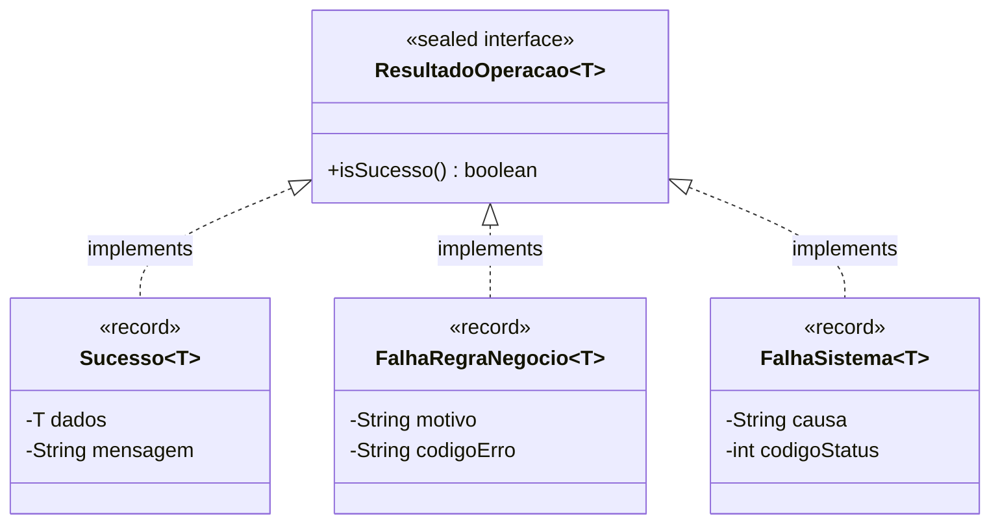
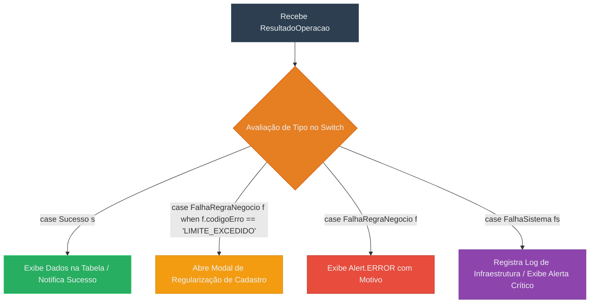

# Guia 12 — Recursos Modernos do Java 21 LTS na POO: Records, Pattern Matching e Sealed Types

## 1. O Conceito em Linguagem Clara

O Java evoluiu drasticamente desde a sua criação. A versão **Java 21 LTS (Long-Term Support)** consolida uma série de recursos que modernizam a Programação Orientada a Objetos, reduzindo drasticamente o código repetitivo (*boilerplate*), fortalecendo o encapsulamento e introduzindo garantias de segurança verificadas em tempo de compilação.

### 1.1 Records: Imutabilidade Nativa e Expressividade sem Boilerplate
Imagine um recibo de compra ou um extrato de transferência bancária. Uma vez impresso, seus dados nunca mudam — ele é estritamente **imutável**.
- Antes do Java 14/16, para criar uma classe de dados simples (DTO ou Value Object), o desenvolvedor precisava escrever dezenas de linhas: atributos `private final`, construtor longo, métodos de leitura `get...()`, e implementações manuais propensas a erros de `equals()`, `hashCode()` e `toString()`.
- Com **`record`**, o compilador Java gera toda essa infraestrutura em uma única linha.
- **Construtor Compacto (`Compact Constructor`):** Permite validar regras de invariantes antes da atribuição dos campos, garantindo que o record jamais nasça em estado inválido.

### 1.2 Pattern Matching para `instanceof`: O Fim do Cast Manual
No Java clássico, verificar o tipo e usá-lo exigia um ritual cansativo de duas linhas:
```java
// Java arcaico:
if (objeto instanceof Livro) {
    Livro l = (Livro) objeto; // Cast manual perigoso e redundante
    System.out.println(l.getIsbn());
}
```
Com o **Pattern Matching para `instanceof`** (Java 16+ / 21 LTS):
```java
// Java moderno (Java 21 LTS):
if (objeto instanceof Livro l) {
    System.out.println(l.getIsbn()); // 'l' já está disponível e tipado!
}
```

### 1.3 Sealed Classes e Interfaces: Hierarquias Controladas no Compilador
Imagine que você está projetando o sistema de autorização de portas de um laboratório de alta segurança. Existem exatamente três tipos de credenciais permitidas: `CartaoMagnetico`, `Biometria` e `ChaveMestre`. Qualquer outro tipo deve ser estritamente proibido.
- Em POO tradicional, se você cria uma interface `public interface Credencial`, qualquer desenvolvedor em qualquer pacote pode criar `public class CartaoFalso implements Credencial`.
- Com **`sealed` (Classes e Interfaces Seladas)**, você define explicitamente no código-fonte quais classes têm permissão para herdar ou implementar o seu contrato usando a cláusula `permits`.
- **Exaustividade no `switch`:** Quando o compilador sabe todas as subclasses possíveis de uma interface selada, a expressão `switch` com Pattern Matching se torna **exaustiva**. Isso significa que você **não precisa de cláusula `default`**, e se alguém adicionar uma nova subclasse no futuro, o compilador apontará erro em todos os `switch` que esqueceram de tratá-la!

---

## 2. Modelos Visuais

### 2.1 Hierarquia Selada de Resultados de Operação (Sealed Interface)


### 2.2 Fluxo de Avaliação Exaustiva com Pattern Matching Switch


---

## 3. O Código Prático e Didático

### 3.1 Exemplo de `Record` com Construtor Compacto e Invariantes
```java
package br.edu.ifpb.didatico.exemplos.moderno;

import java.math.BigDecimal;
import java.time.LocalDateTime;
import java.util.Objects;

/**
 * Record moderno demonstrando imutabilidade e validação de invariantes
 * através do Construtor Compacto (Compact Constructor).
 */
public record RegistroItemInventario(
        String identificador,
        String descricao,
        BigDecimal valorEstimado,
        LocalDateTime dataRegistro
) {
    // CONSTRUTOR COMPACTO: não repete os parâmetros, valida antes de atribuir
    public RegistroItemInventario {
        if (identificador == null || identificador.isBlank()) {
            throw new IllegalArgumentException("O identificador do item não pode ser nulo ou vazio.");
        }
        if (descricao == null || descricao.isBlank()) {
            throw new IllegalArgumentException("A descrição do item é obrigatória.");
        }
        if (valorEstimado == null || valorEstimado.compareTo(BigDecimal.ZERO) < 0) {
            throw new IllegalArgumentException("O valor estimado não pode ser nulo ou negativo.");
        }
        // Se a data de registro não for informada, assume o instante atual
        if (dataRegistro == null) {
            dataRegistro = LocalDateTime.now();
        }
    }

    // Construtor de conveniência sobrecarregado
    public RegistroItemInventario(String identificador, String descricao, BigDecimal valorEstimado) {
        this(identificador, descricao, valorEstimado, LocalDateTime.now());
    }
}
```

### 3.2 Hierarquia Selada (`Sealed Hierarchy`)
```java
package br.edu.ifpb.didatico.exemplos.moderno;

/**
 * Interface selada: apenas os tipos declarados na cláusula 'permits'
 * podem implementá-la.
 */
public sealed interface ResultadoProcessamento<T> 
        permits ResultadoProcessamento.Sucesso, 
                ResultadoProcessamento.FalhaRegraNegocio, 
                ResultadoProcessamento.FalhaInfraestrutura {

    record Sucesso<T>(T conteudo, String mensagem) implements ResultadoProcessamento<T> {}

    record FalhaRegraNegocio<T>(String motivo, String codigoErro) implements ResultadoProcessamento<T> {}

    record FalhaInfraestrutura<T>(String causa, Throwable excecaoOriginal) implements ResultadoProcessamento<T> {}
}
```

### 3.3 Consumo com Pattern Matching Switch e Cláusulas Guarda (`when`)
```java
public class ProcessadorResultado {

    public static <T> String processar(ResultadoProcessamento<T> resultado) {
        // Switch com Pattern Matching e Exaustividade (sem necessidade de default!)
        return switch (resultado) {
            case ResultadoProcessamento.Sucesso<T> s -> 
                "Operação realizada: " + s.mensagem() + " -> Dado: " + s.conteudo();

            case ResultadoProcessamento.FalhaRegraNegocio<T> f when "LIMITE_ATINGIDO".equals(f.codigoErro()) ->
                "ATENÇÃO CRÍTICA: " + f.motivo() + " (Código: " + f.codigoErro() + ")";

            case ResultadoProcessamento.FalhaRegraNegocio<T> f -> 
                "Falha de Negócio: " + f.motivo() + " [" + f.codigoErro() + "]";

            case ResultadoProcessamento.FalhaInfraestrutura<T> fi -> 
                "Erro de Infraestrutura: " + fi.causa() + " (Exceção: " + fi.excecaoOriginal().getClass().getSimpleName() + ")";
        };
    }
}
```

---

## 4. Armadilhas Comuns (*Common Pitfalls*)

1. **Coleções Mutáveis dentro de Records:**
   - O `record` torna suas variáveis de instância `final`, mas se um dos componentes for uma lista mutável (`List<String>`), o conteúdo interno da lista ainda poderá ser modificado por quem tiver a referência.
   - **Solução:** No construtor compacto, faça uma cópia defensiva imutável:
     ```java
     public record Grupo(String nome, List<String> membros) {
         public Grupo {
             membros = List.copyOf(membros); // Garante imutabilidade real em profundidade!
         }
     }
     ```
2. **Esquecer a Cláusula `permits` ou tentar estender fora do pacote:**
   - Subclasses de uma classe ou interface `sealed` devem estar no mesmo módulo ou no mesmo pacote da classe selada.
   - Toda subclasse que implementa um tipo `sealed` deve ser declarada obrigatoriamente como `final`, `sealed` ou `non-sealed`.
3. **Adicionar `default` desnecessário em Switch Exaustivo:**
   - Ao fazer `switch` sobre uma hierarquia selada, evite colocar `default: throw new IllegalStateException();`. Sem o `default`, se no futuro você adicionar um novo tipo selado, o compilador **imediatamente avisará onde falta tratamento**, garantindo cobertura completa de código.

---

## 5. Perguntas de Bancas e Justificativas Técnicas

- **Pergunta:** *"Por que utilizar Records em vez de classes tradicionais para DTOs e eventos?"*
  - **Resposta:** *"Records expressam semanticamente que o dado é um portador transparente e imutável de valores. Eles eliminam centenas de linhas de código boilerplate propensas a erros manuais de sincronização entre atributos e métodos `equals`/`hashCode`, e garantem a segurança de invariantes via construtor compacto."*

- **Pergunta:** *"Qual a vantagem arquitetural de usar Sealed Classes no núcleo de domínio?"*
  - **Resposta:** *"O uso de Sealed Classes fecha a hierarquia de tipos em tempo de compilação. Isso impede extensões indevidas do domínio por pacotes terceiros e viabiliza a análise de exaustividade nos padrões de `switch` com Pattern Matching do Java 21 LTS, transformando potenciais bugs de tempo de execução em erros de compilação."*
