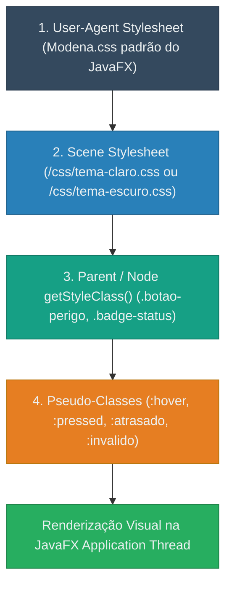
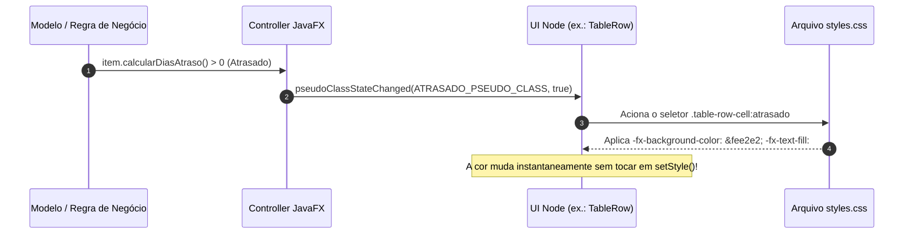

# Guia 13 — Estilização Avançada em JavaFX: CSS Externo, Pseudo-Classes Customizadas e Alternância de Temas (Theming)

## 1. O Conceito em Linguagem Clara

No desenvolvimento de interfaces desktop profissionais com JavaFX, a separação entre **estrutura** (FXML), **lógica de apresentação** (Controllers) e **estilo visual** (CSS) é um dos pilares mais avaliados em bancas e auditorias de código.

### 1.1 A Regra de Ouro da Estilização: Zero `setStyle()` Inline
Muitos iniciantes caem na tentação de colorir componentes diretamente via código Java:
```java
// ❌ ANTI-PADRÃO: Acoplamento de estilo no código Java
botao.setStyle("-fx-background-color: #27ae60; -fx-text-fill: white; -fx-font-weight: bold;");
```
**Por que isso é prejudicial?**
1. **Quebra o encapsulamento da View:** Qualquer ajuste de paleta de cores exige recompilar classes Java.
2. **Sobrescreve o motor de herança do JavaFX:** O método `setStyle()` substitui completamente o estilo do nó e anula os efeitos de `:hover` e `:pressed` definidos no tema padrão.
3. **Impossibilita a troca dinâmica de temas (Dark/Light Mode).**

### 1.2 O Modo Correto: Classes CSS e Pseudo-Classes Customizadas
No JavaFX, os estilos visuais vivem exclusivamente em arquivos `.css`.
- **Classes CSS (`getStyleClass().add("...")`):** Ideais para estilos estáticos ou categorias de nós (ex.: `.botao-sucesso`, `.card-metrica`, `.tabela-elegante`).
- **Pseudo-Classes Customizadas (`PseudoClass`):** O mecanismo nativo mais refinado do JavaFX para representar **estados visuais dinâmicos** (ex.: uma linha de tabela que fica vermelha quando o empréstimo está atrasado, ou um campo que fica com borda de aviso quando o valor é inválido).

### 1.3 Alternância Dinâmica de Temas (Light / Dark Mode)
A árvore de cena do JavaFX (`Scene`) possui uma coleção de folhas de estilo observável: `scene.getStylesheets()`.
Para alternar o tema em tempo de execução sem recriar janelas, basta limpar a folha antiga e registrar a nova folha:
```java
scene.getStylesheets().clear();
scene.getStylesheets().add(getClass().getResource("/css/tema-escuro.css").toExternalForm());
```
O JavaFX recalcula a cascata de estilos de todo o Scene Graph no mesmo frame visual, redesenhando a interface com suavidade instantânea.

---

## 2. Modelos Visuais

### 2.1 A Cascata de Estilização no JavaFX Scene Graph


### 2.2 Ciclo de Ativação de Pseudo-Classes Customizadas


---

## 3. O Código Prático e Didático

### 3.1 Criação de Pseudo-Classes Nativas
```java
import javafx.css.PseudoClass;
import javafx.scene.control.TableRow;
import javafx.scene.control.TableView;

public class TabelaEstilizadaHelper {

    // Declaração estática da pseudo-classe customizada (imutável e reutilizável)
    public static final PseudoClass ATRASADO_PSEUDO_CLASS = PseudoClass.getPseudoClass("atrasado");
    public static final PseudoClass DISPONIVEL_PSEUDO_CLASS = PseudoClass.getPseudoClass("disponivel");

    public static <T> void configurarLinhasComEstado(TableView<T> tabela, java.util.function.Predicate<T> ehAtrasado) {
        tabela.setRowFactory(tv -> new TableRow<>() {
            @Override
            protected void updateItem(T item, boolean vazio) {
                super.updateItem(item, vazio);

                if (vazio || item == null) {
                    // Limpa todos os estados visuais se a linha for vazia
                    pseudoClassStateChanged(ATRASADO_PSEUDO_CLASS, false);
                    pseudoClassStateChanged(DISPONIVEL_PSEUDO_CLASS, false);
                } else {
                    // Aciona as pseudo-classes conforme a regra de domínio
                    boolean atrasado = ehAtrasado.test(item);
                    pseudoClassStateChanged(ATRASADO_PSEUDO_CLASS, atrasado);
                    pseudoClassStateChanged(DISPONIVEL_PSEUDO_CLASS, !atrasado);
                }
            }
        });
    }
}
```

### 3.2 Folha de Estilos CSS (`tema-claro.css`)
```css
/* Paleta de Cores e Estilos Base */
.root {
    -fx-font-family: "Segoe UI", "Cantarell", "Ubuntu", sans-serif;
    -fx-font-size: 14px;
    -fx-background-color: #f8fafc;
    -cor-primaria: #2563eb;
    -cor-fundo-card: #ffffff;
    -cor-texto: #1e293b;
    -cor-borda: #cbd5e1;
}

/* Botões com estados nativos */
.btn-acao {
    -fx-background-color: -cor-primaria;
    -fx-text-fill: white;
    -fx-font-weight: bold;
    -fx-padding: 8px 16px;
    -fx-background-radius: 6px;
    -fx-cursor: hand;
}

.btn-acao:hover {
    -fx-background-color: #1d4ed8;
}

.btn-acao:pressed {
    -fx-background-color: #1e40af;
}

/* Pseudo-classe customizada em linhas de tabela */
.table-row-cell:atrasado {
    -fx-background-color: #fee2e2;
    -fx-text-fill: #991b1b;
}

.table-row-cell:atrasado:filled:selected {
    -fx-background-color: #f87171;
    -fx-text-fill: white;
}

.table-row-cell:disponivel {
    -fx-background-color: #f0fdf4;
    -fx-text-fill: #166534;
}
```

### 3.3 Alternância Dinâmica de Temas em Tempo Real
```java
public class ThemeManager {

    private boolean modoEscuro = false;

    public void alternarTema(Scene scene) {
        scene.getStylesheets().clear();
        modoEscuro = !modoEscuro;

        String caminhoTema = modoEscuro ? "/css/tema-escuro.css" : "/css/tema-claro.css";
        var recurso = getClass().getResource(caminhoTema);
        
        if (recurso != null) {
            scene.getStylesheets().add(recurso.toExternalForm());
        }
    }
}
```

---

## 4. Armadilhas Comuns (*Common Pitfalls*)

1. **Uso de propriedades CSS do navegador (web) sem o prefixo `-fx-`:**
   - No JavaFX, propriedades de fonte, cor e layout exigem o prefixo do motor gráfico: `background-color` (web) **não funciona**; o correto é `-fx-background-color`.
2. **Esquecer de limpar a pseudo-classe quando a célula/linha for vazia (`empty == true`):**
   - Como o JavaFX reutiliza nós visuais na `TableView` para otimizar desempenho de rolagem (*virtualization*), esquecer de chamar `pseudoClassStateChanged(MINHA_PSEUDO, false)` faz com que linhas vazias herdem a cor vermelha de uma linha anterior reciclada!
3. **Caminho de recurso relativo quebrado:**
   - Sempre inicie o caminho com `/` absoluto a partir da raiz de resources (ex.: `"/css/tema-claro.css"`).

---

## 5. Perguntas de Bancas e Justificativas Técnicas

- **Pergunta:** *"Por que usar PseudoClass em vez de `node.setStyle()` ao alterar o estado de um elemento da tabela?"*
  - **Resposta:** *"O uso de `node.setStyle()` insere propriedades inline diretamente na árvore DOM do nó, sobrescrevendo folhas de estilo externas, quebrando pseudo-classes nativas como `:hover` e violando a separação entre apresentação e regras visuais. O uso de `PseudoClass` comunica o estado de negócio (`atrasado`, `bloqueado`, `invalido`) de forma declarativa e deixa a folha CSS decidir as cores, fontes e transições, permitindo troca dinâmica de temas sem alterar uma única linha de Java."*
