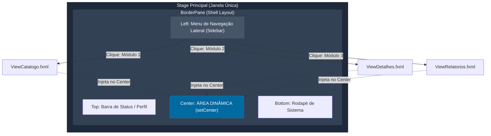
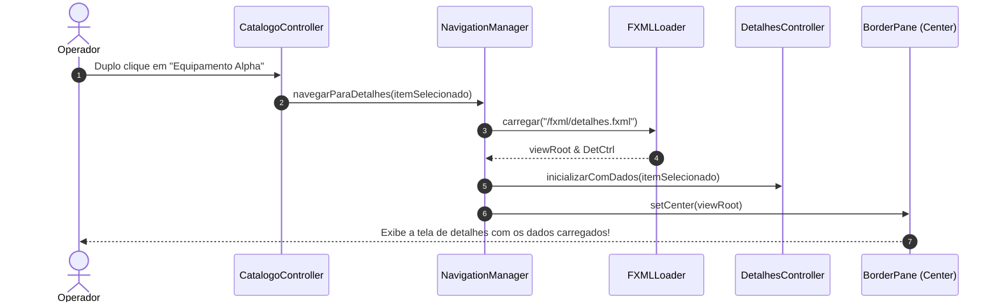

# Guia 14 — Navegação Desacoplada, Troca Dinâmica de Telas e Diálogos Tipados em JavaFX

## 1. O Conceito em Linguagem Clara

No desenvolvimento de aplicações desktop de médio e grande porte, a arquitetura de navegação define se o sistema terá a fluidez de um software moderno ou o comportamento caótico de janelas desordenadas se sobrepondo na barra de tarefas do sistema operacional.

### 1.1 O Anti-Padrão das Janelas Espalhadas vs. O Padrão Shell (Master-Detail)
- **O Erro Comum:** Ao clicar em qualquer opção de menu (\"Cadastrar Livro\", \"Ver Relatório\", \"Consultar Usuários\"), o desenvolvedor executa `new Stage().show()`. O usuário final rapidamente se depara com 6 janelas abertas, perde o foco e fecha a janela errada.
- **A Solução Profissional: O Padrão Shell (Layout Mestre com Painel Dinâmico):**
  - A aplicação mantém um único `Stage` principal.
  - O layout raiz é composto por um container hospedeiro (tipicamente um `BorderPane`).
  - O topo (`top`) contém a barra de título e métricas; a lateral (`left`) contém o menu de navegação; e o centro (`center`) é uma **área dinâmica de visualização (View Host)**.
  - Quando o usuário navega entre módulos, apenas o nó central (`borderPane.setCenter(novoNo)`) é substituído suavemente, preservando o contexto e o menu de controle.

### 1.2 O Gerenciador de Navegação (`NavigationManager`)
Para que um controlador de tela não precise conhecer outros controladores nem instanciar cenas manualmente (violando o SRP e o desacoplamento), criamos uma abstração de navegação:
- O controlador solicita: `navigationManager.navegarParaDetalhes(itemSelecionado);`
- O `NavigationManager` resolve o arquivo FXML, extrai o controlador destino, injeta o parâmetro necessário via método tipado (`initData(item)`) e coloca o nó na área central.

### 1.3 Diálogos Modais Tipados com `Dialog<R>` (Substituição Segura de Modais Manuais)
Para operações que exigem entrada pontual de dados do usuário e retorno ao controlador chamador:
- Não use variáveis estáticas (`public static Item resultadoGlobal;`) — isso é uma fonte grave de bugs de concorrência e vazamento de memória.
- Utilize a classe genérica do JavaFX **`Dialog<R>`** com **`setResultConverter`**:
  - O diálogo coleta as informações em seu `DialogPane`.
  - Ao clicar no botão de confirmação (`ButtonType.OK`), o conversor instancia o objeto imutável (ou `record`) desejado.
  - O método `dialog.showAndWait()` retorna um `Optional<R>` limpo e idiomático!

---

## 2. Modelos Visuais

### 2.1 Padrão Shell (Troca Dinâmica do Painel Central)


### 2.2 Ciclo de Troca com Injeção Tipada de Parâmetros


---

## 3. O Código Prático e Didático

### 3.1 Padrão Shell e ViewSwitcher
```java
public class ViewSwitcher {

    private final BorderPane painelHospedeiro;

    public ViewSwitcher(BorderPane painelHospedeiro) {
        this.painelHospedeiro = Objects.requireNonNull(painelHospedeiro);
    }

    public void trocarVisualizacao(Node novaView) {
        painelHospedeiro.setCenter(novaView);
    }

    public <T> T carregarViewEObterController(String caminhoFxml, Consumer<Parent> noCarregado) throws IOException {
        FXMLLoader loader = new FXMLLoader(getClass().getResource(caminhoFxml));
        Parent root = loader.load();
        noCarregado.accept(root);
        return loader.getController();
    }
}
```

### 3.2 Diálogo Modal Tipado com `Dialog<R>` e `setResultConverter`
```java
public class FormularioItemDialog extends Dialog<ItemCadastroDto> {

    public FormularioItemDialog(Window janelaMae) {
        setTitle("Cadastro de Novo Item");
        setHeaderText("Informe os dados do equipamento:");
        initOwner(janelaMae);
        initModality(Modality.APPLICATION_MODAL);

        ButtonType btnSalvarTipo = new ButtonType("Confirmar", ButtonBar.ButtonData.OK_DONE);
        getDialogPane().getButtonTypes().addAll(btnSalvarTipo, ButtonType.CANCEL);

        GridPane grid = new GridPane();
        grid.setHgap(10);
        grid.setVgap(10);
        grid.setPadding(new Insets(20, 150, 10, 10));

        TextField txtCodigo = new TextField();
        txtCodigo.setPromptText("Ex: NOTE-01");
        TextField txtNome = new TextField();
        txtNome.setPromptText("Ex: Notebook Dell Latitude");

        grid.add(new Label("Código:"), 0, 0);
        grid.add(txtCodigo, 1, 0);
        grid.add(new Label("Nome:"), 0, 1);
        grid.add(txtNome, 1, 1);

        getDialogPane().setContent(grid);

        // Conversor tipado: transforma o clique em botão no objeto imutável de resultado
        setResultConverter(dialogButton -> {
            if (dialogButton == btnSalvarTipo) {
                return new ItemCadastroDto(txtCodigo.getText().trim(), txtNome.getText().trim());
            }
            return null; // Caso o usuário clique em Cancelar ou feche a janela
        });
    }
}
```

### 3.3 Consumo do Diálogo no Controlador Chamador
```java
public void handleAbrirCadastro(Window janelaMae) {
    FormularioItemDialog dialog = new FormularioItemDialog(janelaMae);
    Optional<ItemCadastroDto> resultado = dialog.showAndWait();

    resultado.ifPresent(dto -> {
        // Executado estritamente se o operador confirmou os dados com OK:
        servico.cadastrarItem(dto.codigo(), dto.nome());
        tabela.getItems().setAll(servico.listarTodos());
    });
}
```

---

## 4. Armadilhas Comuns (*Common Pitfalls*)

1. **Vazamento de Memória ao trocar de telas:**
   - Se uma tela intermediária registrar *Listeners* de longa duração no modelo de dados ou na camada de serviço sem desinscrever ao ser descartada, a tela antiga nunca será coletada pelo Garbage Collector da JVM.
2. **Ignorar o retorno do `Optional` do `Dialog`:**
   - Nunca chame `.get()` diretamente em `dialog.showAndWait().get()` sem antes verificar se o usuário cancelou o preenchimento. Use sempre `resultado.ifPresent(...)`.
3. **Bloqueio Incorreto de Janelas Modais:**
   - Ao abrir um diálogo ou janela de confirmação, defina sempre `dialog.initOwner(stageMae)` e `Modality.APPLICATION_MODAL` para garantir que o foco permaneça preso até a resposta.

---

## 5. Perguntas de Bancas e Justificativas Técnicas

- **Pergunta:** *"Por que adotar o padrão Shell com BorderPane dinâmico em vez de abrir novas janelas (Stages) para cada menu?"*
  - **Resposta:** *"O padrão Shell preserva a consistência visual, o foco do usuário e a hierarquia da aplicação em uma única janela integrada do sistema operacional. Ele evita poluição de janelas na barra de tarefas, facilita a persistência de contexto e simplifica o controle de ciclo de vida e consumo de memória da JVM."*

- **Pergunta:** *"Qual a superioridade técnica da API `Dialog<R>` sobre janelas modais manuais?"*
  - **Resposta:** *"A API `Dialog<R>` encapsula o ciclo de vida modal de forma tipada através do padrão `ResultConverter`, retornando um `Optional<R>` funcional. Isso elimina variáveis estáticas compartilhadas, previne vazamentos de estado e assegura rastreabilidade estrita entre o evento de confirmação do usuário e a criação da entidade."*
