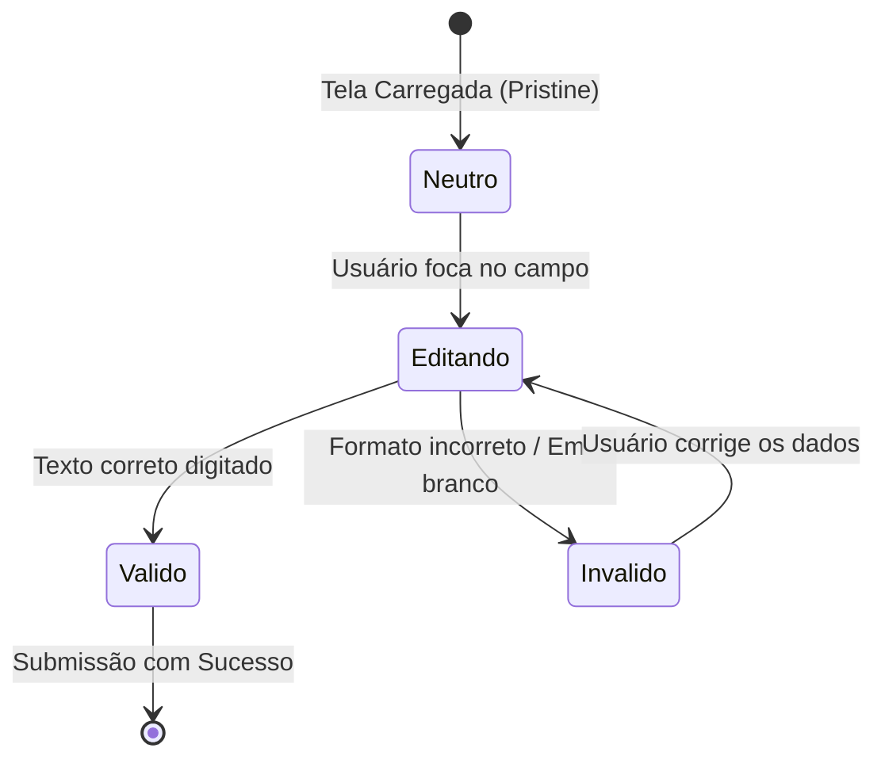

# Guia 15 — Validação Reativa de Formulários, Safe Parsing e Feedback Visual (UX/UI) em JavaFX

## 1. O Conceito em Linguagem Clara

Em aplicações de gestão corporativa ou acadêmica, os formulários são a porta de entrada para a manipulação de dados. Uma interface frágil permite que o usuário submeta dados corrompidos (textos em campos numéricos, datas inexistentes, códigos em branco), resultando em `NumberFormatException` ou travamento de telas.

Uma arquitetura de apresentação robusta opera em **três barreiras defensivas**:
1. **Validação Estrutural e Reativa na UI (Form Validation):** A interface impede a submissão de dados inválidos desabilitando o botão de ação (`disableProperty().bind(...)`) e destacando campos com bordas coloridas e mensagens de orientação.
2. **Conversão Segura e Preventiva (*Safe Parsing*):** Métodos que tratam internamente erros de sintaxe e retornam tipos funcionais (`Optional<BigDecimal>`, `Optional<LocalDate>`), garantindo que exceções de baixo nível nunca alcancem a camada de domínio.
3. **Validação de Invariantes e Regras de Negócio no Domínio:** Caso a camada de apresentação passe, o domínio e os serviços ainda validam a coerência das entidades.

### A Regra da Interação Amigável (*Pristine vs. Dirty Fields*)
Uma interface que nasce com todos os campos em vermelho e mensagens de erro antes mesmo do usuário encostar no teclado transmite insegurança e frustração.
- **Campo Imaculado (*Pristine*):** Enquanto o usuário não focar no campo ou não digitar nada, ele mantém a aparência neutra.
- **Campo Tocado (*Dirty* / Validado):** A partir do momento em que o campo perde o foco (`focusedProperty().addListener(...)`) ou o usuário começa a digitar, a validação visual (borda vermelha ou verde) é ativada dinamicamente.

---

## 2. Modelos Visuais

### 2.1 Ciclo de Estados de um Campo com Validação Amigável


### 2.2 Orquestração do `BooleanBinding` no Botão Salvar
```mermaid
flowchart TD
    A[txtCodigo: Preenchido e Válido?] -->|booleanProperty| D{BooleanBinding}
    B[txtValor: Número Válido > 0?] -->|booleanProperty| D
    C[dpData: Data Selecionada?] -->|booleanProperty| D

    D -->|Se TODOS forem válidos: FALSE| E[btnSalvar.disableProperty: FALSE (Ativo!)]
    D -->|Se QUALQUER um falhar: TRUE| F[btnSalvar.disableProperty: TRUE (Bloqueado!)]

    style D fill:#e67e22,stroke:#d35400,color:#ffffff
    style E fill:#27ae60,stroke:#2ecc71,color:#ffffff
    style F fill:#c0392b,stroke:#e74c3c,color:#ffffff
```

---

## 3. O Código Prático e Didático

### 3.1 Utilitário de Conversão Segura (*Safe Parsing*)
```java
public class ParsingSeguroUtil {

    public static Optional<BigDecimal> tentarConverterMoeda(String texto) {
        if (texto == null || texto.isBlank()) {
            return Optional.empty();
        }
        try {
            // Normaliza vírgula para ponto decimal
            String normalizado = texto.trim().replace(".", "").replace(",", ".");
            BigDecimal valor = new BigDecimal(normalizado);
            return valor.compareTo(BigDecimal.ZERO) >= 0 ? Optional.of(valor) : Optional.empty();
        } catch (NumberFormatException e) {
            return Optional.empty();
        }
    }

    public static Optional<Integer> tentarConverterInteiroPositivo(String texto) {
        if (texto == null || texto.isBlank()) {
            return Optional.empty();
        }
        try {
            int valor = Integer.parseInt(texto.trim());
            return valor > 0 ? Optional.of(valor) : Optional.empty();
        } catch (NumberFormatException e) {
            return Optional.empty();
        }
    }
}
```

### 3.2 Validação Reativa com Pseudo-Classes e `BooleanBinding`
```java
@FXML private TextField txtCodigo;
@FXML private TextField txtPreco;
@FXML private Label lblErroPreco;
@FXML private Button btnSalvar;

private final PseudoClass INVALIDO_PSEUDO = PseudoClass.getPseudoClass("invalido");

@FXML
public void initialize() {
    // 1. Escuta perda de foco para ativar feedback visual (Pristine -> Dirty)
    txtPreco.focusedProperty().addListener((obs, estavaFocado, agoraFocado) -> {
        if (!agoraFocado) {
            validarCampoPreco();
        }
    });

    // 2. Validação reativa do botão com BooleanBinding composto
    BooleanBinding formularioInvalido = Bindings.createBooleanBinding(() -> {
        boolean codigoInvalido = txtCodigo.getText() == null || txtCodigo.getText().isBlank();
        boolean precoInvalido = ParsingSeguroUtil.tentarConverterMoeda(txtPreco.getText()).isEmpty();
        return codigoInvalido || precoInvalido;
    }, txtCodigo.textProperty(), txtPreco.textProperty());

    // O botão fica desabilitado se o formulário for inválido
    btnSalvar.disableProperty().bind(formularioInvalido);
}

private void validarCampoPreco() {
    boolean valido = ParsingSeguroUtil.tentarConverterMoeda(txtPreco.getText()).isPresent();
    txtPreco.pseudoClassStateChanged(INVALIDO_PSEUDO, !valido);
    lblErroPreco.setVisible(!valido);
    lblErroPreco.setManaged(!valido);
}
```

---

## 4. Armadilhas Comuns (*Common Pitfalls*)

1. **Permitir que `NumberFormatException` estoure na JavaFX Thread:**
   - Fazer `Integer.parseInt(txt.getText())` diretamente no controlador sem tratamento preventivo gera logs de erro feios no terminal e quebra a fluidez da aplicação.
2. **Esquecer `lblErro.setManaged(false)`:**
   - No JavaFX, se você apenas fizer `lblErro.setVisible(false)`, o componente fica invisível mas continua ocupando espaço físico no layout (`GridPane`/`VBox`), gerando buracos em branco feios. Para recolher o espaço, alterne também `setManaged(false)`.
3. **Não sanitizar strings com `.trim()`:**
   - Um usuário pode acidentalmente apertar a barra de espaço. Sempre use `.trim()` ou `.isBlank()` para validar textos.

---

## 5. Perguntas de Bancas e Justificativas Técnicas

- **Pergunta:** *"Por que implementar validação reativa com `Bindings.createBooleanBinding` em vez de validar os campos apenas dentro do método do botão Salvar?"*
  - **Resposta:** *"A validação reativa com `BooleanBinding` antecipa o feedback para o usuário no próprio momento da digitação e desabilita proativamente o botão de submissão. Isso impede que o sistema entre em estado inconsistente, melhora drasticamente a experiência do usuário (UX) e garante que o método de submissão do controlador receba dados estruturalmente válidos para entregar com segurança à camada de serviço."*
