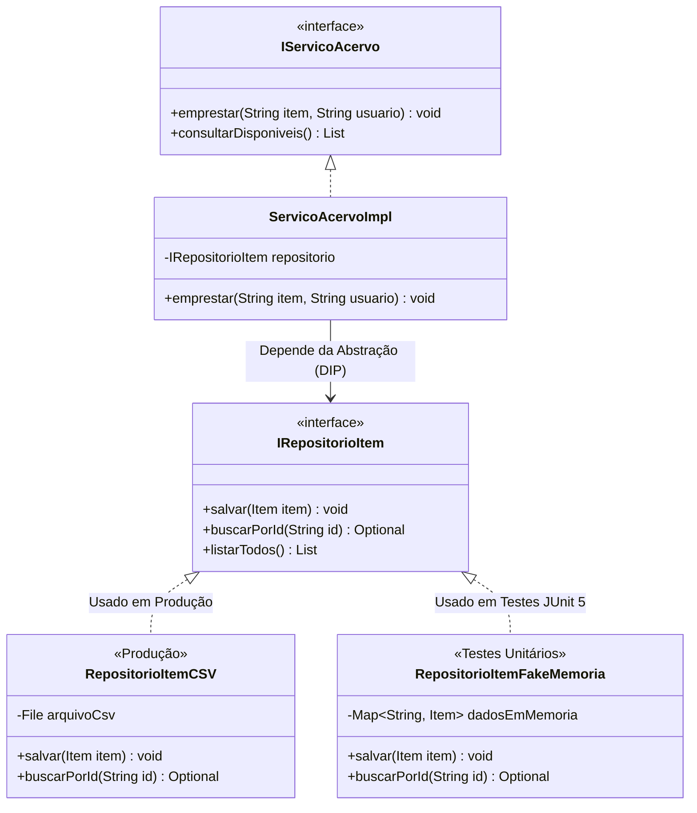
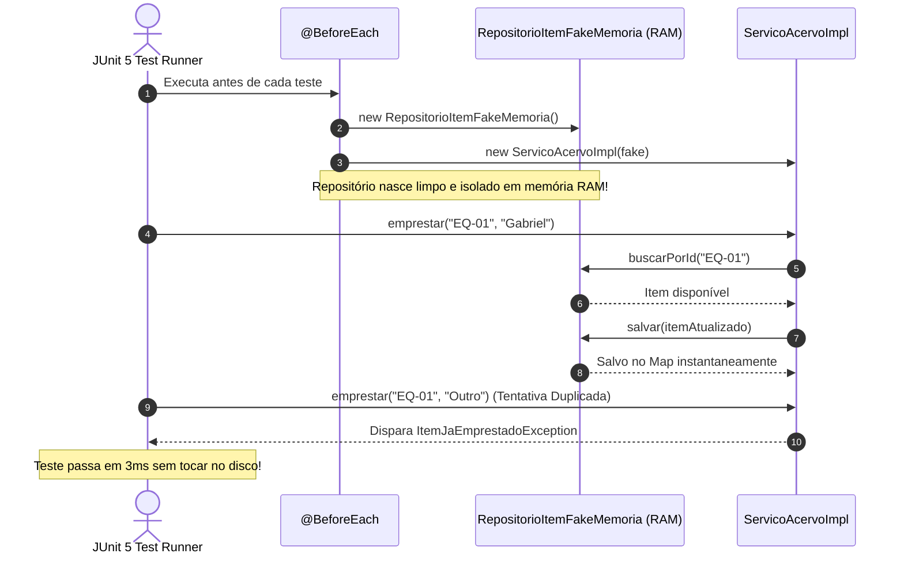

# Guia 16 — Testabilidade Arquitetural: Testes Unitários sem Disco com Repositórios Fake em Memória

## 1. O Conceito em Linguagem Clara

Um dos momentos mais gratificantes na engenharia de software ocorre quando compreendemos a **verdadeira razão de ser da Inversão de Dependência (DIP - Dependency Inversion Principle)**.

Frequentemente, estudantes e desenvolvedores perguntam:
> *\"Por que criar uma interface `IRepositorio` se o meu sistema tem apenas uma classe `RepositorioCSV`? Não é código a mais sem necessidade?\"*

A resposta definitiva está na **Testabilidade**:
- Se a sua camada de serviço der `new RepositorioCSV("dados/arquivo.csv")` diretamente, para rodar um teste unitário você precisará de um arquivo físico no disco.
- Isso torna os testes **lentos**, **frágeis** (um teste pode apagar os dados do outro) e **dependentes do ambiente** (permissões de pasta, SO Windows vs. Linux).
- Por outro lado, se o serviço recebe a interface `IRepositorio` via construtor, podemos criar um **`RepositorioFakeEmMemoria`** (baseado em um simples `Map<ID, T>`).
- O teste unitário com JUnit 5 roda na memória RAM em **menos de 5 milissegundos**, sem ler nem gravar 1 byte em disco, garantindo testes 100% isolados, repetíveis e instantâneos!

### Vocabulário Didático de Testes: Mock vs. Stub vs. Fake
Segundo a taxonomia clássica de Martin Fowler e Gerard Meszaros:
- **Dummy:** Objeto passado apenas para preencher parâmetros de assinatura (ex.: uma string vazia ou objeto nulo que nunca é chamado).
- **Stub:** Objeto que retorna respostas pré-programadas e fixas para chamadas de método (ex.: sempre retorna `true` ou um valor estático).
- **Mock:** Objeto que registra as chamadas que recebeu para verificar se certos métodos foram executados com os argumentos esperados.
- **Fake:** **Uma implementação de trabalho real, mas simplificada e leve, inadequada para produção (como um banco ou repositório em memória RAM com `HashMap`).**

---

## 2. Modelos Visuais

### 2.1 Polimorfismo Arquitetural: Produção vs. Testes Unitários


### 2.2 Isolamento de Execução no JUnit 5


---

## 3. O Código Prático e Didático

### 3.1 Contrato Genérico de Repositório
```java
public interface IRepositorioGenerico<T, ID> {
    void salvar(T entidade);
    Optional<T> buscarPorId(ID id);
    List<T> listarTodos();
    boolean existePorId(ID id);
    void excluir(ID id);
}
```

### 3.2 O Repositório Fake em Memória
```java
public class RepositorioGenericoFake<T, ID> implements IRepositorioGenerico<T, ID> {

    private final Map<ID, T> bancoEmMemoria = new ConcurrentHashMap<>();
    private final Function<T, ID> extratorId;

    public RepositorioGenericoFake(Function<T, ID> extratorId) {
        this.extratorId = Objects.requireNonNull(extratorId);
    }

    @Override
    public void salvar(T entidade) {
        bancoEmMemoria.put(extratorId.apply(entidade), entidade);
    }

    @Override
    public Optional<T> buscarPorId(ID id) {
        return Optional.ofNullable(bancoEmMemoria.get(id));
    }

    @Override
    public List<T> listarTodos() {
        return new ArrayList<>(bancoEmMemoria.values());
    }

    @Override
    public boolean existePorId(ID id) {
        return bancoEmMemoria.containsKey(id);
    }

    @Override
    public void excluir(ID id) {
        bancoEmMemoria.remove(id);
    }
}
```

### 3.3 Teste Unitário com JUnit 5 Isolado
```java
class ServicoAcervoTest {

    private IRepositorioGenerico<ExemploItem, String> repoFake;
    private ServicoAcervo servico;

    @BeforeEach
    void setUp() {
        // Inicializa uma base nova e limpa para CADA teste
        repoFake = new RepositorioGenericoFake<>(ExemploItem::codigo);
        servico = new ServicoAcervo(repoFake);

        // Preenche com estado de teste
        repoFake.salvar(new ExemploItem("NOTE-1", "Notebook", false));
    }

    @Test
    @DisplayName("Deve permitir emprestar item quando disponível")
    void deveEmprestarItemDisponivel() {
        assertDoesNotThrow(() -> servico.emprestarItem("NOTE-1", "Gabriel"));

        ExemploItem item = repoFake.buscarPorId("NOTE-1").orElseThrow();
        assertTrue(item.ocupado());
    }

    @Test
    @DisplayName("Deve lançar exceção ao tentar emprestar item já ocupado")
    void deveLancarExcecaoItemJaOcupado() {
        servico.emprestarItem("NOTE-1", "Gabriel");

        assertThrows(ItemIndisponivelException.class, () ->
            servico.emprestarItem("NOTE-1", "Outro")
        );
    }
}
```

---

## 4. Armadilhas Comuns (*Common Pitfalls*)

1. **Estado Estático Compartilhado Entre Testes:**
   - Se o `RepositorioFake` for declarado como campo `static`, as alterações feitas no teste `A` poluirão o teste `B`, gerando resultados intermitentes. Sempre recrie o Fake no método `@BeforeEach`.
2. **Retornar referências mutáveis do Map interno:**
   - No método `listarTodos()` do Fake, retorne sempre `new ArrayList<>(bancoEmMemoria.values())` ou `Collections.unmodifiableList(...)`, nunca o `values()` direto que permitiria alterações não controladas no mapa.
3. **Escrever testes unitários dependentes de ordem:**
   - O framework JUnit 5 não garante a ordem de execução dos testes por padrão. Cada teste deve ser completamente independente e auto-suficiente.

---

## 5. Perguntas de Bancas e Justificativas Técnicas

- **Pergunta:** *"Por que não utilizar um arquivo CSV de teste temporário em vez de um repositório Fake em memória nos testes unitários?"*
  - **Resposta:** *"O uso de arquivos temporários de disco em testes unitários introduz I/O físico desnecessário, tornando a suíte de testes ordens de grandeza mais lenta e suscetível a falhas de bloqueio de arquivo no sistema operacional. O Repositório Fake em memória testa as regras de negócio em microssegundos de forma determinística, validando na prática a pureza da Inversão de Dependências (DIP) da arquitetura."*
