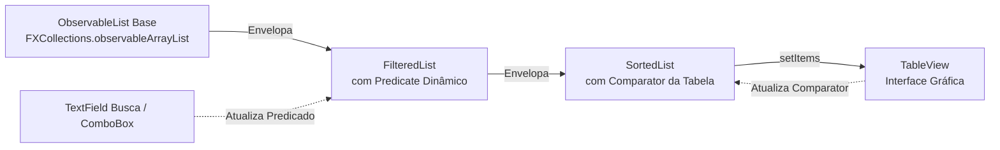

# Guia 17 — Filtros Dinâmicos, Ordenação com `FilteredList` / `SortedList` e Ações em `TableView`

## 1. O Problema das Tabelas Estáticas
Em aplicações de gestão comercial, acadêmica e industrial, a visualização de dados em tabelas (`TableView`) nunca é estática:
1. **O usuário precisa buscar registros em tempo real** enquanto digita em um campo de texto (`TextField`), sem ter que pressionar "Enter" ou clicar em um botão de busca.
2. **O usuário precisa combinar múltiplos critérios** (ex.: buscar por texto na descrição e filtrar simultaneamente por status em um `ComboBox`).
3. **O usuário precisa clicar nos cabeçalhos das colunas para ordenar** (alfabeticamente, por valor ou por data) sem perder o filtro ativo.
4. **O usuário precisa interagir diretamente com a linha** através de botões como "Editar", "Devolver" ou "Excluir".

### O Erro Amador Mais Comum
Muitos estudantes tentam implementar busca limpando e repovoando a tabela manualmente a cada tecla digitada:
```java
// ❌ ANTI-PADRÃO: Apagar e repovoar a lista manualmente a cada tecla
txtBusca.textProperty().addListener((obs, antigo, novo) -> {
    tabela.getItems().clear(); // Quebra seleção, perde ordenação e causa flickering!
    for (Item item : repositorio.listarTodos()) {
        if (item.getNome().contains(novo)) {
            tabela.getItems().add(item);
        }
    }
});
```
Esse anti-padrão gera perda de foco, reseta o scroll da tabela, quebra a ordenação das colunas e degrada a performance para listas médias.

---

## 2. A Arquitetura Reativa do JavaFX: `FilteredList` e `SortedList`

O ecossistema JavaFX possui um pipeline reativo elegante para coleções observáveis:



### 2.1 Como Funciona o Pipeline Passo a Passo
1. **Fonte Única da Verdade (`ObservableList`):** Contém todos os dados recuperados do repositório/serviço. Ela nunca é alterada pela busca.
2. **Camada de Filtro (`FilteredList`):** Envelopa a lista base. Expõe o método `setPredicate(Predicate<T>)`. Sempre que o predicado muda, apenas os elementos que retornam `true` são repassados adiante.
3. **Camada de Ordenação (`SortedList`):** Envelopa a `FilteredList`. Suas propriedades de comparação são vinculadas diretamente à tabela através de `sortedList.comparatorProperty().bind(tabela.comparatorProperty())`.
4. **Visualização (`TableView`):** Recebe exclusivamente a `SortedList` em `tabela.setItems(sortedData)`.

---

## 3. Implementação Prática do Pipeline de Busca e Filtro

```java
public class JanelaGestaoControlador {

    @FXML private TextField txtBusca;
    @FXML private ComboBox<String> cbFiltroStatus;
    @FXML private TableView<EquipamentoExemplo> tabela;

    private ObservableList<EquipamentoExemplo> dadosMestres;
    private FilteredList<EquipamentoExemplo> dadosFiltrados;
    private SortedList<EquipamentoExemplo> dadosOrdenados;

    @FXML
    public void initialize() {
        // 1. Instancia a lista base com dados do serviço
        dadosMestres = FXCollections.observableArrayList(servico.listarTodos());

        // 2. Envelopa em uma FilteredList (inicialmente aceitando tudo: p -> true)
        dadosFiltrados = new FilteredList<>(dadosMestres, p -> true);

        // 3. Listener no campo de busca de texto
        txtBusca.textProperty().addListener((obs, antigo, novo) -> atualizarPredicado());

        // 4. Listener no ComboBox de status
        cbFiltroStatus.valueProperty().addListener((obs, antigo, novo) -> atualizarPredicado());

        // 5. Envelopa a FilteredList na SortedList
        dadosOrdenados = new SortedList<>(dadosFiltrados);

        // 6. Conecta o comparador da SortedList ao comparador da TableView
        dadosOrdenados.comparatorProperty().bind(tabela.comparatorProperty());

        // 7. Define a SortedList como a fonte de dados da TableView
        tabela.setItems(dadosOrdenados);
    }

    /**
     * Combina busca textual e filtro de status em um único Predicate composto.
     */
    private void atualizarPredicado() {
        String termoBusca = txtBusca.getText() == null ? "" : txtBusca.getText().trim().toLowerCase();
        String statusSelecionado = cbFiltroStatus.getValue();

        dadosFiltrados.setPredicate(equipamento -> {
            // Regra 1: Filtro textual (código ou descrição)
            boolean correspondeTexto = termoBusca.isEmpty()
                    || equipamento.getCodigo().toLowerCase().contains(termoBusca)
                    || equipamento.getDescricao().toLowerCase().contains(termoBusca);

            // Regra 2: Filtro de status
            boolean correspondeStatus = (statusSelecionado == null || statusSelecionado.equals("Todos"))
                    || (statusSelecionado.equals("Disponível") && !equipamento.isEmprestado())
                    || (statusSelecionado.equals("Emprestado") && equipamento.isEmprestado());

            return correspondeTexto && correspondeStatus;
        });
    }
}
```

---

## 4. Botões de Ação Embutidos na Linha (`TableCell` com Ações)

Muitas vezes, a interface exige uma coluna final intitulada "Ações" contendo botões como **"Editar"** ou **"Remover"**.

### Como Construir uma Coluna com Botões Customizados
```java
@FXML private TableColumn<EquipamentoExemplo, Void> colunaAcoes;

private void configurarColunaAcoes() {
    colunaAcoes.setCellFactory(col -> new TableCell<>() {
        private final Button btnRemover = new Button("Remover");
        private final Button btnEditar = new Button("Editar");
        private final HBox painelBotoes = new HBox(8, btnEditar, btnRemover);

        {
            painelBotoes.setAlignment(Pos.CENTER);
            btnRemover.getStyleClass().add("btn-perigo");
            btnEditar.getStyleClass().add("btn-primario");

            // Ação do Botão Remover com Confirmação
            btnRemover.setOnAction(evt -> {
                EquipamentoExemplo item = getTableRow().getItem();
                if (item != null) {
                    confirmarExclusao(item);
                }
            });

            // Ação do Botão Editar
            btnEditar.setOnAction(evt -> {
                EquipamentoExemplo item = getTableRow().getItem();
                if (item != null) {
                    abrirModalEdicao(item);
                }
            });
        }

        @Override\n        protected void updateItem(Void item, boolean empty) {
            super.updateItem(item, empty);
            if (empty || getTableRow() == null || getTableRow().getItem() == null) {
                setGraphic(null);
            } else {
                setGraphic(painelBotoes);
            }
        }
    });
}
```

### Diálogo de Confirmação Obrigatório para Exclusão
```java
private void confirmarExclusao(EquipamentoExemplo item) {
    Alert confirmacao = new Alert(Alert.AlertType.CONFIRMATION);
    confirmacao.setTitle("Confirmar Exclusão");
    confirmacao.setHeaderText("Deseja realmente remover o registro?");
    confirmacao.setContentText("Código: " + item.getCodigo() + " - " + item.getDescricao());

    Optional<ButtonType> resposta = confirmacao.showAndWait();
    if (resposta.isPresent() && resposta.get() == ButtonType.OK) {
        try {
            servico.remover(item.getCodigo());
            // Atualiza a fonte de dados mestre; o FilteredList reflete imediatamente!
            dadosMestres.remove(item);
        } catch (DominioException ex) {
            AlertHelper.exibirErro("Erro ao Excluir", ex.getMessage());
        }
    }
}
```

---

## 5. Perguntas Clássicas de Banca e Avaliadores

1. **"Por que não simplesmente filtrar a lista com Stream e chamar `tabela.setItems(...)` toda vez?"**
   - *Resposta:* Porque recriar o `ObservableList` redefine toda a árvore interna do JavaFX, desfazendo a linha que o usuário estava selecionando, resetando o scroll vertical e anulando a ordenação da coluna que o usuário clicou. A `FilteredList` apenas esconde os nós visuais sem destruir o estado da tabela.
2. **"O que acontece se eu adicionar um novo item no `dadosMestres`?"**
   - *Resposta:* A `FilteredList` escuta automaticamente alterações na lista base. Se o novo item atender ao predicado atual, ele aparece imediatamente na tabela sem intervenção manual.
3. **"Por que na coluna de ações o tipo genérico é `TableColumn<EquipamentoExemplo, Void>`?"**
   - *Resposta:* Porque a coluna de botões não extrai nenhum valor específico da entidade; seu objetivo é puramente comportamental (renderizar os botões que operam sobre a entidade inteira da linha via `getTableRow().getItem()`).

---

## 6. Armadilhas Comuns (*Common Pitfalls*)

| Armadilha | Consequência | Como Evitar |
| :--- | :--- | :--- |
| **Esquecer `getTableRow().getItem() == null` no `updateItem`** | Linhas vazias da tabela renderizam botões fantasmas que causam `NullPointerException` ao clicar. | Sempre checar `if (empty \|\| getTableRow() == null \|\| getTableRow().getItem() == null) setGraphic(null);` |
| **Passar `dadosFiltrados` diretamente para `tabela.setItems` sem `SortedList`** | O usuário clica no cabeçalho da coluna para ordenar e nada acontece. | Envelopar sempre em `SortedList` e fazer o bind de `comparatorProperty()`. |
| **Alterar `dadosMestres` a partir de uma thread secundária** | `IllegalStateException: Not on FX application thread`. | Realizar modificações na lista da UI sempre na JavaFX Thread via `Platform.runLater()`. |
