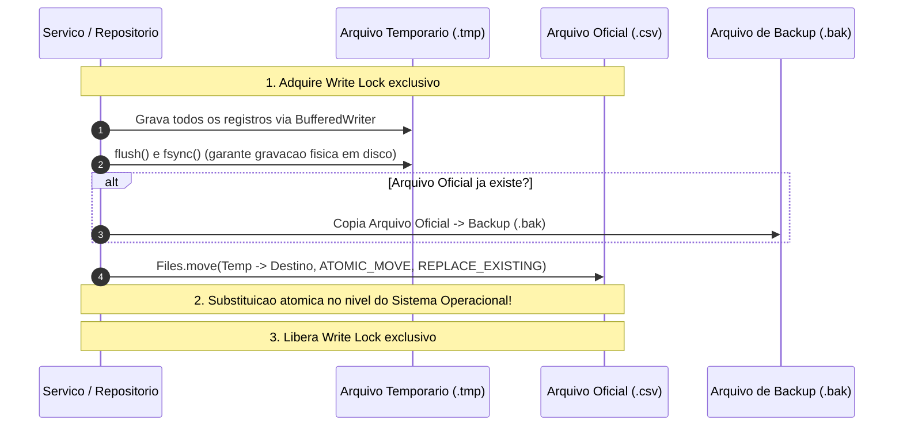
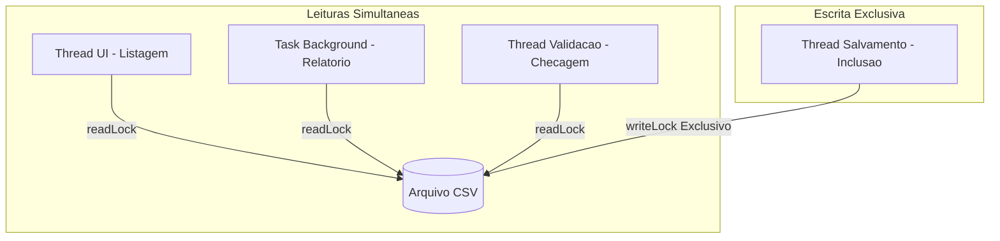

# Guia 18 — Persistência Atômica, Integridade de Arquivos e Concorrência com Locks em CSV

## 1. O Problema da Persistência Insegura em Arquivo de Texto
Em aplicações desktop com persistência em arquivos planos (como `.csv` ou `.txt`):
1. **Risco de Corrupção por Interrupção Súbita:** Se a gravação de dados for interrompida no meio do arquivo (queda de energia, finalização forçada do processo `kill -9`, exceção inesperada durante a iteração), o arquivo original fica cortado ou vazio, resultando em perda catastrófica e irreversível de dados.
2. **Concorrência Descoordenada:** Se uma `Task` em segundo plano estiver lendo o arquivo para gerar um relatório enquanto o usuário salva um novo registro na UI thread, a leitura capturará linhas parciais, lançando erros de parsing (`IndexOutOfBoundsException` ou `NumberFormatException`).

---

## 2. Padrão Gravação Atômica (Safe Atomic Write com Rollback)

Para garantir integridade de dados profissional sem banco de dados relacional, adotamos o padrão **Safe Atomic Write**:



### Por que esse padrão é infalível?
- Se o processo quebrar durante a escrita no arquivo `.tmp`, o arquivo oficial `.csv` permanece 100% intocado.
- Se a gravação do `.tmp` terminar com sucesso, a substituição pelo `Files.move(..., ATOMIC_MOVE)` é uma operação pontual de nível de ponteiro de i-node no sistema de arquivos do sistema operacional (POSIX e NTFS modernos).
- Se houver qualquer falha física grave posterior, o arquivo `.bak` fornece um ponto de restauração imediato.

---

## 3. Concorrência com `ReentrantReadWriteLock`

Diferente de um `synchronized` primitivo (que bloqueia todo mundo, inclusive leitores simultâneos), o `ReentrantReadWriteLock` implementa a semântica ideal para repositórios:
- **Múltiplos Leitores Simultâneos (`readLock().lock()`):** Dezenas de threads ou tasks podem ler o CSV ao mesmo tempo sem bloqueio mútuo, pois leituras não alteram o estado.
- **Escrita Exclusiva (`writeLock().lock()`):** Quando um novo registro precisa ser salvo ou o CSV reescrito, o bloqueador de escrita aguarda os leitores atuais terminarem e impede qualquer nova leitura ou escrita até que o salvamento termine.



---

## 4. Implementação Completa do Repositório Atômico Thread-Safe

```java
public class RepositorioCSVAtomico<T> {

    private final Path caminhoArquivo;
    private final Path caminhoBackup;
    private final ReentrantReadWriteLock lock = new ReentrantReadWriteLock();
    private final Lock readLock = lock.readLock();
    private final Lock writeLock = lock.writeLock();

    public RepositorioCSVAtomico(Path caminhoArquivo) {
        this.caminhoArquivo = caminhoArquivo;
        this.caminhoBackup = caminhoArquivo.resolveSibling(caminhoArquivo.getFileName().toString() + ".bak");
    }

    /**
     * Leitura segura com ReadLock: multiplos consumidores podem ler simultaneamente.
     */
    public List<T> lerTodos(Function<String, T> conversorLinha) throws IOException {
        readLock.lock();
        try {
            if (!Files.exists(caminhoArquivo)) {
                return Collections.emptyList();
            }

            List<T> registros = new ArrayList<>();
            try (BufferedReader reader = Files.newBufferedReader(caminhoArquivo, StandardCharsets.UTF_8)) {
                String linha;
                while ((linha = reader.readLine()) != null) {
                    linha = linha.trim();
                    if (linha.isEmpty() || linha.startsWith("#")) {
                        continue;
                    }
                    registros.add(conversorLinha.apply(linha));
                }
            }
            return Collections.unmodifiableList(registros);
        } finally {
            readLock.unlock();
        }
    }

    /**
     * Gravacao segura com WriteLock exclusivo, arquivo temporario e renomeacao atomica.
     */
    public void salvarTodosAtomico(List<T> registros, Function<T, String> formatadorLinha) throws IOException {
        writeLock.lock();
        try {
            Path diretorio = caminhoArquivo.getParent();
            if (diretorio != null && !Files.exists(diretorio)) {
                Files.createDirectories(diretorio);
            }

            // 1. Cria arquivo temporario no mesmo diretorio (necessario para ATOMIC_MOVE no mesmo filesystem)
            Path arquivoTemp = Files.createTempFile(diretorio, "dados-temp-", ".tmp");

            try {
                // 2. Grava os dados completamente no temporario
                try (BufferedWriter writer = Files.newBufferedWriter(
                        arquivoTemp, StandardCharsets.UTF_8, StandardOpenOption.WRITE)) {
                    
                    writer.write("# Versao do Arquivo: 1.0 - UTF-8");
                    writer.newLine();

                    for (T registro : registros) {
                        writer.write(formatadorLinha.apply(registro));
                        writer.newLine();
                    }
                    writer.flush();
                }

                // 3. Efetua backup do arquivo original se ele existir
                if (Files.exists(caminhoArquivo)) {
                    Files.copy(caminhoArquivo, caminhoBackup, 
                            StandardCopyOption.REPLACE_EXISTING, 
                            StandardCopyOption.COPY_ATTRIBUTES);
                }

                // 4. Substituicao atomica: move o temporario para o destino oficial
                Files.move(arquivoTemp, caminhoArquivo, 
                        StandardCopyOption.ATOMIC_MOVE, 
                        StandardCopyOption.REPLACE_EXISTING);

            } catch (Exception ex) {
                // Em caso de falha antes da substituicao, remove o arquivo temporario
                Files.deleteIfExists(arquivoTemp);
                throw new IOException("Falha durante gravacao atomica. O arquivo original permaneceu intacto.", ex);
            }

        } finally {
            writeLock.unlock();
        }
    }

    /**
     * Rotina de restauracao automatica a partir do backup caso o arquivo oficial sofra corrupcao.
     */
    public boolean restaurarBackupSeNecessario() throws IOException {
        writeLock.lock();
        try {
            if ((!Files.exists(caminhoArquivo) || Files.size(caminhoArquivo) == 0) && Files.exists(caminhoBackup)) {
                Files.copy(caminhoBackup, caminhoArquivo, StandardCopyOption.REPLACE_EXISTING);
                return true;
            }
            return false;
        } finally {
            writeLock.unlock();
        }
    }
}
```

---

## 5. Perguntas Clássicas de Banca e Avaliadores

1. **"Por que criar o arquivo temporário no mesmo diretório do arquivo oficial e não em `java.io.tmpdir`?"**
   - *Resposta:* A garantia de `StandardCopyOption.ATOMIC_MOVE` só é suportada pelo sistema operacional quando a origem e o destino estão no **mesmo ponto de montagem / partição de disco (mesmo filesystem)**. Se o arquivo temporário for criado em `/tmp` e o arquivo oficial estiver em `/home/...` (em partições diferentes), o `Files.move` é forçado a fazer uma cópia byte a byte não atômica!
2. **"Qual a diferença prática entre `synchronized` e `ReentrantReadWriteLock`?"**
   - *Resposta:* O `synchronized` trata leitura e escrita com a mesma exclusividade drástica, serializando todas as operações. Em um sistema com muitas consultas simultâneas na interface gráfica, isso cria gargalos artificiais de fila. O `ReentrantReadWriteLock` permite leitura paralela de N threads com desempenho máximo, restringindo apenas o momento da escrita.
3. **"O que acontece se uma exceção for lançada dentro do bloco `try` antes de liberar o lock?"**
   - *Resposta:* O bloco `finally { lock.unlock(); }` é executado com garantia incondicional pela JVM, impedindo o temido deadlock de recurso retido.

---

## 6. Armadilhas Comuns (*Common Pitfalls*)

| Armadilha | Consequência | Como Evitar |
| :--- | :--- | :--- |
| **Esquecer de liberar o lock no bloco `finally`** | Se um erro ocorrer dentro do `try`, o lock nunca é liberado, congelando a aplicação inteira para sempre em deadlock. | Sempre seguir o padrão canônico: `lock.lock(); try { ... } finally { lock.unlock(); }`. |
| **Criar o temporário em partição diferente do destino** | `AtomicMoveNotSupportedException` em tempo de execução quando executado em Linux/Unix com partições separadas. | Criar o temporário com `Files.createTempFile(diretorioDestino, ...)` no mesmo diretório. |
| **Não fechar adequadamente o `BufferedWriter` antes de mover** | No Windows, o arquivo é marcado com bloqueio exclusivo de processo (`FileAlreadyInUseException`), impedindo a substituição. | Usar `try-with-resources` para garantir que o descritor do temporário seja fechado antes do `Files.move()`. |
