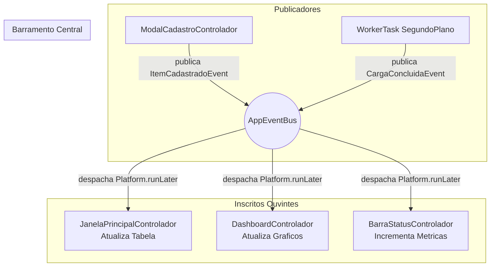

# Guia 19 — Event Bus e Comunicação Desacoplada entre Controladores JavaFX

## 1. O Problema do Acoplamento Cruzado em UI
À medida que uma aplicação desktop cresce e ganha múltiplas telas (janela principal, janelas modais de cadastro, dashboards de métricas, painel lateral de filtros e barra de status), surge a seguinte necessidade:
> **"Quando o usuário cadastra um novo registro na janela modal, como a tabela da janela principal, o gráfico do dashboard e o contador da barra de status ficam sabendo que precisam se atualizar?"**

### O Anti-Padrão Clássico: Injeção de Controladores Cruzados
Desenvolvedores iniciantes costumam resolver isso passando o controlador principal para dentro do controlador secundário:

```java
// ❌ ANTI-PADRÃO: Acoplamento rígido e dependência circular
public class CadastroModalControlador {
    private JanelaPrincipalControlador principalCtrl; // Acoplamento direto!
    private DashboardControlador dashboardCtrl;       // Mais acoplamento!
    private BarraStatusControlador statusCtrl;        // E mais acoplamento!

    public void setControladores(JanelaPrincipalControlador p, DashboardControlador d, BarraStatusControlador s) {
        this.principalCtrl = p;
        this.dashboardCtrl = d;
        this.statusCtrl = s;
    }

    private void salvar() {
        servico.salvar(item);
        // Chama manualmente cada tela dependente
        principalCtrl.atualizarTabela();
        dashboardCtrl.recalcularGraficos();
        statusCtrl.incrementarContador();
    }
}
```

### Por que esse anti-padrão é prejudicial?
1. **Quebra o Princípio da Responsabilidade Única (SRP):** O formulário de cadastro agora conhece a existência de tabelas, gráficos e contadores.
2. **Dependência Circular e Vazamento de Memória:** Janelas secundárias mantêm referências ativas para telas que talvez já deveriam ter sido coletadas pelo Garbage Collector.
3. **Rigidez:** Adicionar um novo painel que precise reagir ao cadastro exige alterar o código de todos os modais.

---

## 2. A Solução Arquitetural: Padrão Mediator / Event Bus

Com um **Event Bus (Barramento de Eventos)** em memória, nenhum controlador conhece a existência do outro. Eles comunicam-se exclusivamente através de **mensagens imutáveis (Eventos tipados em Java 21 `record`)**:



---

## 3. Implementação do `AppEventBus` Thread-Safe

```java
public final class AppEventBus {

    private static final AppEventBus INSTANCIA = new AppEventBus();

    // Mapeia a classe do evento para uma lista thread-safe de consumidores
    private final Map<Class<?>, List<Consumer<Object>>> ouvintes = new ConcurrentHashMap<>();

    private AppEventBus() {}

    public static AppEventBus getInstance() {
        return INSTANCIA;
    }

    /**
     * Inscreve um ouvinte para um tipo especifico de evento.
     * Retorna um Runnable de desinscrição para evitar vazamento de memória.
     */
    @SuppressWarnings("unchecked")
    public <T> Runnable inscrever(Class<T> tipoEvento, Consumer<T> consumidor) {
        Consumer<Object> wrappedConsumer = obj -> consumidor.accept((T) obj);
        ouvintes.computeIfAbsent(tipoEvento, k -> new CopyOnWriteArrayList<>()).add(wrappedConsumer);

        // Retorna lambda para desinscricao limpa
        return () -> {
            List<Consumer<Object>> lista = ouvintes.get(tipoEvento);
            if (lista != null) {
                lista.remove(wrappedConsumer);
            }
        };
    }

    /**
     * Publica um evento para todos os ouvintes inscritos.
     * Garante que a execucao ocorra na JavaFX Application Thread caso o JavaFX esteja ativo.
     */
    public void publicar(Object evento) {
        if (evento == null) return;

        Class<?> tipoEvento = evento.getClass();
        List<Consumer<Object>> lista = ouvintes.get(tipoEvento);

        if (lista != null && !lista.isEmpty()) {
            for (Consumer<Object> ouvinte : lista) {
                executarComSeguranca(() -> ouvinte.accept(evento));
            }
        }
    }

    private void executarComSeguranca(Runnable acao) {
        if (Platform.isFxApplicationThread()) {
            acao.run();
        } else {
            Platform.runLater(acao);
        }
    }
}
```

---

## 4. Modelagem dos Eventos Tipados com Java 21 `record`

Como eventos representam fatos consumados no passado, eles devem ser **estritamente imutáveis**:

```java
// Evento disparado quando um novo item e adicionado
public record ItemCadastradoEvent(String codigo, String descricao, LocalDateTime momento) {
    public ItemCadastradoEvent(String codigo, String descricao) {
        this(codigo, descricao, LocalDateTime.now());
    }
}

// Evento disparado quando um item e removido
public record ItemRemovidoEvent(String codigo, LocalDateTime momento) {
    public ItemRemovidoEvent(String codigo) {
        this(codigo, LocalDateTime.now());
    }
}
```

---

## 5. Uso Prático nos Controladores

### 5.1 No Controlador da Janela Principal (Ouvinte)
```java
public class JanelaPrincipalControlador {

    private Runnable cancelarInscricao;

    @FXML
    public void initialize() {
        // Se inscreve para escutar quando itens forem cadastrados ou removidos
        cancelarInscricao = AppEventBus.getInstance().inscrever(ItemCadastradoEvent.class, evento -> {
            carregarTabela(); // Atualiza a tabela na tela
            exibirNotificacaoToast("Novo item registrado: " + evento.codigo());
        });
    }

    public void destruir() {
        // Desinscrição explícita ao fechar a janela
        if (cancelarInscricao != null) {
            cancelarInscricao.run();
        }
    }
}
```

### 5.2 No Controlador do Modal de Cadastro (Publicador)
```java
public class CadastroModalControlador {

    @FXML
    private void handleSalvar() {
        try {
            servico.cadastrar(codigo, descricao);

            // Publica o evento no barramento; NINGUÉM precisa ser referenciado diretamente!
            AppEventBus.getInstance().publicar(new ItemCadastradoEvent(codigo, descricao));

            fecharJanela();
        } catch (ValidacaoException ex) {
            AlertHelper.exibirErro("Erro de Validação", ex.getMessage());
        }
    }
}
```

---

## 6. Perguntas Clássicas de Banca e Avaliadores

1. **"Qual a vantagem do EventBus em relação ao padrão Observer tradicional do Gang of Four?"**
   - *Resposta:* No Observer clássico (`Subject.addObserver`), o sujeito precisa ser instanciado e explicitamente injetado em cada observador. No Event Bus, a comunicação é completamente desacoplada (muitos para muitos), intermediada por um canal central sem que emissores e receptores conheçam as classes uns dos outros.
2. **"O que acontece se uma thread de segundo plano disparar um evento que atualiza a interface?"**
   - *Resposta:* Nosso `AppEventBus` verifica `Platform.isFxApplicationThread()`. Se não estiver na thread gráfica, o despacho é envelopado automaticamente em `Platform.runLater()`, prevenindo exceções de concorrência.
3. **"Como evitar vazamento de memória com o EventBus?"**
   - *Resposta:* O método `inscrever()` retorna um token `Runnable` de cancelamento. Quando um `Stage` ou diálogo for fechado, o controlador executa esse cancelamento removendo-se da lista de inscritos.

---

## 7. Armadilhas Comuns (*Common Pitfalls*)

| Armadilha | Consequência | Como Evitar |
| :--- | :--- | :--- |
| **Esquecer de desinscrever ao fechar telas temporárias** | A instância do controlador continua em memória viva no mapa de ouvintes do EventBus, consumindo RAM (Memory Leak). | Chamar a rotina de desinscrição no fechamento da janela (`stage.setOnHidden(...)`). |
| **Criar eventos com objetos mutáveis** | Um ouvinte altera o estado do objeto e corrompe os dados dos outros ouvintes. | Usar sempre Java 21 `record` para todos os eventos. |
| **Disparar eventos dentro de transações antes do commit** | Se a persistência falhar com erro de I/O, a UI já terá refletido uma inclusão fantasma. | Publicar o evento estritamente após a conclusão bem-sucedida da persistência. |
