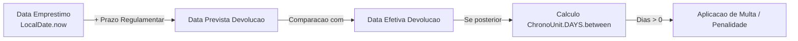

# Guia 20 — Manipulação de Datas Modernas (`java.time`), `DatePicker` e Regras Temporais no JavaFX

## 1. O Fim das Classes Legadas de Data
No desenvolvimento Java moderno (Java 17 e 21 LTS), o uso das classes antigas `java.util.Date`, `java.util.Calendar` e `java.text.SimpleDateFormat` é considerado **má prática grave**:
- São mutáveis (qualquer método pode alterar o timestamp internamente, quebrando encapsulamento).
- `SimpleDateFormat` **não é thread-safe** (causa corrupção de datas quando acessado concorrentemente).
- Meses base zero (Janeiro era mês `0`, causando confusão sem fim).

A partir do Java 8, a especificação oficial introduziu a API imutável e thread-safe `java.time` (JSR-310):
- `LocalDate`: Data sem fuso e sem hora (ex.: `2026-11-25`).
- `LocalDateTime`: Data e horário completos (ex.: `2026-11-25T14:30:00`).
- `ChronoUnit`: Enum de unidades temporais para cálculos precisos (`ChronoUnit.DAYS.between(...)`).

---

## 2. Integração com JavaFX: O Componente `DatePicker`

O componente nativo de seleção de datas do JavaFX é o `DatePicker`, cujo valor interno é diretamente um `LocalDate`.

Por padrão americano, o `DatePicker` exibe datas no formato `MM/dd/yyyy` ou `yyyy-MM-dd`. Em sistemas brasileiros de alta fidelidade, precisamos configurá-lo para `dd/MM/yyyy` e adicionar validações estritas de negócio.

---

## 3. Formatando com `StringConverter<LocalDate>` (Padrão pt-BR)

Para exibir e converter textos no padrão brasileiro sem quebras por digitação inválida:

```java
public final class DataBrConverter extends StringConverter<LocalDate> {

    private final DateTimeFormatter formatador = DateTimeFormatter.ofPattern("dd/MM/yyyy");

    @Override
    public String toString(LocalDate data) {
        return (data == null) ? "" : formatador.format(data);
    }

    @Override
    public LocalDate fromString(String texto) {
        if (texto == null || texto.trim().isEmpty()) {
            return null;
        }
        try {
            return LocalDate.parse(texto.trim(), formatador);
        } catch (DateTimeParseException ex) {
            // Em caso de digitação com formato incorreto, retorna null defensivamente
            return null;
        }
    }
}
```

Aplicação no controlador:
```java
@FXML private DatePicker dpDataDevolucao;

@FXML
public void initialize() {
    dpDataDevolucao.setConverter(new DataBrConverter());
    dpDataDevolucao.setPromptText("dd/mm/aaaa");
}
```

---

## 4. Restrição de Seleção Visual com `DayCellFactory`

Muitas regras de negócio proíbem datas passadas ou fins de semana para empréstimos e reservas. Em vez de esperar o usuário clicar em "Salvar" para avisar que a data é inválida, **desabilitamos visualmente as células inválidas no próprio calendário**:

```java
private void configurarRestricoesCalendario(DatePicker datePicker, LocalDate dataMinima, int prazoMaximoDias) {
    LocalDate dataMaxima = dataMinima.plusDays(prazoMaximoDias);

    datePicker.setDayCellFactory(picker -> new DateCell() {
        @Override
        public void updateItem(LocalDate data, boolean vazio) {
            super.updateItem(data, vazio);

            // 1. Desabilita datas anteriores à data mínima permitida
            if (data.isBefore(dataMinima)) {
                setDisable(true);
                setStyle("-fx-background-color: #f2f2f2; -fx-text-fill: #b0b0b0;");
            }

            // 2. Desabilita datas superiores ao teto de dias permitidos
            if (data.isAfter(dataMaxima)) {
                setDisable(true);
                setStyle("-fx-background-color: #f2f2f2; -fx-text-fill: #b0b0b0;");
            }

            // 3. Opcional: Desabilitar finais de semana (Sábado e Domingo)
            if (data.getDayOfWeek() == DayOfWeek.SATURDAY || data.getDayOfWeek() == DayOfWeek.SUNDAY) {
                setDisable(true);
                setStyle("-fx-background-color: #fee; -fx-text-fill: #d9534f;");
            }
        }
    });
}
```

---

## 5. Regras de Negócio Temporais: Prazos, Atrasos e Multas



### 5.1 Cálculo Preciso de Dias em Atraso
```java
public class CalculadoraTemporal {

    /**
     * Calcula o total de dias de atraso. Se devolvido no prazo ou antes, retorna 0.
     */
    public static long calcularDiasAtraso(LocalDate dataPrevista, LocalDate dataDevolucaoReal) {
        Objects.requireNonNull(dataPrevista, "Data prevista não pode ser nula");
        Objects.requireNonNull(dataDevolucaoReal, "Data de devolução não pode ser nula");

        if (!dataDevolucaoReal.isAfter(dataPrevista)) {
            return 0;
        }

        return ChronoUnit.DAYS.between(dataPrevista, dataDevolucaoReal);
    }

    /**
     * Calcula a data limite regulamentar considerando apenas dias úteis (segunda a sexta).
     */
    public static LocalDate somarDiasUteis(LocalDate dataInicio, int diasUteis) {
        LocalDate dataAtual = dataInicio;
        int adicionados = 0;

        while (adicionados < diasUteis) {
            dataAtual = dataAtual.plusDays(1);
            if (dataAtual.getDayOfWeek() != DayOfWeek.SATURDAY && 
                dataAtual.getDayOfWeek() != DayOfWeek.SUNDAY) {
                adicionados++;
            }
        }
        return dataAtual;
    }
}
```

---

## 6. Perguntas Clássicas de Banca e Avaliadores

1. **"Por que usar `LocalDate` e não `LocalDateTime` quando o requisito fala em datas de empréstimo?"**
   - *Resposta:* Se a regra de devolução baseia-se em dias do calendário (ex.: devolução até o dia 28/11 sem horário estrito), o uso de `LocalDateTime` introduz complexidade indesejada de minutos e fusos horários. A regra do domínio é expressa de forma muito mais limpa com `LocalDate`.
2. **"Como o `DatePicker` deve se comportar se o usuário digitar uma string como '99/99/9999'?"**
   - *Resposta:* O `StringConverter` implementado captura a `DateTimeParseException` e retorna `null`. O controlador trata o `null` desabilitando o botão de envio através de validação preventiva, sem travar a interface do usuário.
3. **"Por que `ChronoUnit.DAYS.between(d1, d2)` é superior a calcular milissegundos divididos por 86.400.000?"**
   - *Resposta:* Porque divisões aritméticas simples de milissegundos quebram em dias de transição de Horário de Verão (Daylight Saving Time), onde o dia pode ter 23 ou 25 horas. A API `java.time` é ciente dessas particularidades astronômicas e de calendário civil.

---

## 7. Armadilhas Comuns (*Common Pitfalls*)

| Armadilha | Consequência | Como Evitar |
| :--- | :--- | :--- |
| **Comparar datas com `==` ou `!=`** | Compara a referência em memória em vez do valor da data. | Usar sempre métodos semânticos: `dataA.isBefore(dataB)`, `dataA.isAfter(dataB)` ou `dataA.equals(dataB)`. |
| **Não validar nulos no `DatePicker.getValue()`** | `NullPointerException` imediato ao tentar salvar antes que o usuário selecione uma data. | Fazer bind de validação ou checar `if (dpData.getValue() == null)` antes de prosseguir. |
| **Usar `java.util.Date` na entidade e tentar converter no controlador** | Acoplamento a APIs depreciadas e código de conversão poluído. | Modelar entidades e persistência CSV diretamente com `LocalDate` e formatos ISO-8601 (`yyyy-MM-dd`) para armazenamento em disco. |
