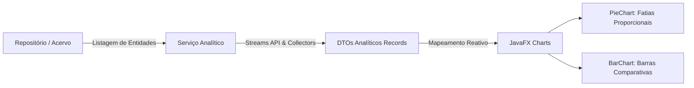

# Guia 21 — Dashboards Executivos, Métricas Agregadas e Gráficos no JavaFX (`PieChart` e `BarChart`)

## 1. Por que Visões Gerenciais e Dashboards são Críticos?
Em sistemas de gestão patrimonial, controle de acervo ou reservas de recursos, painéis puramente tabulares atendem apenas ao operador de linha de frente. Bancas avaliadoras, coordenadores de laboratório e Product Owners buscam **visões analíticas de alto nível**:
- Qual categoria concentra a maior parte dos itens ou investimentos?
- Qual é o índice percentual de ocupação/empréstimo dos recursos em tempo real?
- Como está a distribuição financeira do acervo?

Construir visões analíticas no JavaFX exige unir **duas competências de ponta**:
1. **Agregações em Memória com Java Streams (`java.util.stream.Collectors`)**: Agrupamentos, contagens e somatórios sem poluir a interface com loops imperativos.
2. **Componentes Gráficos Nativos do JavaFX (`PieChart` e `BarChart`)**: Apresentação visual limpa com tooltips, legendas dinâmicas e reatividade sem travar a JavaFX Application Thread.

---

## 2. Modelagem Conceitual: Do Domínio aos DTOs de Métricas

O princípio arquitetural primordial é: **a View (gráfico) jamais deve calcular regras de negócio ou métricas diretamente**.



### DTOs de Métricas com Java 21 Records
Utilizamos *Records* imutáveis para transportar as métricas consolidadas:

```java
public record MetricaCategoria(
    String categoria,
    long quantidade,
    BigDecimal valorTotal
) {}

public record ResumoGeral(
    long totalItens,
    long itensEmUso,
    long itensDisponiveis,
    BigDecimal valorTotalGeral,
    double percentualOcupacao
) {}
```

---

## 3. Agregações Modernas com Streams API

A camada de serviço processa os dados utilizando os coletores avançados da API de Streams do Java:

```java
public final class ServicoAnalitico {

    // 1. Agrupamento por Categoria com Contagem Quantitativa
    public Map<String, Long> contarPorCategoria(List<ItemEstoque> itens) {
        return itens.stream()
                .collect(Collectors.groupingBy(
                        ItemEstoque::getCategoria,
                        Collectors.counting()
                ));
    }

    // 2. Agrupamento com Somatório Financeiro (BigDecimal)
    public Map<String, BigDecimal> calcularValorTotalPorCategoria(List<ItemEstoque> itens) {
        return itens.stream()
                .collect(Collectors.groupingBy(
                        ItemEstoque::getCategoria,
                        Collectors.reducing(
                                BigDecimal.ZERO,
                                ItemEstoque::getValorEstimado,
                                BigDecimal::add
                        )
                ));
    }

    // 3. Resumo Consolidado com Particionamento Booleano
    public ResumoGeral calcularResumo(List<ItemEstoque> itens) {
        long total = itens.size();
        if (total == 0) {
            return new ResumoGeral(0, 0, 0, BigDecimal.ZERO, 0.0);
        }

        // Particiona itens em um único passe: true (em uso), false (disponíveis)
        Map<Boolean, Long> porStatus = itens.stream()
                .collect(Collectors.partitioningBy(
                        ItemEstoque::isEmprestado,
                        Collectors.counting()
                ));

        long emUso = porStatus.getOrDefault(true, 0L);
        long disponiveis = porStatus.getOrDefault(false, 0L);

        BigDecimal valorTotal = itens.stream()
                .map(ItemEstoque::getValorEstimado)
                .reduce(BigDecimal.ZERO, BigDecimal::add);

        double percentualOcupacao = ((double) emUso / total) * 100.0;

        return new ResumoGeral(total, emUso, disponiveis, valorTotal, percentualOcupacao);
    }
}
```

---

## 4. Apresentação Gráfica no JavaFX

### 4.1 Gráfico de Setores (`PieChart`) com Tooltips Dinâmicos
O `PieChart` recebe uma coleção observável de instâncias `PieChart.Data`. Para uma experiência de usuário profissional, adicionamos tooltips com o valor e o percentual calculado:

```java
PieChart graficoPizza = new PieChart();
graficoPizza.setTitle("Distribuição Quantitativa por Categoria");

ObservableList<PieChart.Data> dadosPizza = FXCollections.observableArrayList();
Map<String, Long> metricas = servico.contarPorCategoria(itens);
long total = itens.size();

metricas.forEach((categoria, quantidade) -> {
    double percentual = total > 0 ? (quantidade * 100.0 / total) : 0.0;
    PieChart.Data fatia = new PieChart.Data(categoria, quantidade);
    dadosPizza.add(fatia);
});

graficoPizza.setData(dadosPizza);

// Instalação de Tooltips nos nós das fatias após a renderização
for (PieChart.Data fatia : graficoPizza.getData()) {
    Tooltip tooltip = new Tooltip(String.format("%s: %d itens (%.1f%%)",
            fatia.getName(), (long) fatia.getPieValue(),
            total > 0 ? (fatia.getPieValue() * 100.0 / total) : 0.0));
    Tooltip.install(fatia.getNode(), tooltip);
}
```

### 4.2 Gráfico de Barras (`BarChart<String, Number>`)
Para comparar valores financeiros entre categorias, o `BarChart` é ideal:

```java
CategoryAxis eixoCategorias = new CategoryAxis();
eixoCategorias.setLabel("Categorias");

NumberAxis eixoValores = new NumberAxis();
eixoValores.setLabel("Valor Estimado (R$)");

BarChart<String, Number> graficoBarras = new BarChart<>(eixoCategorias, eixoValores);
graficoBarras.setTitle("Patrimônio Estimado por Categoria");
graficoBarras.setLegendVisible(false);

XYChart.Series<String, Number> serie = new XYChart.Series<>();
Map<String, BigDecimal> valores = servico.calcularValorTotalPorCategoria(itens);

valores.forEach((categoria, valorTotal) -> {
    serie.getData().add(new XYChart.Data<>(categoria, valorTotal.doubleValue()));
});

graficoBarras.getData().add(serie);
```

---

## 5. Armadilhas Comuns (*Common Pitfalls*)

1. **Chamar agregações pesadas dentro da JavaFX Application Thread:**
   - Se o acervo possuir milhares de itens gravados em CSV ou disco, envolva a chamada do `servico.calcularResumo(...)` em uma `javafx.concurrent.Task<ResumoGeral>` e atualize o gráfico via `Platform.runLater()`.
2. **Nós nulos ao instalar Tooltip em `PieChart.Data` antes da montagem da cena:**
   - `fatia.getNode()` pode retornar `null` se o gráfico ainda não foi renderizado pelo toolkit gráfico. Sempre adicione os dados ao gráfico antes de iterar ou faça a instalação após o `Stage.show()`.
3. **Não tratar divisão por zero em percentuais:**
   - Quando o repositório estiver inicialmente vazio (zero itens), proteger o cálculo de percentual com `total > 0 ? ... : 0.0` para evitar exibir `NaN%`.

---

## 6. Perguntas Típicas em Bancas Avaliadoras

- **Pergunta:** *"Por que você utilizou `Collectors.groupingBy` e `Collectors.reducing` em vez de um laço `for` tradicional?"*
  - **Resposta:** *"O uso da Streams API expressa a intenção de negócio de forma declarativa e imutável. Além de eliminar variáveis temporárias acumuladoras de escopo aberto, garante facilidade de manutenção e possibilita paralelização segura (`parallelStream()`) caso o volume de dados escale, mantendo o serviço desacoplado de qualquer dependência visual."*
- **Pergunta:** *"Como os gráficos refletem novos cadastros ou devoluções no sistema?"*
  - **Resposta:** *"Integrando o controlador do Dashboard ao nosso `AppEventBus` ou registrando um `ListChangeListener` na `ObservableList` do acervo. Quando um evento de cadastro ou devolução ocorre, o serviço analítico recalcula os DTOs em memória e o gráfico é atualizado sem reiniciar a aplicação."*
