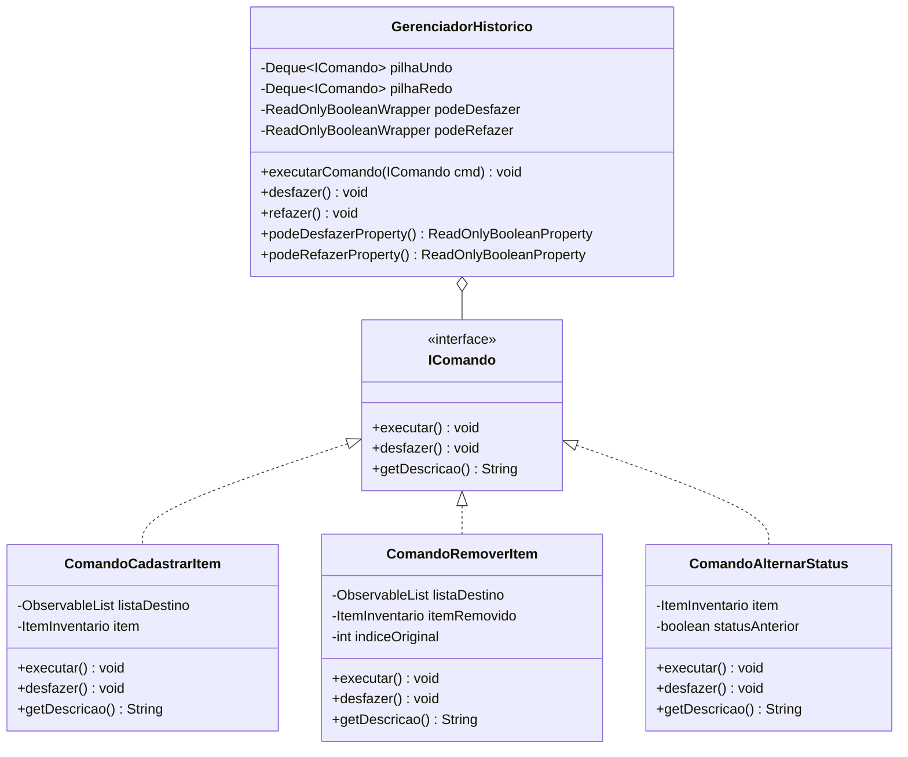

# Guia 22 — Padrão GoF Command, Histórico Reversível (Undo / Redo) e Atalhos de Teclado no JavaFX

## 1. Por que Operações Reversíveis são Essenciais em Desktop?
Em interfaces desktop profissionais, o usuário espera poder desfazer uma ação equivocada instantaneamente pressionando **`Ctrl+Z`** (ou botão "Desfazer") e refazer via **`Ctrl+Y`** (ou botão "Refazer").

Se um sistema executa mutações diretas no modelo (ex.: `lista.remove(item)`), o estado anterior é perdido para sempre, a menos que tenhamos implementado o **Padrão GoF Command**.

### O que é o Padrão Command?
O padrão Command encapsula uma solicitação/ação como um objeto independente, contendo:
1. Todas as informações necessárias para **executar** a ação.
2. Todas as informações necessárias para **reverter (desfazer)** a ação exatamente para o estado anterior.
3. Metadados descritivos para apresentação na interface (ex.: *"Cadastrou item #102"*).

---

## 2. Diagrama de Classes e Arquitetura Conceitual



---

## 3. Implementação Passo a Passo

### 3.1 Contrato do Comando (`IComando.java`)
```java
public interface IComando {
    void executar();
    void desfazer();
    String getDescricao();
}
```

### 3.2 Comandos Concretos Autocontidos
Cada comando armazena o receptor (*Receiver*) e os dados de contexto necessários para reversão:

```java
// 1. Comando de Cadastro: ao desfazer, remove o item inserido
public final class ComandoCadastrarItem implements IComando {
    private final ObservableList<ItemInventario> lista;
    private final ItemInventario item;

    public ComandoCadastrarItem(ObservableList<ItemInventario> lista, ItemInventario item) {
        this.lista = Objects.requireNonNull(lista);
        this.item = Objects.requireNonNull(item);
    }

    @Override
    public void executar() {
        lista.add(item);
    }

    @Override
    public void desfazer() {
        lista.remove(item);
    }

    @Override
    public String getDescricao() {
        return "Cadastrar item: " + item.getNome();
    }
}

// 2. Comando de Remoção: ao desfazer, reinsere no índice original preservando ordenação!
public final class ComandoRemoverItem implements IComando {
    private final ObservableList<ItemInventario> lista;
    private final ItemInventario itemRemovido;
    private int indiceOriginal = -1;

    public ComandoRemoverItem(ObservableList<ItemInventario> lista, ItemInventario itemRemovido) {
        this.lista = Objects.requireNonNull(lista);
        this.itemRemovido = Objects.requireNonNull(itemRemovido);
    }

    @Override
    public void executar() {
        this.indiceOriginal = lista.indexOf(itemRemovido);
        if (this.indiceOriginal >= 0) {
            lista.remove(this.indiceOriginal);
        }
    }

    @Override
    public void desfazer() {
        if (indiceOriginal >= 0 && indiceOriginal <= lista.size()) {
            lista.add(indiceOriginal, itemRemovido);
        } else {
            lista.add(itemRemovido);
        }
    }

    @Override
    public String getDescricao() {
        return "Remover item: " + itemRemovido.getNome();
    }
}
```

### 3.3 Gerenciador de Histórico Reativo (`GerenciadorHistorico.java`)
O gerenciador orquestra as duas pilhas (`ArrayDeque`) e expõe propriedades booleanas observáveis para que a interface habilite/desabilite os botões de forma 100% reativa:

```java
public final class GerenciadorHistorico {
    private final Deque<IComando> pilhaUndo = new ArrayDeque<>();
    private final Deque<IComando> pilhaRedo = new ArrayDeque<>();
    private final int limiteHistorico;

    private final ReadOnlyBooleanWrapper podeDesfazer = new ReadOnlyBooleanWrapper(false);
    private final ReadOnlyBooleanWrapper podeRefazer = new ReadOnlyBooleanWrapper(false);

    public GerenciadorHistorico(int limiteHistorico) {
        this.limiteHistorico = limiteHistorico;
    }

    public void executarComando(IComando comando) {
        comando.executar();
        pilhaUndo.push(comando);
        
        // Regra Fundamental: uma nova ação limpa a pilha de Redo!
        pilhaRedo.clear();

        // Limita o histórico em memória (Memory Guard)
        if (pilhaUndo.size() > limiteHistorico) {
            pilhaUndo.removeLast();
        }

        atualizarPropriedades();
    }

    public void desfazer() {
        if (!pilhaUndo.isEmpty()) {
            IComando comando = pilhaUndo.pop();
            comando.desfazer();
            pilhaRedo.push(comando);
            atualizarPropriedades();
        }
    }

    public void refazer() {
        if (!pilhaRedo.isEmpty()) {
            IComando comando = pilhaRedo.pop();
            comando.executar();
            pilhaUndo.push(comando);
            atualizarPropriedades();
        }
    }

    public ReadOnlyBooleanProperty podeDesfazerProperty() {
        return podeDesfazer.getReadOnlyProperty();
    }

    public ReadOnlyBooleanProperty podeRefazerProperty() {
        return podeRefazer.getReadOnlyProperty();
    }

    private void atualizarPropriedades() {
        podeDesfazer.set(!pilhaUndo.isEmpty());
        podeRefazer.set(!pilhaRedo.isEmpty());
    }
}
```

---

## 4. Integração Visual e Atalhos no JavaFX

No controlador FXML ou na classe de apresentação JavaFX:

```java
// 1. Data Binding reativo para habilitar botões apenas quando há ações no histórico
btnDesfazer.disableProperty().bind(historico.podeDesfazerProperty().not());
btnRefazer.disableProperty().bind(historico.podeRefazerProperty().not());

btnDesfazer.setOnAction(e -> historico.desfazer());
btnRefazer.setOnAction(e -> historico.refazer());

// 2. Atalhos Universais no Palco / Cena (Ctrl+Z e Ctrl+Y)
cena.getAccelerators().put(
    new KeyCodeCombination(KeyCode.Z, KeyCombination.SHORTCUT_DOWN),
    historico::desfazer
);

cena.getAccelerators().put(
    new KeyCodeCombination(KeyCode.Y, KeyCombination.SHORTCUT_DOWN),
    historico::refazer
);
```

---

## 5. Armadilhas Comuns (*Common Pitfalls*)

1. **Esquecer de limpar a pilha de Redo ao executar um novo comando:**
   - Se o usuário faz A -> B -> Desfaz B (B vai para Redo) -> Executa C, a ação B não pode mais ser refeita! A árvore de histórico se ramificou. A pilha de Redo deve ser sempre esvaziada (`pilhaRedo.clear()`).
2. **Reinserir item removido sempre no final da lista (`add(item)`):**
   - Ao desfazer uma exclusão, o item deve retornar para a **mesma linha/índice** onde estava antes (`add(indiceOriginal, item)`), caso contrário a ordem da tabela é subvertida.
3. **Não colocar limite de tamanho nas pilhas de histórico:**
   - Se a aplicação ficar aberta por dias ou executar milhares de comandos em lote, o histórico consumirá memória RAM indefinidamente. Sempre use um teto configurável (ex.: 50 ou 100 comandos).

---

## 6. Perguntas Típicas em Bancas Avaliadoras

- **Pergunta:** *"Qual a vantagem do padrão Command sobre simplesmente salvar um clone de todo o banco de dados/lista antes de cada ação?"*
  - **Resposta:** *"O padrão Command armazena apenas o delta (a operação e os dados específicos modificados), operando em tempo O(1) e ocupando memória mínima. Clonar toda a base a cada clique causaria degradação severa de desempenho e desperdício de memória."*
- **Pergunta:** *"Por que usamos `KeyCombination.SHORTCUT_DOWN` em vez de `CONTROL_DOWN`?"*
  - **Resposta:** *"Porque `SHORTCUT_DOWN` é portável entre plataformas: mapeia automaticamente para `Ctrl` no Linux e Windows, e para `Command (⌘)` no macOS, garantindo uma aplicação verdadeiramente multiplataforma."*
