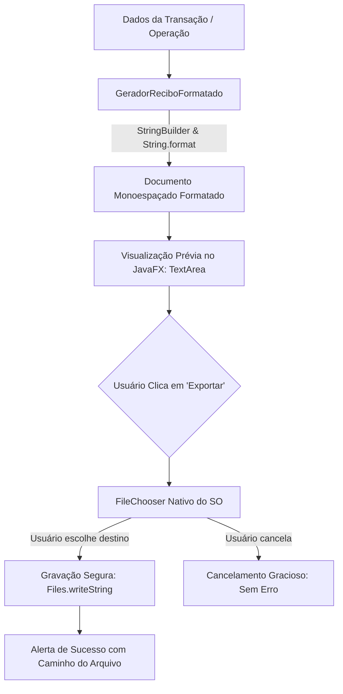

# Guia 23 — Exportação de Relatórios, Recibos Formatados e Diálogos Nativos do Sistema (`FileChooser`)

## 1. Por que Recibos e Exportações Formatadas são Cruciais?
Em sistemas de controle de empréstimos, devoluções, patrimônio ou vendas, a **emissão de comprovantes de transação** é um requisito funcional de auditoria e conformidade indispensável:
- Quando um usuário devolve um item ou quita uma multa, ele exige um **comprovante formal** com identificador único, data/hora e resumo discriminado.
- Coordenadores e auditores exigem **relatórios consolidados exportáveis** (em `.txt` monoespaçado legível ou `.csv` para planilhas).

Adicionar bibliotecas externas pesadas de PDF (como iText ou PDFBox) muitas vezes **viola o regulamento** de editais acadêmicos ou traz dependências binárias complexas. A abordagem de engenharia profissional e elegante é **gerar documentos textuais perfeitamente alinhados e tabulados**, integrados ao diálogo nativo **`javafx.stage.FileChooser`**.

---

## 2. Arquitetura do Gerador de Comprovantes



---

## 3. Formatação Textual Determinística em Largura Fixa

O segredo de um comprovante com visual limpo e legível é o uso de especificadores de formato de string com alinhamento à esquerda (`%-Ns`) ou à direita (`%Ns`):

```java
public final class GeradorReciboFormatado {

    private static final String LINHA_DIVISORIA = "+---------------+--------------------------------+--------------+";
    private static final DateTimeFormatter FORMATO_DATA_HORA = DateTimeFormatter.ofPattern("dd/MM/yyyy HH:mm:ss");

    public static String gerarReciboMovimentacao(
            String idTransacao,
            String operador,
            String destinatario,
            List<ItemMovimentado> itens,
            BigDecimal valorTaxasMultas
    ) {
        StringBuilder sb = new StringBuilder();

        // 1. Cabeçalho Institucional
        sb.append("=================================================================\n");
        sb.append("                  SISTEMA DE CONTROLE PATRIMONIAL                \n");
        sb.append("                   COMPROVANTE OFICIAL DE OPERAÇÃO               \n");
        sb.append("=================================================================\n\n");

        // 2. Metadados da Transação
        sb.append(String.format("Identificador Único : %s\n", idTransacao));
        sb.append(String.format("Data e Horário      : %s\n", LocalDateTime.now().format(FORMATO_DATA_HORA)));
        sb.append(String.format("Responsável/Operador: %s\n", operador));
        sb.append(String.format("Destinatário/Usuário: %s\n", destinatario));
        sb.append("\n");

        // 3. Tabela Discriminada de Itens
        sb.append(LINHA_DIVISORIA).append("\n");
        sb.append(String.format("| %-13s | %-30s | %12s |\n", "CÓDIGO", "DISCRIMINAÇÃO DO ITEM", "VALOR DIÁRIA"));
        sb.append(LINHA_DIVISORIA).append("\n");

        BigDecimal somaDiarias = BigDecimal.ZERO;
        for (ItemMovimentado item : itens) {
            sb.append(String.format("| %-13s | %-30s | R$ %9.2f |\n",
                    item.codigo(),
                    abreviar(item.descricao(), 30),
                    item.valorDiaria().doubleValue()));
            somaDiarias = somaDiarias.add(item.valorDiaria());
        }

        sb.append(LINHA_DIVISORIA).append("\n\n");

        // 4. Sumário Financeiro
        BigDecimal totalGeral = somaDiarias.add(valorTaxasMultas);
        sb.append(String.format("Quantidade de Itens : %d\n", itens.size()));
        sb.append(String.format("Subtotal Diárias    : R$ %10.2f\n", somaDiarias.doubleValue()));
        sb.append(String.format("Taxas / Multas      : R$ %10.2f\n", valorTaxasMultas.doubleValue()));
        sb.append(String.format("TOTAL REGISTRADO    : R$ %10.2f\n", totalGeral.doubleValue()));
        sb.append("\n");

        // 5. Código de Autenticidade (Hash Digital SHA-256 / UUID)
        String hashAutenticacao = gerarHashAutenticidade(idTransacao, destinatario, totalGeral);
        sb.append("-----------------------------------------------------------------\n");
        sb.append(String.format("Chave de Validação  : %s\n", hashAutenticacao));
        sb.append("Documento emitido eletronicamente. Dispensa assinatura manual.\n");
        sb.append("=================================================================\n");

        return sb.toString();
    }
}
```

---

## 4. Integração com o Diálogo Nativo `FileChooser` do JavaFX

Para salvar o documento gerado no sistema de arquivos do usuário:

```java
private void exportarArquivo(Stage janelaPai, String conteudoTexto, String nomeSugerido) {
    FileChooser seletor = new FileChooser();
    seletor.setTitle("Salvar Comprovante de Operação");

    // 1. Filtros de Extensão
    seletor.getExtensionFilters().addAll(
            new FileChooser.ExtensionFilter("Documento de Texto (*.txt)", "*.txt"),
            new FileChooser.ExtensionFilter("Todos os Arquivos (*.*)", "*.*")
    );

    // 2. Nome Sugerido Dinâmico com Timestamp
    seletor.setInitialFileName(nomeSugerido);

    // 3. Diretório Inicial Lembrado (Ex.: Pasta Home do Usuário)
    File diretorioPadrao = new File(System.getProperty("user.home"));
    if (diretorioPadrao.exists()) {
        seletor.setInitialDirectory(diretorioPadrao);
    }

    // 4. Abertura Bloqueante do Diálogo Nativo
    File arquivoDestino = seletor.showSaveDialog(janelaPai);

    // 5. Validação Defensiva de Cancelamento (Evita NullPointerException)
    if (arquivoDestino == null) {
        return; // Usuário cancelou ou fechou a janela; aborta graciosamente
    }

    // 6. Gravação Segura em Disco com NIO.2
    try {
        Files.writeString(arquivoDestino.toPath(), conteudoTexto, StandardCharsets.UTF_8);

        Alert alertaSucesso = new Alert(Alert.AlertType.INFORMATION);
        alertaSucesso.setTitle("Exportação Concluída");
        alertaSucesso.setHeaderText("Comprovante exportado com sucesso!");
        alertaSucesso.setContentText("Arquivo salvo em:\n" + arquivoDestino.getAbsolutePath());
        alertaSucesso.showAndWait();

    } catch (IOException ex) {
        Alert alertaErro = new Alert(Alert.AlertType.ERROR);
        alertaErro.setTitle("Falha na Gravação");
        alertaErro.setHeaderText("Não foi possível salvar o arquivo.");
        alertaErro.setContentText("Erro de I/O: " + ex.getMessage());
        alertaErro.showAndWait();
    }
}
```

---

## 5. Armadilhas Comuns (*Common Pitfalls*)

1. **Não tratar retorno `null` do `showSaveDialog`:**
   - Se o usuário clicar em "Cancelar" ou fechar a janela no "X", `showSaveDialog` retorna `null`. Invocar métodos em `arquivoDestino` sem checar nulidade gera `NullPointerException` imediato.
2. **Fontes proporcionais na visualização prévia da UI:**
   - Ao exibir o recibo formatado em um `TextArea` ou `Label` do JavaFX, se você usar a fonte padrão da interface, as colunas ficarão todas desalinhadas! Sempre aplique estilo monoespaçado: `-fx-font-family: 'Courier New', monospace;`.
3. **Hardcodar caminhos com barras de diretório fixas (`/` ou `\`):**
   - Nunca concatene caminhos como `"C:\	emp\\" + nome` ou `"/home/" + nome`. Utilize sempre `Path.resolve()` ou `System.getProperty("user.home")` para compatibilidade entre Linux, macOS e Windows.
4. **Esquecer de especificar UTF-8 na gravação:**
   - O uso de métodos legados como `FileWriter(file)` adota o encoding padrão do sistema operacional (que no Windows antigo costumava ser Windows-1252), corrompendo acentuações. Utilize sempre `Files.writeString(path, texto, StandardCharsets.UTF_8)`.

---

## 6. Perguntas Típicas em Bancas Avaliadoras

- **Pergunta:** *"Por que gerar recibos em formato texto tabular puro em vez de utilizar uma biblioteca como JasperReports ou iText?"*
  - **Resposta:** *"A geração em texto puro respeita o princípio de arquitetura enxuta (Zero Bloatware) e conformidade estrita aos requisitos do edital, sem adicionar dependências binárias externas que quebram builds corporativos ou educacionais. O documento pode ser lido em qualquer terminal, impresso em qualquer impressora térmica ou matricial, e visualizado instantaneamente na UI."*
- **Pergunta:** *"Como garantir que o comprovante emitido não foi adulterado pelo usuário?"*
  - **Resposta:** *"O gerador embute uma chave de validação criptográfica (Hash SHA-256 ou HMAC simplificado) calculada a partir dos dados invioláveis da operação (ID, solicitante e valores). Qualquer alteração em um centavo ou dígito no arquivo de texto invalida a chave de verificação."*
