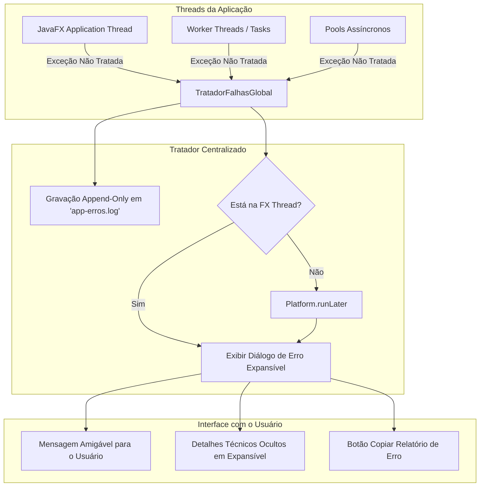

# Guia 24 — Resiliência Operacional em JavaFX: `UncaughtExceptionHandler` Global, Diálogos de Falha e Logs de Diagnóstico

## 1. O Cenário Catastrófico da Aplicação Silenciosa
Em aplicações desktop, o tratamento de exceções nos métodos de serviço e persistência (`try/catch`) cobre os erros previstos de negócio (ex.: `ItemJaEmprestadoException`, `FormatoInvalidoException`). Porém, o que acontece quando ocorre:
- Um `NullPointerException` imprevisto ao manipular um nó de interface?
- Um `OutOfMemoryError` ou falha de rede/disco em uma thread em segundo plano (`Task<V>`)?
- Uma inconsistência não tratada disparada por um evento assíncrono?

No JavaFX padrão:
1. Se a falha ocorrer na **JavaFX Application Thread**, a exceção é impressa no terminal console (que o usuário final não vê), o processamento do evento é abortado e a interface pode ficar desincronizada ou congelada.
2. Se a falha ocorrer em uma **Worker Thread (`Task` ou `ExecutorService`)**, a thread morre silenciosamente no pool sem qualquer feedback visual para o usuário.

A solução de nível de Engenharia de Software Principal é implementar o **Tratamento Global de Falhas (*Global Uncaught Exception Handler*)**, acoplado a **Logs de Diagnóstico em Disco** e **Diálogos de Erro Expansíveis com Stack Trace**.

---

## 2. Arquitetura da Resiliência Global



---

## 3. Implementação do Tratador Global de Falhas

### 3.1 Instalação no Ponto de Entrada (`AppLauncher` ou `Application.init()`)
Configuramos o manipulador padrão da JVM antes de carregar qualquer cena ou tela:

```java
public final class TratadorFalhasGlobal implements Thread.UncaughtExceptionHandler {

    private static final Path ARQUIVO_LOG = Path.of("app-erros.log");
    private static final DateTimeFormatter FORMATADOR_TIMESTAMP = DateTimeFormatter.ofPattern("yyyy-MM-dd HH:mm:ss.SSS");

    @Override
    public void uncaughtException(Thread thread, Throwable throwable) {
        // 1. Grava no log de diagnóstico em disco de forma síncrona e segura
        registrarLogEmDisco(thread, throwable);

        // 2. Despacha a exibição do diálogo para a UI Thread do JavaFX
        if (Platform.isFxApplicationThread()) {
            exibirDialogoFalha(thread, throwable);
        } else {
            Platform.runLater(() -> exibirDialogoFalha(thread, throwable));
        }
    }

    public static void registrarLogEmDisco(Thread thread, Throwable throwable) {
        String logEntry = formatarEntradaLog(thread, throwable);
        try {
            Files.writeString(ARQUIVO_LOG, logEntry, StandardCharsets.UTF_8,
                    StandardOpenOption.CREATE, StandardOpenOption.APPEND);
        } catch (IOException ex) {
            System.err.println("CRÍTICO: Não foi possível gravar log de erro em disco: " + ex.getMessage());
        }
    }

    public static String formatarEntradaLog(Thread thread, Throwable throwable) {
        StringWriter sw = new StringWriter();
        PrintWriter pw = new PrintWriter(sw);
        throwable.printStackTrace(pw);

        return String.format("[%s] [THREAD: %s] [EXCEÇÃO: %s]\nMensagem: %s\nRastreamento de Pilha:\n%s\n-----------------------------------------------------------------\n",
                LocalDateTime.now().format(FORMATADOR_TIMESTAMP),
                thread.getName(),
                throwable.getClass().getName(),
                throwable.getMessage(),
                sw.toString());
    }
}
```

---

## 4. Diálogo de Erro Nativo Expansível no JavaFX

O diálogo profissional não assusta o usuário leigo com jargões técnicos na tela inicial, mas disponibiliza o rastreamento completo de pilha para suporte e debugging:

```java
private static void exibirDialogoFalha(Thread thread, Throwable throwable) {
    Alert alerta = new Alert(Alert.AlertType.ERROR);
    alerta.setTitle("Inconsistência Inesperada no Sistema");
    alerta.setHeaderText("Ocorreu um problema inesperado durante a operação.");
    alerta.setContentText("A operação não pôde ser concluída. Os detalhes do incidente foram registrados no arquivo de log do sistema.");

    // Painel Expansível com Rastreamento de Pilha
    StringWriter sw = new StringWriter();
    throwable.printStackTrace(new PrintWriter(sw));
    String stackTrace = sw.toString();

    Label lblDetalhes = new Label("Detalhes técnicos da falha:");

    TextArea txtAreaDetalhes = new TextArea(stackTrace);
    txtAreaDetalhes.setEditable(false);
    txtAreaDetalhes.setWrapText(true);
    txtAreaDetalhes.setStyle("-fx-font-family: monospace; -fx-font-size: 11px;");
    txtAreaDetalhes.setMaxWidth(Double.MAX_VALUE);
    txtAreaDetalhes.setMaxHeight(Double.MAX_VALUE);
    GridPane.setVgrow(txtAreaDetalhes, Priority.ALWAYS);
    GridPane.setHgrow(txtAreaDetalhes, Priority.ALWAYS);

    GridPane painelConteudo = new GridPane();
    painelConteudo.setMaxWidth(Double.MAX_VALUE);
    painelConteudo.add(lblDetalhes, 0, 0);
    painelConteudo.add(txtAreaDetalhes, 0, 1);

    // Oculta os detalhes técnicos inicialmente sob controle do usuário
    alerta.getDialogPane().setExpandableContent(painelConteudo);
    alerta.showAndWait();
}
```

---

## 5. Armadilhas Comuns (*Common Pitfalls*)

1. **Disparar `Alert` diretamente a partir de threads em segundo plano:**
   - Se uma thread worker estourar uma exceção e o handler chamar `new Alert().showAndWait()` sem envelopar em `Platform.runLater()`, o JavaFX lança imediatamente `IllegalStateException: Not on FX application thread`.
2. **Loop de Erros Recursivos (*Crash Loop*):**
   - Se a construção do diálogo de erro ou a escrita do arquivo de log falhar e disparar outra exceção não capturada, a aplicação entra em um loop infinito de exceções. O código do handler deve ser ultra-defensivo (`try/catch` interno em bloco fechado).
3. **Ignorar Exceções em Tasks (`Task.setOnFailed` vs Handler Global):**
   - O `Thread.setDefaultUncaughtExceptionHandler` intercepta falhas de threads comuns. Contudo, classes `javafx.concurrent.Task` capturam exceções internamente e as armazenam no estado `Task.State.FAILED`. Sempre registre `task.setOnFailed(e -> tratador.uncaughtException(Thread.currentThread(), task.getException()))` ou inspecione o estado para assegurar que falhas assíncronas nunca fiquem invisíveis.

---

## 6. Perguntas Típicas em Bancas Avaliadoras

- **Pergunta:** *"Se o sistema já possui blocos try/catch nos controladores, por que ainda precisamos de um UncaughtExceptionHandler global?"*
  - **Resposta:** *"O try/catch nos controladores atende às exceções previstas e modeladas do domínio (Happy Path e Falhas de Negócio). O UncaughtExceptionHandler global atua como a rede de segurança de última instância (Safety Net) para capturar bugs imprevistos, falhas de memória ou erros de concorrência em segundo plano, impedindo telas congeladas silenciosas e garantindo trilha de auditoria para o suporte técnico."*
- **Pergunta:** *"Por que gravamos o stack trace em arquivo texto além de exibir no diálogo?"*
  - **Resposta:** *"Porque usuários finais frequentemente fecham a janela de diálogo sem ler o erro. A gravação append-only em `app-erros.log` permite que desenvolvedores inspecionem o histórico pós-morte (Post-Mortem Analysis) com horário exato e thread causadora, facilitando a reprodução e correção do bug."*
