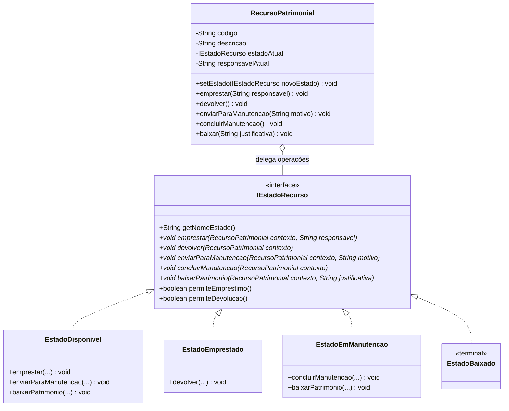
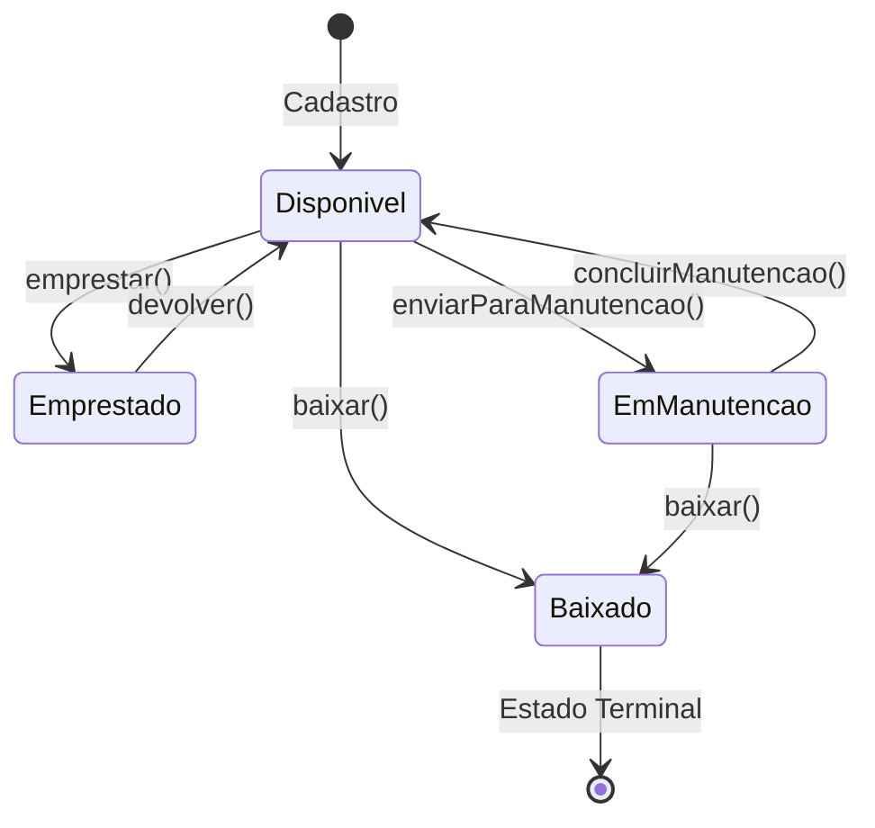

# Guia 25 — Padrão GoF State: Máquina de Estados Finita e Ciclo de Vida de Entidades de Domínio

## 1. O Problema das "Flags Booleanas Espalhadas"
Em sistemas corporativos e acadêmicos, é extremamente comum encontrar entidades de domínio modeladas com múltiplos atributos booleanos para representar seu status operacional:

```java
// ❌ ANTI-PATTERN: Explosão combinatória de flags booleanas
public class RecursoEquipamento {
    private boolean emprestado;
    private boolean emManutencao;
    private boolean atrasado;
    private boolean baixado;
    private boolean reservado;
    
    public void devolver() {
        if (this.emprestado && !this.emManutencao && !this.baixado) {
            this.emprestado = false;
        } else if (this.baixado) {
            throw new IllegalStateException("Item baixado do patrimônio!");
        } // ... cadeias gigantescas e propensas a bugs
    }
}
```

### Por que esse design quebra em produção?
1. **Estados Impossíveis:** Nada impede que um programador acidentalmente atribua `emprestado = true` e `emManutencao = true` simultaneamente. O objeto entra em um estado contraditório e inválido.
2. **Violação do Princípio Aberto/Fechado (OCP):** Cada novo status (ex.: `EM_QUARANTENA` ou `EM_AUDITORIA`) exige alterar dezenas de métodos com novos `if/else`.
3. **Complexidade Ciclomática Alta:** Os métodos ficam poluídos com validações defensivas repetitivas.

### A Solução da Engenharia: Padrão GoF State
O **Padrão State** encapsula o comportamento associado a cada estado em uma classe separada, transformando o ciclo de vida da entidade em uma **Máquina de Estados Finita (FSM - Finite State Machine)** estritamente tipada e polimórfica.

---

## 2. Diagrama de Classes e Arquitetura Conceitual



### Ciclo de Transições Válidas


---

## 3. Implementação Passo a Passo em Java 21

### 3.1 Exceção Checada de Transição Ilegal
```java
public class TransicaoEstadoInvalidaException extends Exception {
    public TransicaoEstadoInvalidaException(String mensagem) {
        super(mensagem);
    }
}
```

### 3.2 O Contrato do Estado (`IEstadoRecurso.java`)
Usamos métodos default para fornecer rejeição padrão com mensagem amigável, permitindo que cada estado concreto sobrescreva apenas as transições que autoriza:

```java
public interface IEstadoRecurso {
    String getNomeEstado();
    
    default void emprestar(RecursoPatrimonial ctx, String responsavel) throws TransicaoEstadoInvalidaException {
        throw new TransicaoEstadoInvalidaException(
            String.format("Operação de empréstimo não permitida no estado atual: [%s]", getNomeEstado()));
    }

    default void devolver(RecursoPatrimonial ctx) throws TransicaoEstadoInvalidaException {
        throw new TransicaoEstadoInvalidaException(
            String.format("Operação de devolução não permitida no estado atual: [%s]", getNomeEstado()));
    }

    default void enviarParaManutencao(RecursoPatrimonial ctx, String motivo) throws TransicaoEstadoInvalidaException {
        throw new TransicaoEstadoInvalidaException(
            String.format("Envio para manutenção não permitido no estado atual: [%s]", getNomeEstado()));
    }

    default void concluirManutencao(RecursoPatrimonial ctx) throws TransicaoEstadoInvalidaException {
        throw new TransicaoEstadoInvalidaException(
            String.format("Conclusão de manutenção não permitida no estado atual: [%s]", getNomeEstado()));
    }

    default void baixarPatrimonio(RecursoPatrimonial ctx, String justificativa) throws TransicaoEstadoInvalidaException {
        throw new TransicaoEstadoInvalidaException(
            String.format("Baixa patrimonial não permitida no estado atual: [%s]", getNomeEstado()));
    }

    boolean permiteEmprestimo();
    boolean permiteDevolucao();
}
```

### 3.3 Estados Concretos
```java
public final class EstadoDisponivel implements IEstadoRecurso {
    @Override
    public String getNomeEstado() { return "DISPONÍVEL"; }

    @Override
    public void emprestar(RecursoPatrimonial ctx, String responsavel) {
        ctx.setResponsavelAtual(responsavel);
        ctx.setEstado(new EstadoEmprestado());
    }

    @Override
    public void enviarParaManutencao(RecursoPatrimonial ctx, String motivo) {
        ctx.setUltimoMotivoManutencao(motivo);
        ctx.setEstado(new EstadoEmManutencao());
    }

    @Override
    public void baixarPatrimonio(RecursoPatrimonial ctx, String justificativa) {
        ctx.setJustificativaBaixa(justificativa);
        ctx.setEstado(new EstadoBaixado());
    }

    @Override
    public boolean permiteEmprestimo() { return true; }

    @Override
    public boolean permiteDevolucao() { return false; }
}

public final class EstadoEmprestado implements IEstadoRecurso {
    @Override
    public String getNomeEstado() { return "EMPRESTADO"; }

    @Override
    public void devolver(RecursoPatrimonial ctx) {
        ctx.setResponsavelAtual(null);
        ctx.setEstado(new EstadoDisponivel());
    }

    @Override
    public boolean permiteEmprestimo() { return false; }

    @Override
    public boolean permiteDevolucao() { return true; }
}
```

---

## 4. Integração Reativa com a Interface JavaFX
No JavaFX, os botões de ação e itens de menu devem refletir dinamicamente as operações válidas para o item atualmente selecionado na `TableView`:

```java
// No Controlador JavaFX:
tabelaRecursos.getSelectionModel().selectedItemProperty().addListener((obs, antigo, selecionado) -> {
    if (selecionado == null) {
        btnEmprestar.setDisable(true);
        btnDevolver.setDisable(true);
        btnManutencao.setDisable(true);
        lblStatusBadge.setText("NENHUM ITEM SELECIONADO");
        return;
    }

    IEstadoRecurso estado = selecionado.getEstado();
    btnEmprestar.setDisable(!estado.permiteEmprestimo());
    btnDevolver.setDisable(!estado.permiteDevolucao());
    btnManutencao.setDisable(!estado.getNomeEstado().equals("DISPONÍVEL"));
    
    lblStatusBadge.setText(estado.getNomeEstado());
});
```

---

## 5. Armadilhas Comuns (*Common Pitfalls*)

| Armadilha | Consequência | Como Evitar |
| :--- | :--- | :--- |
| **Persistir o objeto Estado direto em CSV** | Nomes de classes e referências em memória são salvos no arquivo (`EstadoDisponivel@4f2`), quebrando a restauração. | Na persistência, salve apenas a chave textual padronizada (ex.: `"DISPONIVEL"`) e use um método de fábrica (`EstadoFactory.criar(string)`) ao ler do CSV. |
| **Permitir que o Controlador altere o estado livremente** | O controlador chama `item.setEstado(novoEstado)` pulando as validações de transição. | Torne o método `setEstado(...)` com visibilidade de pacote (*package-private*), permitindo que apenas os objetos de estado concretos façam a transição no contexto. |
| **Estados com estado interno não limpo** | Transitar de "Emprestado" para "Disponível" sem limpar a matrícula do responsável mantém referências fantasmas. | A transição de estado deve atualizar os atributos complementares do contexto (`ctx.setResponsavel(null)`). |

---

## 6. Defesa em Banca Avaliadora

> **Pergunta:** *"Por que você usou o Padrão State em vez de um simples Enum com switch-case?"*
>
> **Resposta:**
> *"Com um Enum e switch-case, cada operação de negócio (emprestar, devolver, manutenção) precisaria de um switch que analisa todos os valores do enum, espalhando a lógica em dezenas de lugares. Se um novo estado for criado no futuro, corremos o risco de esquecer de tratar esse estado em algum dos switches espalhados pelo código.*
> 
> *Com o Padrão GoF State, todo o comportamento, regras e transições de um estado específico ficam agrupados em uma única classe coesa. Adicionar um novo estado respeita o Princípio Aberto/Fechado (OCP): basta criar uma nova classe implementando `IEstadoRecurso` sem tocar nas classes dos estados já existentes e testados."*
