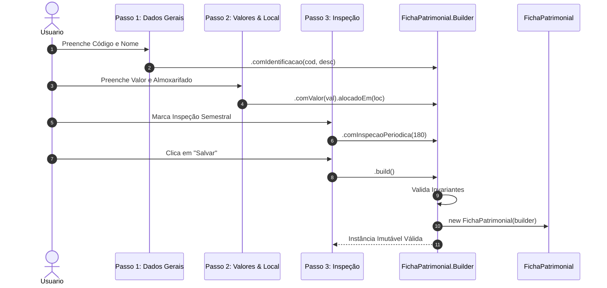

# Guia 26 — Padrão GoF Builder: Validação de Invariantes, Imutabilidade e Formulários Wizard no JavaFX

## 1. Por que Construtores Gigantes e Setters Quebram a POO?
Ao modelar entidades de negócio ricas (como contratos de empréstimo, fichas técnicas de equipamentos ou cadastros de laboratório), é comum deparar-se com duas abordagens perigosas:

### Abordagem Ruim 1: Construtores Telescópicos (*Telescoping Constructors*)
```java
// ❌ ANTI-PATTERN: Impossível de ler, propenso a inversão de parâmetros do mesmo tipo
public FichaEquipamento(String codigo, String nome, String fabricante, String modelo, 
                        BigDecimal valor, LocalDate dataAquisicao, String numeroSerie, 
                        String setor, boolean requerCalibracao, int periodicidadeDias) { ... }
```
- Se dois parâmetros forem do mesmo tipo (ex.: `fabricante` e `modelo`, ou `codigo` e `numeroSerie`), o compilador aceita trocas acidentais de ordem sem alertar nenhum erro.

### Abordagem Ruim 2: Construtor Vazio + Dezenas de Setters Mutáveis
```java
// ❌ ANTI-PATTERN: O objeto nasce incompleto e qualquer classe pode corrompê-lo
FichaEquipamento ficha = new FichaEquipamento();
ficha.setCodigo("EQ-01");
// E se o desenvolvedor esquecer de chamar ficha.setNome(...) e passar o objeto para salvar?
```
- Viola o princípio fundamental do encapsulamento: **nenhum objeto de domínio deve existir em estado inválido na memória**.

---

## 2. A Solução: Padrão GoF Builder com Fluent API

O **Padrão Builder** resolve esses problemas com:
1. **Construtor da Entidade Privado:** Apenas o Builder tem autorização para instanciar a entidade.
2. **Métodos Encadeados (*Fluent Interface*):** Métodos autoexplicativos como `.comCodigo("...")`, `.adquiridoEm(...)`.
3. **Validação Atômica no `.build()`:** Todas as invariantes obrigatórias e regras de consistência mútua são validadas de uma única vez antes de entregar a instância imutável.

---

## 3. Diagrama de Classes e Arquitetura Conceitual

```mermaid
classDiagram
    class FichaPatrimonial {
        -String codigoPatrimonio
        -String descricao
        -String categoria
        -BigDecimal valorAquisicao
        -LocalDate dataAquisicao
        -String numeroSerie
        -String localizacaoFisica
        -boolean requerInspecaoPeriodica
        -Integer intervaloInspecaoDias
        -FichaPatrimonial(Builder builder)
        +builder() Builder$
        +getCodigoPatrimonio() String
        +getDescricao() String
        +getValorAquisicao() BigDecimal
        +requerInspecaoPeriodica() boolean
    }

    class Builder {
        -String codigoPatrimonio
        -String descricao
        -String categoria
        -BigDecimal valorAquisicao
        -LocalDate dataAquisicao
        -String numeroSerie
        -String localizacaoFisica
        -boolean requerInspecaoPeriodica
        -Integer intervaloInspecaoDias
        +comIdentificacao(String codigo, String descricao) Builder
        +naCategoria(String categoria) Builder
        +comValorAquisicao(BigDecimal valor) Builder
        +adquiridoEm(LocalDate data) Builder
        +comNumeroSerie(String serial) Builder
        +alocadoEm(String local) Builder
        +comInspecaoPeriodica(int intervaloDias) Builder
        +semInspecao() Builder
        +build() FichaPatrimonial
    }

    FichaPatrimonial +-- Builder : static nested class
```

---

## 4. Implementação Passo a Passo em Java 21

```java
public final class FichaPatrimonial {

    private final String codigoPatrimonio;
    private final String descricao;
    private final String categoria;
    private final BigDecimal valorAquisicao;
    private final LocalDate dataAquisicao;
    private final String numeroSerie;
    private final String localizacaoFisica;
    private final boolean requerInspecaoPeriodica;
    private final Integer intervaloInspecaoDias;

    // Construtor PRIVADO: garante que NINGUÉM construa sem passar pelo Builder
    private FichaPatrimonial(Builder builder) {
        this.codigoPatrimonio = builder.codigoPatrimonio;
        this.descricao = builder.descricao;
        this.categoria = builder.categoria;
        this.valorAquisicao = builder.valorAquisicao;
        this.dataAquisicao = builder.dataAquisicao;
        this.numeroSerie = builder.numeroSerie;
        this.localizacaoFisica = builder.localizacaoFisica;
        this.requerInspecaoPeriodica = builder.requerInspecaoPeriodica;
        this.intervaloInspecaoDias = builder.intervaloInspecaoDias;
    }

    public static Builder builder() {
        return new Builder();
    }

    // Getters imutáveis
    public String getCodigoPatrimonio() { return codigoPatrimonio; }
    public String getDescricao() { return descricao; }
    public String getCategoria() { return categoria; }
    public BigDecimal getValorAquisicao() { return valorAquisicao; }
    public LocalDate getDataAquisicao() { return dataAquisicao; }
    public Optional<String> getNumeroSerie() { return Optional.ofNullable(numeroSerie); }
    public String getLocalizacaoFisica() { return localizacaoFisica; }
    public boolean isRequerInspecaoPeriodica() { return requerInspecaoPeriodica; }
    public Optional<Integer> getIntervaloInspecaoDias() { return Optional.ofNullable(intervaloInspecaoDias); }

    // BUILDER ESTÁTICO EMBUTIDO
    public static final class Builder {
        private String codigoPatrimonio;
        private String descricao;
        private String categoria = "GERAL"; // Valor default seguro
        private BigDecimal valorAquisicao = BigDecimal.ZERO;
        private LocalDate dataAquisicao = LocalDate.now();
        private String numeroSerie;
        private String localizacaoFisica = "Almoxarifado Principal";
        private boolean requerInspecaoPeriodica = false;
        private Integer intervaloInspecaoDias;

        public Builder comIdentificacao(String codigo, String descricao) {
            this.codigoPatrimonio = codigo;
            this.descricao = descricao;
            return this;
        }

        public Builder naCategoria(String categoria) {
            this.categoria = categoria;
            return this;
        }

        public Builder comValor(BigDecimal valor) {
            this.valorAquisicao = valor;
            return this;
        }

        public Builder adquiridoEm(LocalDate data) {
            this.dataAquisicao = data;
            return this;
        }

        public Builder comNumeroSerie(String serial) {
            this.numeroSerie = serial;
            return this;
        }

        public Builder alocadoEm(String local) {
            this.localizacaoFisica = local;
            return this;
        }

        public Builder comInspecaoPeriodica(int intervaloDias) {
            if (intervaloDias <= 0) {
                throw new IllegalArgumentException("Intervalo de inspeção deve ser positivo.");
            }
            this.requerInspecaoPeriodica = true;
            this.intervaloInspecaoDias = intervaloDias;
            return this;
        }

        public FichaPatrimonial build() {
            // VALIDAÇÃO DAS INVARIANTES ATÔMICAS DE NEGÓCIO
            if (codigoPatrimonio == null || codigoPatrimonio.isBlank()) {
                throw new IllegalStateException("Código patrimonial é obrigatório para construção do recurso.");
            }
            if (descricao == null || descricao.isBlank()) {
                throw new IllegalStateException("Descrição do recurso não pode ser vazia.");
            }
            if (valorAquisicao == null || valorAquisicao.compareTo(BigDecimal.ZERO) < 0) {
                throw new IllegalStateException("Valor de aquisição não pode ser nulo ou negativo.");
            }
            if (dataAquisicao == null || dataAquisicao.isAfter(LocalDate.now())) {
                throw new IllegalStateException("Data de aquisição não pode estar no futuro.");
            }
            if (requerInspecaoPeriodica && (intervaloInspecaoDias == null || intervaloInspecaoDias <= 0)) {
                throw new IllegalStateException("Equipamentos que requerem inspeção devem possuir periodicidade definida.");
            }

            return new FichaPatrimonial(this);
        }
    }
}
```

---

## 5. Aplicação no JavaFX: Formulários em Etapas (*Wizards*)
Em interfaces ricas com múltiplos passos de cadastro (ex.: Aba 1: Dados Gerais ➔ Aba 2: Valores & Localização ➔ Aba 3: Calibração e Garantia):
- Cada etapa do Wizard coleta suas informações e as armazena em uma instância intermediária de `FichaPatrimonial.Builder`.
- Na última tela (botão **"Concluir Cadastro"**), invoca-se `.build()`. Se alguma informação faltar, a exceção é tratada e o usuário é orientado com precisão.



---

## 6. Armadilhas Comuns (*Common Pitfalls*)

| Armadilha | Consequência | Como Evitar |
| :--- | :--- | :--- |
| **Permitir construtor público na entidade** | Usuários da classe ignoram o Builder e chamam o construtor direto sem validações. | Torne o construtor da entidade estritamente `private`. |
| **Reaproveitar o mesmo Builder para múltiplos objetos** | Mutação acidental dos dados de um objeto ao construir o próximo. | Crie um novo Builder para cada construção ou implemente cópia defensiva. |
| **Validar apenas nos métodos fluentes e não no `build()`** | Se o chamador esquecer de chamar um método obrigatório (ex.: `comIdentificacao`), o objeto nasce sem campos essenciais. | Os métodos fluentes guardam valores; a validação das combinações de campos obrigatórios ocorre no `build()`. |

---

## 7. Defesa em Banca Avaliadora

> **Pergunta:** *"Por que não utilizar anotações como `@Builder` do Lombok em vez de escrever o Builder manualmente?"*
>
> **Resposta:**
> *"Em projetos acadêmicos e em arquiteturas com enunciados rígidos que proíbem bibliotecas externas ou geração mágica de bytecode via processadores de anotação, o Builder escrito em Java puro garante conformidade total com os requisitos. Além disso, o Builder manual nos permite embutir validações semânticas e consistência cruzada no método `.build()`, assegurando que entidades nunca existam em estado inválido na memória da JVM."*
