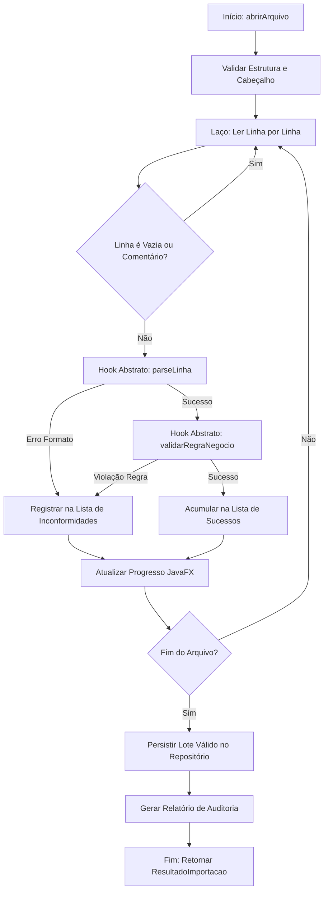
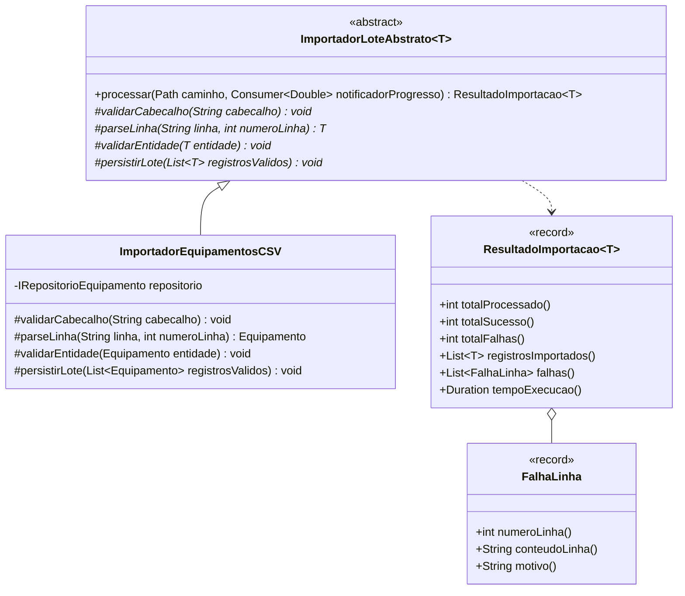

# Guia 27 — Padrão GoF Template Method: Processamento e Importação em Lote Resiliente no JavaFX

## 1. O Desafio da Importação de Dados em Lote (*Batch Processing*)
Em aplicações desktop de gestão patrimonial e laboratorial, a importação de dados externos (arquivos CSV, relatórios legados ou planilhas) é um requisito essencial. No entanto, implementações ingênuas sofrem de problemas crônicos:

1. **Falha Catastrófica no Primeiro Erro:** Se a linha 42 de um arquivo de 500 linhas tiver uma vírgula no lugar de ponto em um número, uma exceção é disparada e toda a importação é interrompida.
2. **Inconsistência de Estado (Persistência Parcial):** As primeiras 41 linhas foram salvas, mas o usuário não sabe quais foram e quais faltam, gerando dados duplicados em tentativas futuras.
3. **Falta de Feedback Visual:** O processo roda na UI Thread, travando o cursor do mouse e sem exibir uma barra de progresso.

---

## 2. A Solução: Padrão GoF Template Method
O **Padrão Template Method** define o esqueleto invariante de um algoritmo em uma superclasse abstrata, delegando etapas variáveis (como o parsing específico e validações de domínio) para subclasses concretas, sem alterar a estrutura do fluxo geral de execução.

### Estrutura do Algoritmo Invariante


---

## 3. Diagrama de Classes e Arquitetura Conceitual



---

## 4. Implementação Passo a Passo em Java 21

### 4.1 Registros de Resultado e Inconformidades (Records Modernos)
```java
public record FalhaLinha(int numeroLinha, String linhaOriginal, String motivo) {}

public record ResultadoImportacao<T>(
    int totalProcessadas,
    List<T> registrosImportados,
    List<FalhaLinha> falhas,
    long tempoExecucaoMs
) {
    public int totalSucesso() { return registrosImportados.size(); }
    public int totalFalhas() { return falhas.size(); }
    public double taxaAproveitamento() {
        return totalProcessadas == 0 ? 0.0 : ((double) totalSucesso() / totalProcessadas) * 100.0;
    }
}
```

### 4.2 Superclasse Template Method (`ImportadorLoteAbstrato.java`)
```java
public abstract class ImportadorLoteAbstrato<T> {

    // O TEMPLATE METHOD (Esqueleto do Algoritmo)
    public final ResultadoImportacao<T> processar(Path arquivo, Consumer<Double> callbackProgresso) throws IOException {
        Objects.requireNonNull(arquivo, "Arquivo de importação não pode ser nulo.");
        if (!Files.exists(arquivo)) {
            throw new FileNotFoundException("Arquivo não encontrado: " + arquivo.toAbsolutePath());
        }

        long inicio = System.currentTimeMillis();
        List<String> linhas = Files.readAllLines(arquivo, StandardCharsets.UTF_8);
        if (linhas.isEmpty()) {
            return new ResultadoImportacao<>(0, List.of(), List.of(), 0);
        }

        // 1. Valida cabeçalho através do hook da subclasse
        validarCabecalho(linhas.getFirst());

        List<T> registrosValidos = new ArrayList<>();
        List<FalhaLinha> falhas = new ArrayList<>();
        int totalLinhasDados = linhas.size() - 1;

        // 2. Itera sobre as linhas de dados isolando erros de forma resiliente
        for (int i = 1; i < linhas.size(); i++) {
            int numLinha = i + 1;
            String linha = linhas.get(i).trim();

            if (linha.isBlank() || linha.startsWith("#")) {
                continue;
            }

            try {
                // Etapa variável A: Parse específico
                T entidade = parseLinha(linha, numLinha);
                
                // Etapa variável B: Validação de regras de negócio
                validarEntidade(entidade);

                registrosValidos.add(entidade);
            } catch (Exception ex) {
                // Captura e cataloga a falha sem interromper as outras linhas!
                falhas.add(new FalhaLinha(numLinha, linha, ex.getMessage()));
            }

            // Notifica progresso para a UI (se callback fornecido)
            if (callbackProgresso != null && totalLinhasDados > 0) {
                callbackProgresso.accept((double) i / totalLinhasDados);
            }
        }

        // 3. Persistência atômica dos registros válidos
        if (!registrosValidos.isEmpty()) {
            persistirLote(registrosValidos);
        }

        long tempoGasto = System.currentTimeMillis() - inicio;
        return new ResultadoImportacao<>(totalLinhasDados, 
                Collections.unmodifiableList(registrosValidos), 
                Collections.unmodifiableList(falhas), 
                tempoGasto);
    }

    // MÉTODOS PRIMITIVOS E HOOKS IMPLEMENTADOS PELAS SUBCLASSES
    protected abstract void validarCabecalho(String cabecalho) throws IOException;
    protected abstract T parseLinha(String linha, int numeroLinha) throws Exception;
    protected abstract void validarEntidade(T entidade) throws Exception;
    protected abstract void persistirLote(List<T> registros) throws IOException;
}
```

---

## 5. Integração com a UI JavaFX via `Task<V>`
Para manter a aplicação responsiva durante a leitura de arquivos volumosos:

```java
Task<ResultadoImportacao<Equipamento>> task = new Task<>() {
    @Override
    protected ResultadoImportacao<Equipamento> call() throws Exception {
        updateMessage("Lendo e validando registros em lote...");
        return importador.processar(caminhoArquivo, progresso -> {
            updateProgress(progresso, 1.0);
        });
    }
};

progressBar.progressProperty().bind(task.progressProperty());
lblStatus.textProperty().bind(task.messageProperty());

task.setOnSucceeded(e -> {
    ResultadoImportacao<Equipamento> resultado = task.getValue();
    exibirResumoImportacao(resultado);
});

task.setOnFailed(e -> {
    AlertHelper.mostrarErro("Falha Crítica na Importação", task.getException().getMessage());
});

new Thread(task).start();
```

---

## 6. Armadilhas Comuns (*Common Pitfalls*)

| Armadilha | Consequência | Como Evitar |
| :--- | :--- | :--- |
| **Não declarar o Template Method como `final`** | Subclasses sobrescrevem o método `processar(...)` quebrando a ordem do algoritmo e o isolamento de erros. | Declare sempre `public final ResultadoImportacao<T> processar(...)`. |
| **Comitar dados no banco/arquivo a cada linha** | Se ocorrer queda de energia ou cancelamento no meio, metade dos dados fica gravada e a outra metade não. | Acumule primeiro todos os registros válidos e execute uma gravação em lote atômica ao final. |
| **Ignorar o número da linha original no log de erros** | O usuário recebe "Valor inválido", mas não sabe em qual das 1.000 linhas da planilha está o erro. | Guarde explicitamente `numLinha` na classe `FalhaLinha`. |

---

## 7. Defesa em Banca Avaliadora

> **Pergunta:** *"Qual a diferença prática entre o Padrão Template Method e o Padrão Strategy neste cenário?"*
>
> **Resposta:**
> *"O Padrão Strategy utiliza composição: injetamos uma estratégia independente para alterar um algoritmo por inteiro. Já o Padrão Template Method utiliza herança: ele fixa o esqueleto invariante do fluxo de controle (abertura de arquivo, laço de repetição resiliente, auditoria de falhas e notificação de progresso na superclasse) e permite que as subclasses personalizem apenas passos específicos (hooks), como o formato de cada linha ou a regra de validação da entidade."*
