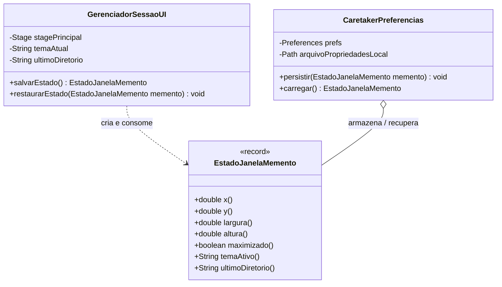

# Guia 28 — Padrão GoF Memento: Persistência de Preferências, Estado de Janela e Sessão de Usuário no JavaFX

## 1. Por que a Persistência de Sessão e Preferências é Crucial?
Em aplicações desktop profissionais, uma das experiências de usuário mais frustrantes ocorre quando:
- O usuário ajusta as dimensões da janela para seu monitor ultrawide, seleciona o Tema Escuro e define seu diretório padrão de trabalho;
- Ao fechar e reabrir o sistema, a janela reabre minúscula no canto superior esquerdo, com o Tema Claro e no diretório raiz do sistema operacional.

O software de nível de produção deve ser capaz de **capturar o estado da interface**, persistir essas preferências de forma limpa e **restaurar a sessão** na próxima inicialização, sem quebrar o desacoplamento arquitetural.

---

## 2. A Solução: Padrão GoF Memento

O **Padrão Memento** permite capturar e externalizar o estado interno de um objeto (o *Originator*) em um snapshot opaco (o *Memento*), que é gerenciado e persistido por um guardião (*Caretaker*), sem violar o encapsulamento.

### Papéis no Padrão:
1. **Originator (Gerador do Estado):** O controlador ou gerenciador de tela que conhece os detalhes do `Stage` e dos controles visuais.
2. **Memento (Snapshot Imutável):** Objeto contendo os dados de estado (coordenadas X/Y, largura/altura, maximizado, tema ativo, último diretório). No Java 21, modelado idealmente como um `record`.
3. **Caretaker (Guardião da Persistência):** Classe responsável por salvar e recarregar os snapshots utilizando a API nativa `java.util.prefs.Preferences` ou arquivos `.properties` no diretório do usuário (`$HOME/.meuapp/preferences.properties`).

---

## 3. Diagrama de Classes e Arquitetura Conceitual



---

## 4. Implementação Passo a Passo em Java 21

### 4.1 O Memento Imutável (`EstadoJanelaMemento.java`)
```java
public record EstadoJanelaMemento(
    double x,
    double y,
    double largura,
    double altura,
    boolean maximizado,
    String temaAtivo,
    String ultimoDiretorio
) {
    public static EstadoJanelaMemento padrao() {
        return new EstadoJanelaMemento(100.0, 100.0, 1024.0, 768.0, false, "CLARO", System.getProperty("user.home"));
    }
}
```

### 4.2 O Guardião de Preferências (`CaretakerPreferencias.java`)
Utilizamos a API padrão do JDK `java.util.prefs.Preferences`, que armazena dados de configuração no registro nativo do sistema operacional (Windows Registry ou diretório `~/.java/.userPrefs` no Linux/macOS) sem dependências externas:

```java
public final class CaretakerPreferencias {

    private static final String CHAVE_X = "janela_x";
    private static final String CHAVE_Y = "janela_y";
    private static final String CHAVE_LARGURA = "janela_largura";
    private static final String CHAVE_ALTURA = "janela_altura";
    private static final String CHAVE_MAXIMIZADO = "janela_maximizado";
    private static final String CHAVE_TEMA = "app_tema";
    private static final String CHAVE_DIR = "app_ultimo_dir";

    private final Preferences prefs;

    public CaretakerPreferencias(Class<?> classeRaiz) {
        this.prefs = Preferences.userNodeForPackage(classeRaiz);
    }

    public void salvar(EstadoJanelaMemento memento) {
        if (memento == null) return;
        
        // Evita salvar coordenadas inválidas (ex: se a janela foi minimizada antes de fechar)
        if (!memento.maximizado() && memento.largura() > 200 && memento.altura() > 200) {
            prefs.putDouble(CHAVE_X, memento.x());
            prefs.putDouble(CHAVE_Y, memento.y());
            prefs.putDouble(CHAVE_LARGURA, memento.largura());
            prefs.putDouble(CHAVE_ALTURA, memento.altura());
        }
        
        prefs.putBoolean(CHAVE_MAXIMIZADO, memento.maximizado());
        prefs.put(CHAVE_TEMA, memento.temaAtivo());
        prefs.put(CHAVE_DIR, memento.ultimoDiretorio());
        
        try {
            prefs.flush();
        } catch (BackingStoreException e) {
            System.err.println("Aviso: Não foi possível descarregar preferências: " + e.getMessage());
        }
    }

    public EstadoJanelaMemento carregar() {
        EstadoJanelaMemento padrao = EstadoJanelaMemento.padrao();
        
        double x = prefs.getDouble(CHAVE_X, padrao.x());
        double y = prefs.getDouble(CHAVE_Y, padrao.y());
        double largura = prefs.getDouble(CHAVE_LARGURA, padrao.largura());
        double altura = prefs.getDouble(CHAVE_ALTURA, padrao.altura());
        boolean maximizado = prefs.getBoolean(CHAVE_MAXIMIZADO, padrao.maximizado());
        String tema = prefs.get(CHAVE_TEMA, padrao.temaAtivo());
        String dir = prefs.get(CHAVE_DIR, padrao.ultimoDiretorio());

        return new EstadoJanelaMemento(x, y, largura, altura, maximizado, tema, dir);
    }
}
```

---

## 5. Integração com o Ciclo de Vida da Aplicação JavaFX
A restauração do Memento ocorre no método `start(Stage)` e a captura automática ocorre no evento `setOnCloseRequest`:

```java
public class AppJavaFX extends Application {

    private CaretakerPreferencias caretaker;

    @Override
    public void init() {
        caretaker = new CaretakerPreferencias(AppJavaFX.class);
    }

    @Override
    public void start(Stage primaryStage) throws Exception {
        // 1. Carrega o snapshot da sessão anterior
        EstadoJanelaMemento estadoSalvo = caretaker.carregar();

        FXMLLoader loader = new FXMLLoader(getClass().getResource("/fxml/JanelaPrincipal.fxml"));
        Parent root = loader.load();
        Scene scene = new Scene(root);

        // 2. Aplica dimensões e posições restauradas
        primaryStage.setScene(scene);
        primaryStage.setX(estadoSalvo.x());
        primaryStage.setY(estadoSalvo.y());
        primaryStage.setWidth(estadoSalvo.largura());
        primaryStage.setHeight(estadoSalvo.altura());
        primaryStage.setMaximized(estadoSalvo.maximizado());

        // 3. Registra gancho automático de salvamento ao fechar
        primaryStage.setOnCloseRequest(event -> {
            EstadoJanelaMemento mementoAtual = new EstadoJanelaMemento(
                    primaryStage.getX(),
                    primaryStage.getY(),
                    primaryStage.getWidth(),
                    primaryStage.getHeight(),
                    primaryStage.isMaximized(),
                    obterTemaAtual(),
                    obterUltimoDiretorio()
            );
            caretaker.salvar(mementoAtual);
        });

        primaryStage.show();
    }
}
```

---

## 6. Armadilhas Comuns (*Common Pitfalls*)

| Armadilha | Consequência | Como Evitar |
| :--- | :--- | :--- |
| **Salvar coordenadas negativas quando a janela está minimizada** | Ao reabrir, a janela fica invisível fora da área visível do monitor (`x = -32000`). | Verifique se `stage.isIconified()` é falso e valide que `x >= 0 && y >= 0` antes de gravar. |
| **Armazenar credenciais de autenticação no Memento** | Senhas salvas em texto claro no `Preferences` configuram brecha de segurança grave. | Persista apenas preferências de apresentação e layout; dados sensíveis pertencem a cofres seguros. |
| **Poluir controladores FXML com I/O de disco** | O controlador fica acoplado a caminhos de arquivos e APIs de preferências do sistema operacional. | Utilize a classe `Caretaker` intermediária respeitando o Princípio da Responsabilidade Única (SRP). |

---

## 7. Defesa em Banca Avaliadora

> **Pergunta:** *"Por que não utilizar um simples arquivo `.json` ou `Properties` embutido no projeto para salvar essas configurações?"*
>
> **Resposta:**
> *"Arquivos embutidos dentro do JAR ou do classpath do projeto são somente-leitura após o empacotamento. Gravar dentro da pasta do executável pode falhar em ambientes com permissões restritas (como `C:\Program Files` ou `/usr/bin`). A API padrão `java.util.prefs.Preferences` resolve isso nativamente gravando as preferências no perfil isolado de cada usuário do sistema operacional, sem risco de permissão negada e sem necessitar de bibliotecas externas de terceiros."*
