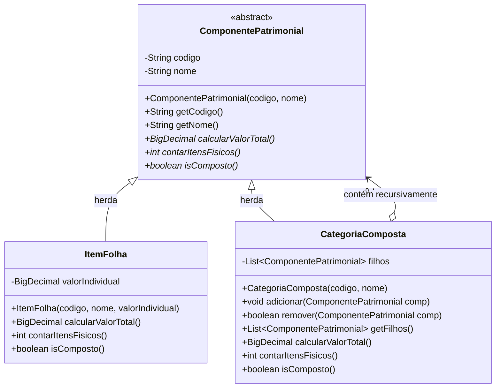

# Guia 29 — Padrão GoF Composite: Hierarquias de Domínio e TreeView no JavaFX

## 1. O Problema das Hierarquias de Domínio Não Uniformes
Em sistemas de gestão patrimonial, acadêmica ou corporativa, recursos e itens físicos frequentemente pertencem a uma estrutura organizacional hierárquica em árvore:
- **Campus** contém **Diretorias/Departamentos**.
- **Departamentos** contêm **Laboratórios**.
- **Laboratórios** contêm **Equipamentos Individuais** e **Subcategorias de Conectividade**.

```text
Campus Central XIUD
└── Laboratório de Informática
    ├── Workstation Dell i7 (R$ 7.500,00)
    ├── Servidor PowerEdge (R$ 28.000,00)
    └── Infraestrutura de Conectividade
        ├── Switch 48p PoE (R$ 4.200,00)
        └── Roteador de Borda (R$ 2.300,00)
```

### O Anti-Pattern: Tratar Folhas e Grupos com Classes Separadas sem Polimorfismo
Quando tentamos modelar isso sem um padrão estrutural, os desenvolvedores criam uma classe `Equipamento` e outra classe `Departamento`, com assinaturas totalmente distintas:
```java
// ❌ ANTI-PATTERN: Falta de polimorfismo hierárquico
public class Departamento {
    private List<Equipamento> itens;
    private List<Departamento> subdepartamentos;
    
    // Obriga o cliente a fazer laços duplos e tratar cada tipo manualmente
    public BigDecimal somarTudo() {
        BigDecimal total = BigDecimal.ZERO;
        for (Equipamento e : itens) total = total.add(e.getPreco());
        for (Departamento d : subdepartamentos) total = total.add(d.somarTudo());
        return total;
    }
}
```

### A Solução da Engenharia: Padrão GoF Composite
O **Padrão Composite** permite compor objetos em estruturas em árvore para representar hierarquias parte-todo. Ele permite que os clientes tratem objetos individuais (**Folhas**) e composições de objetos (**Compostos**) de maneira **completamente uniforme**.

Ambos compartilham o mesmo contrato abstrato (`ComponentePatrimonial`). Uma operação como `calcularValorTotal()` ou `contarItensFisicos()` é executada recursivamente por toda a árvore sem que o chamador precise saber se o nó em que clicou é um único item ou um departamento inteiro.

---

## 2. Diagrama de Classes e Arquitetura Conceitual



---

## 3. O Código Prático e Didático

### 3.1. O Contrato Base Abstrato (`Component`)
```java
public abstract class ComponentePatrimonial {
    private final String codigo;
    private final String nome;

    public ComponentePatrimonial(String codigo, String nome) {
        if (codigo == null || codigo.isBlank()) throw new IllegalArgumentException("Código obrigatório");
        if (nome == null || nome.isBlank()) throw new IllegalArgumentException("Nome obrigatório");
        this.codigo = codigo.trim();
        this.nome = nome.trim();
    }

    public String getCodigo() { return codigo; }
    public String getNome() { return nome; }

    public abstract BigDecimal calcularValorTotal();
    public abstract int contarItensFisicos();
    public abstract boolean isComposto();
}
```

### 3.2. O Nó Folha (`Leaf`)
```java
public final class ItemFolha extends ComponentePatrimonial {
    private final BigDecimal valorIndividual;

    public ItemFolha(String codigo, String nome, BigDecimal valorIndividual) {
        super(codigo, nome);
        if (valorIndividual == null || valorIndividual.compareTo(BigDecimal.ZERO) < 0) {
            throw new IllegalArgumentException("Valor não pode ser negativo");
        }
        this.valorIndividual = valorIndividual;
    }

    @Override
    public BigDecimal calcularValorTotal() {
        return valorIndividual;
    }

    @Override
    public int contarItensFisicos() {
        return 1;
    }

    @Override
    public boolean isComposto() {
        return false;
    }
}
```

### 3.3. O Nó Composto (`Composite`) com Proteção Anti-Loop
```java
public final class CategoriaComposta extends ComponentePatrimonial {
    private final List<ComponentePatrimonial> filhos = new ArrayList<>();

    public CategoriaComposta(String codigo, String nome) {
        super(codigo, nome);
    }

    public void adicionar(ComponentePatrimonial comp) {
        Objects.requireNonNull(comp, "Componente não pode ser nulo");
        if (comp == this) {
            throw new IllegalArgumentException("Um nó composto não pode conter a si mesmo.");
        }
        filhos.add(comp);
    }

    public List<ComponentePatrimonial> getFilhos() {
        return Collections.unmodifiableList(filhos);
    }

    @Override
    public BigDecimal calcularValorTotal() {
        BigDecimal soma = BigDecimal.ZERO;
        for (ComponentePatrimonial f : filhos) {
            soma = soma.add(f.calcularValorTotal());
        }
        return soma;
    }

    @Override
    public int contarItensFisicos() {
        int total = 0;
        for (ComponentePatrimonial f : filhos) {
            total += f.contarItensFisicos();
        }
        return total;
    }

    @Override
    public boolean isComposto() {
        return true;
    }
}
```

---

## 4. Integração Reativa com JavaFX `TreeView` e `TreeCell` Customizado

No JavaFX, o controle nativo para exibir hierarquias é o `javafx.scene.control.TreeView<T>`, alimentado por nós `javafx.scene.control.TreeItem<T>`.

### Mapeamento Recursivo de Domínio para `TreeItem`
```java
public static TreeItem<ComponentePatrimonial> construirTreeItemRecursivo(ComponentePatrimonial componente) {
    TreeItem<ComponentePatrimonial> treeNode = new TreeItem<>(componente);
    if (componente instanceof CategoriaComposta composta) {
        for (ComponentePatrimonial filho : composta.getFilhos()) {
            TreeItem<ComponentePatrimonial> childNode = construirTreeItemRecursivo(filho);
            if (filho.isComposto()) {
                childNode.setExpanded(true); // Expande pastas por padrão
            }
            treeNode.getChildren().add(childNode);
        }
    }
    return treeNode;
}
```

### Customização Visual com `setCellFactory`
Diferenciamos pastas de itens individuais com ícones e formatação de moeda em tempo de execução:
```java
treeView.setCellFactory(tv -> new TreeCell<>() {
    @Override
    protected void updateItem(ComponentePatrimonial item, boolean empty) {
        super.updateItem(item, empty);
        if (empty || item == null) {
            setText(null);
            setStyle("");
        } else {
            if (item.isComposto()) {
                setText(String.format("📁 %s (%d itens | %s)",
                        item.getNome(),
                        item.contarItensFisicos(),
                        moedaFormat.format(item.calcularValorTotal())));
                setStyle("-fx-font-weight: bold; -fx-text-fill: #1a365d;");
            } else {
                setText(String.format("📄 [%s] %s — %s",
                        item.getCodigo(),
                        item.getNome(),
                        moedaFormat.format(item.calcularValorTotal())));
                setStyle("-fx-font-weight: normal; -fx-text-fill: #2d3748;");
            }
        }
    }
});
```

---

## 5. Armadilhas Comuns (*Common Pitfalls*)

| Armadilha | Consequência | Como Evitar |
| :--- | :--- | :--- |
| **Ciclos Infinitos na Composição** | Um composto é adicionado dentro de si mesmo ou de um descendente, gerando `StackOverflowError` no cálculo recursivo. | Validar no `adicionar(...)` se `comp != this` e, em hierarquias profundas, verificar se o novo filho já é ancestral do nó atual. |
| **Expor a Lista Interna Mutável** | Um controlador faz `composto.getFilhos().clear()`, quebrando a integridade estrutural. | Retornar sempre `Collections.unmodifiableList(filhos)` no getter. |
| **Fazer Type-Casting Explícito (`instanceof`) no Cliente** | O código cliente faz `if (nó instanceof CategoriaComposta) ... else ...`, destruindo a vantagem do polimorfismo. | Declare as operações de consulta (`calcularValorTotal()`, `contarItens()`) no contrato base `ComponentePatrimonial` para que o cliente use polimorfismo puro. |

---

## 6. Defesa em Banca Avaliadora

> **Pergunta:** *"Por que usar o Padrão Composite se poderíamos armazenar o ID do pai (`parentId`) em uma tabela plana com autorrelacionamento?"*
>
> **Resposta:**
> *"Armazenar apenas uma chave de `parentId` é uma solução puramente relacional de persistência. No modelo de domínio orientado a objetos, precisamos de comportamentos polimórficos de negócio: somas agregadas em memória, relatórios hierárquicos instantâneos, auditorias patrimoniais recursivas e mapeamento natural para controles gráficos como o `TreeView` do JavaFX.*\n>\n>*O Padrão Composite nos dá transparência total: para o serviço ou para a interface gráfica, não importa se você está consultando o valor de um multímetro de bancada ou o valor total do campus universitário inteiro. Ambos respondem ao método `calcularValorTotal()` sem que o chamador precise de nenhum if/else ou consulta recursiva imperativa manual."*
