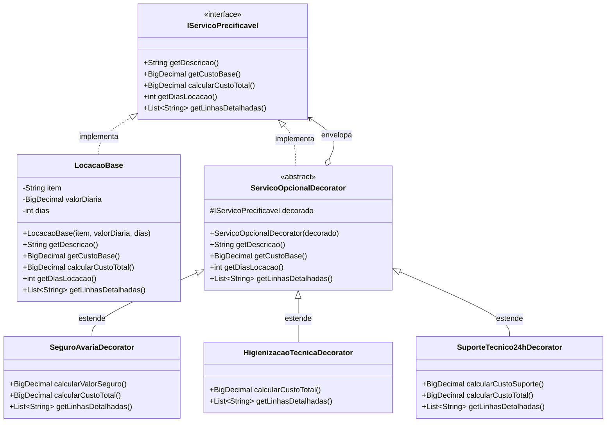

# Guia 30 — Padrão GoF Decorator: Composição Dinâmica de Serviços e Tarifação em JavaFX

## 1. O Problema da Explosão Combinatória por Herança
Em sistemas corporativos, de reservas, aluguel de equipamentos ou prestação de serviços, raramente um serviço é contratado de forma puramente estática. Clientes e usuários demandam serviços e taxas adicionais opcionais:
- **Seguro contra quebra ou avaria** (15% do valor base).
- **Higienização e calibração técnica em sala limpa** (taxa fixa de R$ 35,00).
- **Suporte técnico especializado 24 horas** (R$ 10,00 por dia).

### O Anti-Pattern: Tentar Resolver Opcionais com Subclasses
Se tentarmos modelar cada combinação possível usando herança tradicional, caímos em uma **explosão combinatória de classes**:

```text
LocacaoBase
├── LocacaoComSeguro
├── LocacaoComHigienizacao
├── LocacaoComSuporte
├── LocacaoComSeguroEHigienizacao
├── LocacaoComSeguroESuporte
├── LocacaoComHigienizacaoESuporte
└── LocacaoComSeguroEHigienizacaoESuporte (7 classes para apenas 3 opções!)
```
Se adicionarmos um 4º opcional (ex.: garantia estendida), teremos $2^4 = 16$ classes. Isso torna o sistema inviável e viola frontalmente o **Princípio Aberto/Fechado (OCP)**.

### A Solução da Engenharia: Padrão GoF Decorator
O **Padrão Decorator** anexa responsabilidades adicionais a um objeto dinamicamente. Os decoradores fornecem uma alternativa flexível à subclasse para estender a funcionalidade através de **composição em camadas (envelopamento / wrapping)**.

Tanto o objeto base quanto os decoradores implementam a mesma interface (`IServicoPrecificavel`). Em tempo de execução, você pode empilhar quantos decoradores desejar:
```java
IServicoPrecificavel servico = new LocacaoBase("Osciloscópio Digital", new BigDecimal("50.00"), 5);
if (chkSeguro.isSelected()) {
    servico = new SeguroAvariaDecorator(servico);
}
if (chkSuporte.isSelected()) {
    servico = new SuporteTecnico24hDecorator(servico);
}
```

---

## 2. Diagrama de Classes e Arquitetura Conceitual



---

## 3. O Código Prático e Didático

### 3.1. A Interface Comum do Componente
```java
public interface IServicoPrecificavel {
    String getDescricao();
    BigDecimal getCustoBase();
    BigDecimal calcularCustoTotal();
    int getDiasLocacao();
    List<String> getLinhasDetalhadas();
}
```

### 3.2. O Componente Concreto Base
```java
public class LocacaoBase implements IServicoPrecificavel {
    private final String item;
    private final BigDecimal valorDiaria;
    private final int dias;

    public LocacaoBase(String item, BigDecimal valorDiaria, int dias) {
        if (valorDiaria.compareTo(BigDecimal.ZERO) <= 0 || dias <= 0) {
            throw new IllegalArgumentException("Valores inválidos");
        }
        this.item = item;
        this.valorDiaria = valorDiaria;
        this.dias = dias;
    }

    @Override
    public BigDecimal getCustoBase() {
        return valorDiaria.multiply(BigDecimal.valueOf(dias));
    }

    @Override
    public BigDecimal calcularCustoTotal() {
        return getCustoBase();
    }

    @Override
    public List<String> getLinhasDetalhadas() {
        return List.of("1. [BASE] " + item + " -> " + calcularCustoTotal());
    }
}
```

### 3.3. O Decorador Abstrato e Concreto
```java
public abstract class ServicoOpcionalDecorator implements IServicoPrecificavel {
    protected final IServicoPrecificavel decorado;

    public ServicoOpcionalDecorator(IServicoPrecificavel decorado) {
        this.decorado = Objects.requireNonNull(decorado, "Componente decorado não pode ser nulo");
    }

    @Override public String getDescricao() { return decorado.getDescricao(); }
    @Override public BigDecimal getCustoBase() { return decorado.getCustoBase(); }
    @Override public int getDiasLocacao() { return decorado.getDiasLocacao(); }
    @Override public List<String> getLinhasDetalhadas() { return decorado.getLinhasDetalhadas(); }
}

public final class SeguroAvariaDecorator extends ServicoOpcionalDecorator {
    public SeguroAvariaDecorator(IServicoPrecificavel decorado) {
        super(decorado);
    }

    public BigDecimal calcularValorSeguro() {
        BigDecimal seguro = decorado.getCustoBase().multiply(new BigDecimal("0.15"));
        return seguro.compareTo(new BigDecimal("25.00")) >= 0 ? seguro : new BigDecimal("25.00");
    }

    @Override
    public BigDecimal calcularCustoTotal() {
        return decorado.calcularCustoTotal().add(calcularValorSeguro());
    }

    @Override
    public List<String> getLinhasDetalhadas() {
        List<String> linhas = new ArrayList<>(decorado.getLinhasDetalhadas());
        linhas.add("+ [SEGURO] Cobertura Contra Avarias -> R$ " + calcularValorSeguro());
        return Collections.unmodifiableList(linhas);
    }
}
```

---

## 4. Integração Reativa com JavaFX (UI Dinâmica)

Na interface desktop JavaFX, o Padrão Decorator brilha quando associado a `CheckBox` e listas reativas:

```java
// Rotina de recomposição acionada a qualquer clique do usuário
Runnable recalcularFatura = () -> {
    IServicoPrecificavel servico = base;

    if (chkSeguro.isSelected()) {
        servico = new SeguroAvariaDecorator(servico);
    }
    if (chkHigienizacao.isSelected()) {
        servico = new HigienizacaoTecnicaDecorator(servico);
    }
    if (chkSuporte.isSelected()) {
        servico = new SuporteTecnico24hDecorator(servico);
    }

    // Atualiza a ListView com o discriminativo da fatura
    listaFatura.getItems().setAll(servico.getLinhasDetalhadas());
    
    // Atualiza o totalizador
    lblTotal.setText("Total Faturado: " + moedaFormat.format(servico.calcularCustoTotal()));
};

chkSeguro.setOnAction(e -> recalcularFatura.run());
chkHigienizacao.setOnAction(e -> recalcularFatura.run());
chkSuporte.setOnAction(e -> recalcularFatura.run());
```

---

## 5. Armadilhas Comuns (*Common Pitfalls*)

| Armadilha | Consequência | Como Evitar |
| :--- | :--- | :--- |
| **Ordem de Envelopamento Sensível** | Se uma taxa incidir sobre o subtotal já decorado em vez do custo base, inverter a ordem dos checkboxes altera o valor final. | Defina claramente no contrato da regra de negócio se o cálculo é cumulativo ou proporcional ao `getCustoBase()` imutável. |
| **Esquecer de Delegar Métodos no Decorador Base** | Criar um decorador e esquecer de repassar chamadas acessórias (como `getDiasLocacao()`) faz o método retornar zero ou nulo. | Implemente todos os métodos da interface no decorador abstrato delegando para `decorado.metodo()`. As subclasses concretas sobrescrevem apenas o que modificam. |
| **Dependência de `instanceof` para Encontrar o Objeto Base** | Tentar desembrulhar o decorador no controlador via casts quebra o encapsulamento. | Se você precisar de informações do núcleo, exponha-as através do contrato de interface `IServicoPrecificavel`. |

---

## 6. Defesa em Banca Avaliadora

> **Pergunta:** *"Qual a diferença fundamental entre o Padrão Strategy e o Padrão Decorator? Quando escolher um ou outro?"*
>
> **Resposta:**
> *"A diferença fundamental está na intenção arquitetural:*\n>\n>*- **O Padrão Strategy** altera o 'coração' do algoritmo. A classe cliente mantém uma única referência para uma estratégia por vez (ex.: ou o frete é Grátis, ou Expresso, ou Padrão). É uma substituição mutuamente exclusiva de comportamento.*\n>*- **O Padrão Decorator** altera a 'casca' do objeto, adicionando camadas externas cumulativas. Ele permite empilhar múltiplos comportamentos simultâneos (ex.: um empréstimo pode ter seguro E suporte 24h E calibração especial), sem que nenhum decorador saiba quantos outros estão empilhados antes ou depois dele.*\n>\n>*Portanto, se as regras são alternativas e mutuamente exclusivas, usamos **Strategy**; se as regras são cumulativas e dinamicamente combináveis em tempo de execução, usamos **Decorator**."*
