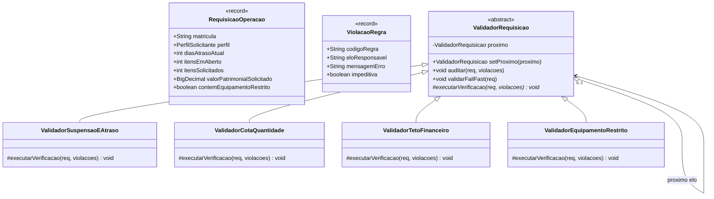

# Guia 31 — Padrão GoF Chain of Responsibility: Pipelines de Validação e Auditoria

## 1. O Problema das Validações Monolíticas e "Emaranhados de Ifs"
Antes de autorizar uma operação crítica em um sistema de laboratório ou gestão de recursos (como conceder um empréstimo, liberar acesso a bancadas ou aprovar baixa patrimonial), uma série de requisitos regulamentares precisa ser atendida:
1. O usuário está suspenso ou com devoluções em atraso?
2. A cota máxima de equipamentos simultâneos foi atingida?
3. O valor financeiro total sob custódia ultrapassa o teto do perfil do solicitante?
4. O equipamento requisitado é restrito e exige nível docente/pesquisador?

### O Anti-Pattern: Método Validador Monolítico
O erro mais frequente é concentrar todas as regras dentro de um único método do serviço:
```java
// ❌ ANTI-PATTERN: Método gigante com violação massiva de SRP e OCP
public void validarEmprestimo(Usuario u, Item i) throws Exception {
    if (u.isSuspenso()) throw new Exception("Usuário suspenso");
    if (u.getAtraso() > 0) throw new Exception("Possui atraso");
    if (u.getItens().size() >= 3) throw new Exception("Cota estourada");
    if (i.getValor().compareTo(new BigDecimal(3000)) > 0) throw new Exception("Teto excedido");
    if (i.isRestrito() && !u.isDocente()) throw new Exception("Não autorizado");
    // Adicionar uma nova regra exige alterar esse método sensível e quebrar testes existentes!
}
```

### A Solução da Engenharia: Padrão GoF Chain of Responsibility
O **Padrão Chain of Responsibility (Cadeia de Responsabilidade)** desacopla o remetente de uma solicitação de seus destinatários ao dar a mais de um objeto a oportunidade de processar a solicitação.
- Os manipuladores são encadeados em um **pipeline linear**.
- Cada elo da cadeia possui **uma única responsabilidade (SRP)**.
- Novos elos podem ser inseridos ou reordenados dinamicamente **sem alterar nenhuma linha dos validadores existentes (OCP)**.
- O pipeline suporta tanto o modo **Fail-Fast** (lança exceção no primeiro erro) quanto o modo **Auditoria Completa** (coleta todas as violações para exibir em um checklist na UI).

---

## 2. Diagrama de Classes e Arquitetura Conceitual



---

## 3. O Código Prático e Didático

### 3.1. O Manipulador Base Abstrato (`Handler`)
```java
public abstract class ValidadorRequisicao {
    private ValidadorRequisicao proximo;

    public ValidadorRequisicao setProximo(ValidadorRequisicao proximo) {
        this.proximo = proximo;
        return proximo; // Fluent interface
    }

    // Modo 1: Coleta todas as violações sem abortar prematuramente
    public void auditar(RequisicaoOperacao req, List<ViolacaoRegra> violacoes) {
        executarVerificacao(req, violacoes);
        if (proximo != null) {
            proximo.auditar(req, violacoes);
        }
    }

    // Modo 2: Fail-Fast checado
    public void validarFailFast(RequisicaoOperacao req) throws RegraNegocioVioladaException {
        List<ViolacaoRegra> locais = new ArrayList<>();
        executarVerificacao(req, locais);
        if (!locais.isEmpty()) {
            ViolacaoRegra primeira = locais.get(0);
            throw new RegraNegocioVioladaException(primeira.codigoRegra(), primeira.mensagemErro());
        }
        if (proximo != null) {
            proximo.validarFailFast(req);
        }
    }

    protected abstract void executarVerificacao(RequisicaoOperacao req, List<ViolacaoRegra> violacoes);
}
```

### 3.2. Exemplos de Elos Concretos da Cadeia
```java
public final class ValidadorSuspensaoEAtraso extends ValidadorRequisicao {
    @Override
    protected void executarVerificacao(RequisicaoOperacao req, List<ViolacaoRegra> violacoes) {
        if (req.diasAtrasoAtual() > 0) {
            violacoes.add(new ViolacaoRegra(
                    "SUSP-01",
                    "ValidadorSuspensaoEAtraso",
                    String.format("Usuário possui %d dia(s) de atraso pendente.", req.diasAtrasoAtual()),
                    true
            ));
        }
    }
}

public final class ValidadorCotaQuantidade extends ValidadorRequisicao {
    @Override
    protected void executarVerificacao(RequisicaoOperacao req, List<ViolacaoRegra> violacoes) {
        int total = req.itensEmAberto() + req.itensSolicitados();
        int max = req.perfil().getCotaMaximaItens();
        if (total > max) {
            violacoes.add(new ViolacaoRegra(
                    "COTA-02",
                    "ValidadorCotaQuantidade",
                    String.format("Cota excedida: perfil %s permite %d itens (total: %d)", req.perfil(), max, total),
                    true
            ));
        }
    }
}
```

### 3.3. Montagem da Cadeia (Pipeline)
```java
public static ValidadorRequisicao criarCadeiaPadrao() {
    ValidadorRequisicao elo1 = new ValidadorSuspensaoEAtraso();
    ValidadorRequisicao elo2 = new ValidadorCotaQuantidade();
    ValidadorRequisicao elo3 = new ValidadorTetoFinanceiro();
    ValidadorRequisicao elo4 = new ValidadorEquipamentoRestrito();

    elo1.setProximo(elo2).setProximo(elo3).setProximo(elo4);
    return elo1;
}
```

---

## 4. Integração com JavaFX: Checklist Visual de Conformidade

Em interfaces de usuário desktop, apresentar apenas "Operação negada" frustra o usuário. Com o modo `auditar()`, alimentamos um **Checklist Visual de Pré-Requisitos**:

```java
// No Controlador JavaFX
ValidadorRequisicao cadeia = criarCadeiaPadrao();
List<ViolacaoRegra> violacoes = new ArrayList<>();
cadeia.auditar(requisicao, violacoes);

painelAuditoria.getChildren().clear();

if (violacoes.isEmpty()) {
    lblResultado.setText("✅ Requisição Aprovada em todos os critérios regulamentares.");
    btnConfirmarOperacao.setDisable(false);
} else {
    lblResultado.setText(String.format("❌ Requisição Rejeitada: %d pendência(s) detectada(s).", violacoes.size()));
    btnConfirmarOperacao.setDisable(true);
    for (ViolacaoRegra v : violacoes) {
        Label item = new Label(String.format("⛔ [%s] %s", v.codigoRegra(), v.mensagemErro()));
        item.setStyle("-fx-text-fill: #e53e3e; -fx-font-weight: bold;");
        painelAuditoria.getChildren().add(item);
    }
}
```

---

## 5. Armadilhas Comuns (*Common Pitfalls*)

| Armadilha | Consequência | Como Evitar |
| :--- | :--- | :--- |
| **Cadeia com Ponta Solta (Esquecer de encadear)** | Um validador é instanciado mas nunca ligado ao anterior com `setProximo()`, fazendo suas regras serem ignoradas silenciosamente. | Utilize um método de fábrica (`PipelineFactory`) centralizado e cubra a cadeia completa com testes unitários automatizados. |
| **Modificar a Requisição Dentro do Elo** | Um elo altera o estado da requisição (efeito colateral), contaminando os elos seguintes. | Modele a requisição como um **Java 21 Record imutável**, garantindo que nenhum validador consiga adulterar os dados sob auditoria. |
| **Falta de Tratamento de Null no Elo Final** | Tentar chamar `proximo.validar()` quando `proximo == null` causa `NullPointerException`. | Sempre verifique `if (proximo != null)` antes de propagar a chamada. |

---

## 6. Defesa em Banca Avaliadora

> **Pergunta:** *"Por que não utilizar um simples método com múltiplos métodos `validarX()`, `validarY()` chamados em sequência dentro da classe `Servico`?"*
>
> **Resposta:**
> *"Chamar métodos estáticos ou privados sequenciais dentro do Serviço acopla o serviço a regras individuais e impede que a ordem, ativação ou composição das regras seja flexível.*\n>\n>*Com o Padrão Chain of Responsibility, os validadores são classes autônomas que podem ser testadas isoladamente com mocks ou fakes. Além disso, podemos montar cadeias diferentes para diferentes contextos: uma cadeia mais rigorosa para 'Empréstimo de Alta Precisão' e uma cadeia simplificada para 'Reserva Rápida de Sala', reutilizando os mesmos blocos sem duplicar código."*
