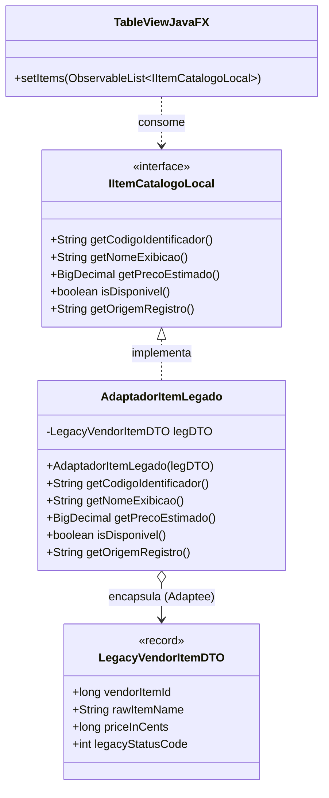

# Guia 32 — Padrão GoF Adapter: Interoperabilidade e Integração de Sistemas Legados

## 1. O Problema da Interoperabilidade com Fontes Incompatíveis
Em projetos corporativos e acadêmicos avançados, seu sistema quase nunca opera em isolamento total. Frequentemente é necessário consumir dados de:
- Arquivos legados gerados por sistemas arcaicos em COBOL, C ou versões antigas de Java.
- Web APIs ou feeds CSV de terceiros/fornecedores cujos nomes de campos e estruturas violam o padrão de nomenclatura e tipos do seu domínio.

### O Exemplo do Sistema Legado Incompatível
Imagine que um sistema parceiro fornece os seguintes dados brutos delimitados por pipe (`|`):
```text
vendorId|rawItemName|priceInCents|legacyStatusCode
101|Multímetro Fluke True-RMS|145000|1
102|Estação de Solda Hikari Digital|42990|1
103|Gerador de Sinais Arbitrários 25MHz|389000|2
```

Observe as discrepâncias com a arquitetura limpa do nosso sistema:
- O identificador é um `long` cru (ex.: `101`), mas nosso sistema exige um código textual unificado formatado (ex.: `"LEG-000101"`).
- O preço é um número inteiro em centavos (`145000`), mas nosso sistema opera exclusivamente com `BigDecimal` (`1450.00`).
- O status de disponibilidade é um código numérico arbitrário (`1` = Ativo, `2` = Reservado, `9` = Sucateado), mas nosso sistema espera um `boolean isDisponivel()`.

### O Anti-Pattern: Poluir o Modelo de Domínio e a UI com Tipos Legados
Se usarmos `LegacyVendorItemDTO` diretamente nos nossos controladores JavaFX e serviços, todo o nosso código ficará **acoplado e refém do esquema legado**:
```java
// ❌ ANTI-PATTERN: A UI conhece detalhes arcaicos do parceiro
TableColumn<LegacyVendorItemDTO, Long> colCentavos; // Errado! A UI agora sabe de centavos legados
if (dto.getLegacyStatusCode() == 1) { ... }          // Lógica de mapeamento espalhada na apresentação
```

### A Solução da Engenharia: Padrão GoF Adapter
O **Padrão Adapter (Adaptador)** converte a interface de uma classe na interface esperada pelos clientes. Ele permite que classes com interfaces incompatíveis trabalhem juntas, funcionando como um **adaptador de tomada elétrica universal**.

---

## 2. Diagrama de Classes e Arquitetura Conceitual



---

## 3. O Código Prático e Didático

### 3.1. A Interface Canônica de Domínio (Target)
```java
public interface IItemCatalogoLocal {
    String getCodigoIdentificador();
    String getNomeExibicao();
    BigDecimal getPrecoEstimado();
    boolean isDisponivel();
    String getOrigemRegistro();
}
```

### 3.2. O DTO Arcaico Incompatível (Adaptee)
```java
public record LegacyVendorItemDTO(
        long vendorItemId,
        String rawItemName,
        long priceInCents,
        int legacyStatusCode
) {}
```

### 3.3. O Adaptador Concreto (Object Adapter)
O adaptador realiza todas as conversões de tipos, formatações e sanitizações:
```java
public final class AdaptadorItemLegado implements IItemCatalogoLocal {
    private final LegacyVendorItemDTO legDTO;

    public AdaptadorItemLegado(LegacyVendorItemDTO legDTO) {
        this.legDTO = Objects.requireNonNull(legDTO, "DTO legado não pode ser nulo");
    }

    @Override
    public String getCodigoIdentificador() {
        // Converte ID longo em formato padronizado com zeros à esquerda
        return String.format("LEG-%06d", legDTO.vendorItemId());
    }

    @Override
    public String getNomeExibicao() {
        return legDTO.rawItemName().trim();
    }

    @Override
    public BigDecimal getPrecoEstimado() {
        // Converte centavos para BigDecimal com 2 casas decimais
        return BigDecimal.valueOf(legDTO.priceInCents())
                .divide(BigDecimal.valueOf(100), 2, RoundingMode.HALF_EVEN);
    }

    @Override
    public boolean isDisponivel() {
        // Mapeia código numérico legado para semântica de negócio
        return legDTO.legacyStatusCode() == 1;
    }

    @Override
    public String getOrigemRegistro() {
        return "Parceiro Externo Legacy (API v1)";
    }
}
```

---

## 4. Integração com TableView no JavaFX

Na interface gráfica, configuramos as colunas da tabela consumindo estritamente `IItemCatalogoLocal`. A interface não tem nenhuma linha de código acoplada a centavos inteiros ou flags legadas:

```java
TableView<IItemCatalogoLocal> tabela = new TableView<>();

TableColumn<IItemCatalogoLocal, String> colCodigo = new TableColumn<>("Código");
colCodigo.setCellValueFactory(d -> new SimpleStringProperty(d.getValue().getCodigoIdentificador()));

TableColumn<IItemCatalogoLocal, String> colNome = new TableColumn<>("Nome");
colNome.setCellValueFactory(d -> new SimpleStringProperty(d.getValue().getNomeExibicao()));

TableColumn<IItemCatalogoLocal, String> colPreco = new TableColumn<>("Preço");
colPreco.setCellValueFactory(d -> new SimpleStringProperty(moedaFormat.format(d.getValue().getPrecoEstimado())));

TableColumn<IItemCatalogoLocal, String> colDisp = new TableColumn<>("Status");
colDisp.setCellValueFactory(d -> new SimpleStringProperty(d.getValue().isDisponivel() ? "✅ Liberado" : "❌ Indisponível"));

// Itens adaptados entram diretamente na tabela
tabela.getItems().addAll(itensAdaptados);
```

---

## 5. Armadilhas Comuns (*Common Pitfalls*)

| Armadilha | Consequência | Como Evitar |
| :--- | :--- | :--- |
| **Colocar Regras de Negócio Dentro do Adaptador** | O adaptador deixa de ser puramente estrutural e começa a calcular descontos ou aplicar multas. | O papel do Adapter é **apenas tradução de tipos e interfaces**. Toda lógica de negócio deve residir na camada `Service`. |
| **Vazar Exceções do Sistema Legado para a UI** | Uma exceção de socket ou driver proprietário do legado escapa diretamente para a tela. | O Adapter ou o serviço de importação deve capturar exceções legadas e traduzi-las para exceções de domínio checadas do seu próprio sistema. |
| **Class Adapter vs Object Adapter** | Tentar usar *Class Adapter* (herança múltipla) em Java, o que é limitado pois Java suporta herança de apenas uma classe. | Prefira sempre **Object Adapter** via composição (`implements Target` e mantém uma referência privada para `Adaptee`), aplicando o princípio de *Composição sobre Herança*. |

---

## 6. Defesa em Banca Avaliadora

> **Pergunta:** *"Qual a diferença entre os padrões Adapter, Facade e Proxy? Todos eles não envelopam objetos?"*
>
> **Resposta:**
> *"Embora os três padrões usem envelopamento (wrapping), a intenção arquitetural de cada um é completamente diferente:*\n>\n>*- **Adapter:** Muda a interface de um objeto existente para compatibilizá-lo com outra interface esperada pelo cliente. O cliente e o objeto original falam 'línguas diferentes'.*\n>*- **Facade:** Não muda uma interface individual, mas cria uma **nova interface simplificada** de alto nível para mascarar a complexidade de um subsistema inteiro composto por dezenas de classes.*\n>*- **Proxy:** Mantém a **mesma interface idêntica** do objeto original, mas intercepta as chamadas para adicionar controle de acesso, cache, lazy loading ou segurança.*\n>\n>*No nosso caso, usamos **Adapter** porque precisávamos exatamente converter os tipos incompatíveis do `LegacyVendorItemDTO` para a interface contratual do nosso sistema (`IItemCatalogoLocal`)."*
