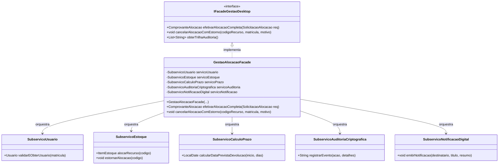
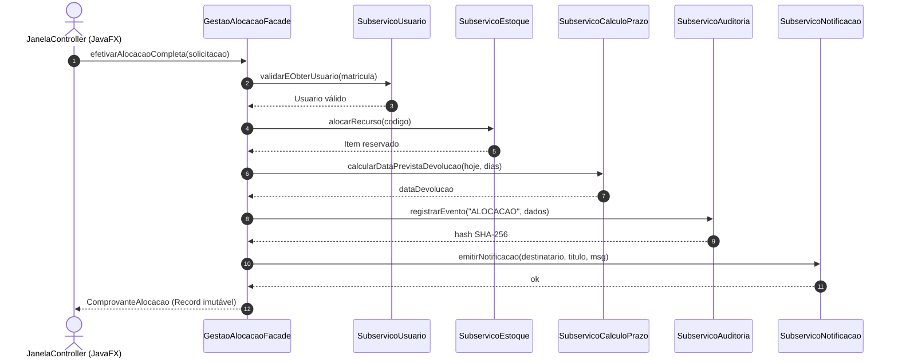

# Guia 33 — Padrão GoF Facade: Fachada de Subsistemas e Gateway Desktop

## 1. O Problema do Acoplamento Excessivo em Controladores de Apresentação
Em aplicações desktop corporativas ou acadêmicas em JavaFX, uma operação transacional aparentemente simples solicitada pelo usuário (como clicar no botão *"Efetivar Alocação"* ou *"Confirmar Empréstimo"*) raramente envolve apenas uma chamada de método. Nos bastidores, a operação exige a coordenação rigorosa de múltiplos subsistemas independentes:

1. **Subsistema de Usuários / Autenticação:** Validar se o solicitante existe, se está com status ativo e se não possui inadimplência ou suspensão.
2. **Subsistema de Estoque / Patrimônio:** Checar a disponibilidade física do recurso no inventário e realizar o bloqueio da reserva.
3. **Subsistema de Prazos e Políticas:** Calcular a data limite de devolução com base no tipo de equipamento e perfil acadêmico/funcional.
4. **Subsistema de Auditoria e Criptografia:** Gerar registro pericial com timestamp ISO-8601 e hash criptográfico SHA-256 para não-repúdio.
5. **Subsistema de Notificação:** Despachar recibo digital e comprovante para o usuário.

```text
❌ ANTI-PATTERN: O Controlador "God Controller" Acoplado a 5 Subsistemas

   ┌────────────────────────────────────────────────────────┐
   │          JanelaAlocacaoController (JavaFX)             │
   └───────┬────────────┬────────────┬───────────┬──────────┘
           │            │            │           │
     invoca│      invoca│      invoca│     invoca│     invoca
           ▼            ▼            ▼           ▼          ▼
     ┌───────────┐┌───────────┐┌───────────┐┌─────────┐┌──────────────┐
     │Servico    ││Servico    ││Servico    ││Servico  ││Servico       │
     │Usuario    ││Estoque    ││Politica   ││Auditoria││Notificacao   │
     └───────────┘└───────────┘└───────────┘└─────────┘└──────────────┘
```

### O Anti-Pattern: Controladores Inchados e Lógica Transacional Espalhada na UI
Quando os controladores FXML injetam diretamente 5 ou mais instâncias de serviços:
- **Violação do Princípio da Responsabilidade Única (SRP):** O controlador passa a ser responsável pela UI, pela orquestração do fluxo de negócio e pela coordenação de compensações (rollbacks manuais).
- **Alto Acoplamento (High Coupling):** Qualquer alteração na assinatura de um subsistema interno quebra diretamente a camada visual.
- **Risco Crítico de Inconsistência:** Se a reserva for feita no estoque, mas o cálculo de prazo ou a auditoria falhar no meio do caminho, o controlador de UI raramente sabe como estornar os passos anteriores com segurança.

### A Solução da Engenharia: Padrão GoF Facade
O **Padrão GoF Facade (Fachada)** fornece uma interface unificada e de alto nível para um conjunto de interfaces em um subsistema. A Fachada define um ponto de entrada simplificado que torna o subsistema muito mais fácil de utilizar pela camada de apresentação (JavaFX), sem ocultar a flexibilidade dos componentes internos quando necessária.

```text
✔ PADRÃO FACADE: Gateway Coeso e Ponto de Entrada Simplificado

   ┌──────────────────────────────────────────────┐
   │       JanelaAlocacaoController (JavaFX)      │
   └──────────────────────┬───────────────────────┘
                          │ 1. efetivarAlocacaoCompleta(solicitacao)
                          ▼
   ┌──────────────────────────────────────────────┐
   │         GestaoAlocacaoFacade (Facade)        │
   └───────┬────────────┬────────────┬────────────┘
           │            │            │            │
           ▼            ▼            ▼            ▼
     ┌───────────┐┌───────────┐┌───────────┐┌──────────────┐
     │  Usuário  ││  Estoque  ││ Auditoria ││ Notificação  │
     └───────────┘└───────────┘└───────────┘└──────────────┘
```

---

## 2. Diagrama de Classes e Arquitetura Conceitual



### Diagrama de Sequência: Orquestração Transacional via Facade



---

## 3. O Código Prático e Didático

### 3.1. DTO de Entrada e Record de Retorno Imutável
Utilizamos **Records do Java 21** com construtor compacto para validação de dados antes que alcancem os subsistemas:

```java
public record SolicitacaoAlocacao(
        String codigoUsuario,
        String codigoRecurso,
        int diasSolicitados,
        String finalidade
) {
    public SolicitacaoAlocacao {
        if (codigoUsuario == null || codigoUsuario.isBlank()) {
            throw new IllegalArgumentException("Código de usuário é obrigatório.");
        }
        if (codigoRecurso == null || codigoRecurso.isBlank()) {
            throw new IllegalArgumentException("Código do recurso é obrigatório.");
        }
        if (diasSolicitados <= 0 || diasSolicitados > 60) {
            throw new IllegalArgumentException("Prazo deve estar entre 1 e 60 dias.");
        }
        codigoUsuario = codigoUsuario.trim();
        codigoRecurso = codigoRecurso.trim();
        finalidade = (finalidade == null || finalidade.isBlank()) ? "Uso Institucional" : finalidade.trim();
    }
}
```

### 3.2. Implementação da Fachada com Rollback de Compensação
A Fachada orquestra o fluxo. Se uma etapa subsequente falhar, a Fachada tem a inteligência de compensar o que já havia sido modificado:

```java
public class GestaoAlocacaoFacade implements IFacadeGestaoDesktop {

    private final SubservicoUsuario servicoUsuario;
    private final SubservicoEstoque servicoEstoque;
    private final SubservicoCalculoPrazo servicoPrazo;
    private final SubservicoAuditoriaCriptografica servicoAuditoria;
    private final SubservicoNotificacaoDigital servicoNotificacao;

    @Override
    public ComprovanteAlocacao efetivarAlocacaoCompleta(SolicitacaoAlocacao solicitacao) throws FalhaAlocacaoException {
        // 1. Validar Usuário
        var usuario = servicoUsuario.validarEObterUsuario(solicitacao.codigoUsuario());

        // 2. Alocar no Estoque
        var item = servicoEstoque.alocarRecurso(solicitacao.codigoRecurso());

        try {
            // 3. Regra Temporal
            LocalDate dataDevolucao = servicoPrazo.calcularDataPrevistaDevolucao(LocalDate.now(), solicitacao.diasSolicitados());

            // 4. Auditoria com Hash
            String txId = "TX-" + UUID.randomUUID().toString().substring(0, 8).toUpperCase();
            String hash = servicoAuditoria.registrarEvento("ALOCACAO_RECURSO", txId + " -> " + item.getCodigo());

            // 5. Notificação
            servicoNotificacao.emitirNotificacao(usuario.matricula(), "Alocação Confirmada", "Recibo: " + txId);

            return new ComprovanteAlocacao(txId, usuario.matricula(), usuario.nome(), item.getCodigo(),
                    item.getDescricao(), LocalDate.now(), dataDevolucao, hash, LocalDateTime.now());
        } catch (Exception e) {
            // COMPENSAÇÃO TRANSAÇÃO: Estorna o item caso ocorra qualquer falha no fluxo pós-reserva
            servicoEstoque.estornarAlocacao(solicitacao.codigoRecurso());
            servicoAuditoria.registrarEvento("ROLLBACK_ALOCACAO", "Falha pós-reserva do item " + solicitacao.codigoRecurso());
            throw new FalhaAlocacaoException("FALHA_ORQUESTRACAO", "Erro na orquestração: " + e.getMessage());
        }
    }
}
```

---

## 4. Integração Prática com JavaFX Desktop

No controlador FXML da interface gráfica:
1. O controlador declara apenas uma dependência da Fachada:
   ```java
   private final IFacadeGestaoDesktop facade = new GestaoAlocacaoFacade();
   ```
2. Ao clicar no botão de submissão, o manipulador de eventos do JavaFX faz apenas uma chamada limpa envolvida em tratamento de exceção específico:
   ```java
   @FXML
   private void handleEfetivar() {
       try {
           SolicitacaoAlocacao req = new SolicitacaoAlocacao(txtUsuario.getText(), cbRecurso.getValue(), spDias.getValue(), "Pesquisa");
           ComprovanteAlocacao comprovante = facade.efetivarAlocacaoCompleta(req);
           txtRecibo.setText(comprovante.formatarRecibo());
           AlertHelper.mostrarInformacao("Sucesso", "Alocação concluída via Fachada!");
       } catch (FalhaAlocacaoException e) {
           AlertHelper.mostrarErro("Falha na Fachada", "[" + e.getCodigoEtapa() + "] " + e.getMessage());
       }
   }
   ```

---

## 5. Armadilhas Comuns (*Common Pitfalls*)

1. **Transformar a Facade em uma "Classe Deus" com Lógica Direta:**
   *Pitfall:* Colocar código SQL, manipulação de arquivos CSV ou cálculos matemáticos pesados diretamente dentro da Facade.
   *Solução:* A Facade **não executa regras de negócio fundamentais por conta própria**; ela delega para os subsistemas especializados e apenas coordena o fluxo de chamada entre eles.
2. **Esquecer Ações de Compensação (Rollback) em Falhas Parciais:**
   *Pitfall:* Reservar o recurso no estoque, encontrar um erro na auditoria ou notificação e deixar o recurso bloqueado para sempre.
   *Solução:* Em bloco `catch` na Fachada, reverta as mutações que já foram efetuadas (`estornarAlocacao`).
3. **Impedir o Acesso Direto aos Subsistemas Quando Realmente Necessário:**
   *Pitfall:* Tratar a Facade como uma barreira intransponível que proíbe qualquer leitura direta.
   *Solução:* O GoF define a Fachada como um atalho conveniente de alto nível; subsistemas continuam disponíveis para clientes avançados caso seja necessária uma operação fina.

---

## 6. Perguntas Frequentes em Bancas Avaliadoras

- **Qual a diferença entre o Padrão Facade e o Padrão Adapter?**
  - O **Adapter** adapta **uma única interface existente** para compatibilizá-la com um contrato esperado pelo cliente (mudança de interface para interoperabilidade).
  - A **Facade** cria uma **nova interface mais simples** para orquestrar **múltiplos subsistemas** complexos simultaneamente.
- **Como a Facade favorece a testabilidade com testes unitários?**
  - Como a Facade recebe os subsistemas por injeção de dependências (`SubservicoUsuario`, `SubservicoEstoque`), em testes automatizados podemos injetar mocks ou fakes para simular falhas em cada etapa e verificar se a compensação/estorno foi chamada com precisão cirúrgica.
