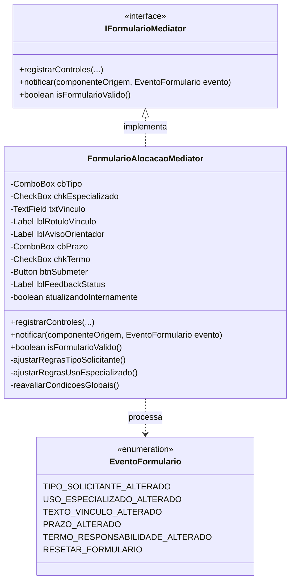

# Guia 34 — Padrão GoF Mediator: Orquestração e Desacoplamento de Componentes JavaFX

## 1. O Problema das Interdependências Caóticas em Telas Complexas
Em formulários interativos de telas ricas no JavaFX, é muito comum que múltiplos nós gráficos (widgets) precisem reagir dinamicamente às ações do usuário:
- Ao alterar o **Perfil do Solicitante** no `ComboBox` (Estudante vs Professor vs Pesquisador):
  - Se for *Professor*: desabilita o campo de orientador, remove alertas e libera prazos longos (15 e 30 dias).
  - Se for *Estudante*: limita prazos a curto período (3 e 7 dias) e exige matrícula do orientador caso o recurso seja de alta precisão.
- Ao marcar o `CheckBox` **"Equipamento Especializado"**:
  - Exibe label de advertência em destaque.
  - Se for estudante, torna o campo de orientador obrigatório com asterisco visual.
- Ao preencher o `TextField` de matrícula:
  - Dispara validação de caracteres numéricos.
- Ao marcar o `CheckBox` **"Termo de Responsabilidade"**:
  - Avalia se todos os pré-requisitos estão válidos para habilitar ou manter desabilitado o `Button` "Submeter".

```text
❌ ANTI-PATTERN: Teia Caótica de Dependências Cruzadas (N:N Coupling)

   ComboBox (Tipo) ───────┐
      │         ▲         │
      │         │         ▼
      ▼         └─────► CheckBox (Especial)
   TextField (Orientador) │
      ▲         │         │
      │         ▼         ▼
   CheckBox (Termo) ──► Button (Submeter)
```

### O Anti-Pattern: Cada Nó Conhece e Modifica Diretamente os Outros Nós
Se cada componente adicionar ouvintes (`setOnAction`, `textProperty().addListener`) que manipulam diretamente as propriedades (`setVisible`, `setDisable`, `setItems`) de outros 4 componentes:
- Gera um emaranhado impossível de depurar (*Spaghetti UI*).
- Loops infinitos de eventos de disparo cruzado (*Listener Ping-Pong*).
- Qualquer nova regra exige alterar dezenas de callbacks espalhados no código do controlador.

### A Solução da Engenharia: Padrão GoF Mediator
O **Padrão GoF Mediator (Mediador)** define um objeto que encapsula como um conjunto de objetos interage. O Mediator promove o acoplamento fraco ao evitar que os objetos se refiram uns aos outros explicitamente, permitindo que a interação entre eles varie de forma independente.

```text
✔ PADRÃO MEDIATOR: Topologia em Estrela Desacoplada (1:N)

        ComboBox (Tipo)       CheckBox (Especial)
              │                       │
     notifica │              notifica │
              ▼                       ▼
      ┌───────────────────────────────────────┐
      │     FormularioAlocacaoMediator        │
      │        (Cérebro Orquestrador)         │
      └───────────────────────────────────────┘
              ▲                       ▲
     notifica │              notifica │
              │                       │
      TextField (Orientador)   Button (Submeter) / CheckBox (Termo)
```

---

## 2. Diagrama de Classes e Arquitetura Conceitual



---

## 3. O Código Prático e Didático

### 3.1. Contrato do Mediador e Notificação de Eventos
O contrato define uma assinatura genérica `notificar(origem, evento)`:

```java
public interface IFormularioMediator {
    void registrarControles(
            ComboBox<TipoSolicitante> cbTipo,
            CheckBox chkEspecializado,
            TextField txtVinculo,
            Label lblRotuloVinculo,
            Label lblAvisoOrientador,
            ComboBox<OpcaoPrazo> cbPrazo,
            CheckBox chkTermo,
            Button btnSubmeter,
            Label lblFeedbackStatus
    );

    void notificar(Object componenteOrigem, EventoFormulario evento);

    boolean isFormularioValido();
}
```

### 3.2. Centralização da Lógica de Negócio de Apresentação
O Mediador gerencia regras de habilitação e evita loops com uma flag de controle atômica `atualizandoInternamente`:

```java
public class FormularioAlocacaoMediator implements IFormularioMediator {

    private boolean atualizandoInternamente = false;

    @Override
    public void notificar(Object componenteOrigem, EventoFormulario evento) {
        if (atualizandoInternamente) return; // Evita loop de eventos

        switch (evento) {
            case TIPO_SOLICITANTE_ALTERADO -> {
                ajustarRegrasTipoSolicitante();
                reavaliarCondicoesGlobais();
            }
            case USO_ESPECIALIZADO_ALTERADO -> {
                ajustarRegrasUsoEspecializado();
                reavaliarCondicoesGlobais();
            }
            case TEXTO_VINCULO_ALTERADO, PRAZO_ALTERADO, TERMO_RESPONSABILIDADE_ALTERADO -> {
                reavaliarCondicoesGlobais();
            }
            case RESETAR_FORMULARIO -> resetarTudo();
        }
    }

    private void reavaliarCondicoesGlobais() {
        TipoSolicitante tipo = cbTipo.getValue();
        boolean termoAceito = chkTermo.isSelected();
        String vinculo = txtVinculo.getText() == null ? "" : txtVinculo.getText().trim();

        if (!termoAceito) {
            desabilitarSubmissao("É obrigatório aceitar os termos regulamentares.");
            return;
        }

        if (tipo == TipoSolicitante.ESTUDANTE && chkEspecializado.isSelected() && vinculo.isBlank()) {
            desabilitarSubmissao("Alunos exigem matrícula do orientador para este equipamento.");
            return;
        }

        habilitarSubmissao("Formulário validado com sucesso! Pronto para submeter.");
    }
}
```

---

## 4. Integração Prática com JavaFX Desktop

No controlador ou classe visual JavaFX, os listeners **apenas avisam o Mediator**, sem tentar comandar outros controles:

```java
// Cada controle apenas notifica o mediador sobre seu evento
cbTipo.setOnAction(e -> mediator.notificar(cbTipo, EventoFormulario.TIPO_SOLICITANTE_ALTERADO));
chkEspecializado.setOnAction(e -> mediator.notificar(chkEspecializado, EventoFormulario.USO_ESPECIALIZADO_ALTERADO));
txtVinculo.textProperty().addListener((obs, oldV, newV) -> mediator.notificar(txtVinculo, EventoFormulario.TEXTO_VINCULO_ALTERADO));
chkTermo.setOnAction(e -> mediator.notificar(chkTermo, EventoFormulario.TERMO_RESPONSABILIDADE_ALTERADO));

btnSubmeter.setOnAction(e -> {
    if (mediator.isFormularioValido()) {
        // Prossegue com segurança garantida pelo Mediator
    }
});
```

---

## 5. Armadilhas Comuns (*Common Pitfalls*)

1. **Ping-Pong de Eventos Infinito (Event Cascading Loop):**
   *Pitfall:* Ao alterar uma opção no ComboBox dentro do Mediador, o listener do ComboBox dispara novamente para o Mediador, gerando `StackOverflowError`.
   *Solução:* Proteger as rotinas do Mediador com uma flag booleana `atualizandoInternamente = true; try { ... } finally { atualizandoInternamente = false; }`.
2. **Deixar Controles Visuais Conhecerem Outros Controles:**
   *Pitfall:* O `CheckBox` guardar referência direta para o `TextField` para fazer `txt.setDisable(...)`.
   *Solução:* Nenhum componente deve conhecer referências dos demais; apenas o Mediador possui a visão sistêmica e coordena o estado visual.
3. **Misturar Regras de Banco de Dados no Mediator de UI:**
   *Pitfall:* Colocar SQL ou chamadas remotas de I/O dentro do Mediator.
   *Solução:* O Mediator coordena **estado e validação da tela**. A persistência e chamadas de domínio devem ser delegadas para a camada Service ou Facade.

---

## 6. Perguntas Frequentes em Bancas Avaliadoras

- **Qual a diferença entre o Padrão Mediator e o Padrão Observer?**
  - No **Observer**, a comunicação é tipicamente unidirecional (1 Sujeito emite para N Observadores passivos).
  - No **Mediator**, a comunicação é bidirecional e multiponto: múltiplos colegas dialogam através do Mediador central, que atua como árbitro coordenando o comportamento conjunto.
- **Por que o Mediator simplifica a manutenção de formulários complexos?**
  - Se a regra regulamentar mudar (ex.: *estudantes agora podem solicitar até 10 dias*), a alteração é feita **em uma única linha no Mediador**, sem precisar caçar callbacks em múltiplos arquivos FXML ou controladores.
