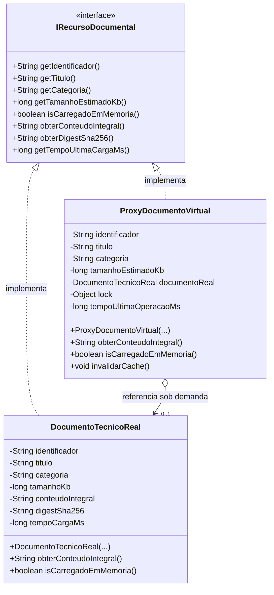
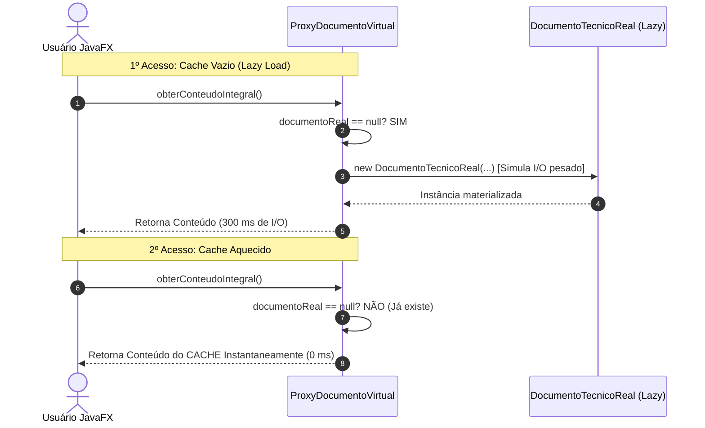

# Guia 35 — Padrão GoF Proxy: Virtual Proxy, Lazy Loading e Caching de Recursos

## 1. O Problema da Carga Eager de Recursos Pesados na Interface Gráfica
Em sistemas corporativos, acadêmicos ou laboratoriais desenvolvidos com JavaFX, entidades de inventário e equipamentos frequentemente possuem artefatos pesados associados:
- **Manuais Técnicos e Diagramas de Circuito:** Arquivos PDF volumosos de dezenas ou centenas de páginas.
- **Relatórios Periciais e Calibrações:** Logs extensos de telemetria e laudos de ensaio.
- **Imagens em Alta Resolução:** Fotos de macroscopia ou termografia de bancada.

### O Anti-Pattern: Eager Loading na População Inicial de Tabelas
Se a aplicação instanciar e carregar o conteúdo integral de todos os manuais técnicos na inicialização ou no momento de preencher uma `TableView`:
```java
// ❌ ANTI-PATTERN: Eager Loading sobrecarregando a memória Heap
List<ManualTecnico> lista = new ArrayList<>();
for (String id : ids) {
    // Cada chamada lê 15 MB do disco ou rede e aloca na RAM imediatamente!
    lista.add(new ManualTecnicoReal(id)); // Heap explode com 50 itens!
}
tabela.setItems(FXCollections.observableArrayList(lista));
```
- **Consumo Explosivo de Memória RAM:** Dezenas de megabytes ou gigabytes alocados para itens que o usuário talvez nunca clique para abrir.
- **Congelamento da UI (Application Thread Freeze):** A tela leva 10 a 20 segundos para abrir, transmitindo a impressão de travamento ao usuário.

### A Solução da Engenharia: Padrão GoF Proxy (Virtual Proxy com Lazy Loading)
O **Padrão GoF Proxy (Procurador)** fornece um substituto ou ponto de acesso para outro objeto a fim de controlar o seu acesso.
No caso do **Virtual Proxy**:
1. Criamos um objeto procurador leve (`ProxyDocumentoVirtual`) que implementa a mesma interface de negócio (`IRecursoDocumental`).
2. O Proxy armazena apenas metadados leves (ID, Título, Tamanho estimado em KB).
3. A instância real pesada (`DocumentoTecnicoReal`) **NÃO é criada** até o momento em que o método `obterConteudoIntegral()` for expressamente invocado.
4. Quando solicitado pela primeira vez, o Proxy materializa o objeto real, executa o I/O em segundo plano, **armazena o resultado em cache transparente**, e em acessos futuros responde com latência de **0 ms**.

```text
✔ VIRTUAL PROXY: Instanciação Sob Demanda e Cache em RAM

   TableView (JavaFX) ───► IRecursoDocumental (Interface Comum)
                                   ▲
                    ┌──────────────┴──────────────┐
                    │                             │
          DocumentoTecnicoReal           ProxyDocumentoVirtual
          (Pesado - Carrega I/O)         (Leve - Metadados)
                                                  │
                                            cria sob demanda
                                                  ▼
                                         [DocumentoTecnicoReal]
                                            (Cache em RAM)
```

---

## 2. Diagrama de Classes e Arquitetura Conceitual



### Diagrama de Sequência: Lazy Loading e Reuso em Cache



---

## 3. O Código Prático e Didático

### 3.1. A Interface Comum do Sujeito
Tanto o objeto real quanto o proxy compartilham a mesma assinatura:

```java
public interface IRecursoDocumental {
    String getIdentificador();
    String getTitulo();
    String getCategoria();
    long getTamanhoEstimadoKb();
    boolean isCarregadoEmMemoria();
    String obterConteudoIntegral() throws FalhaCargaDocumentoException;
    String obterDigestSha256();
    long getTempoUltimaCargaMs();
}
```

### 3.2. Implementação do Proxy com Double-Checked Locking Thread-Safe
O Proxy utiliza o padrão **Double-Checked Locking** com palavra-chave `volatile` para garantir segurança estrita em ambientes com múltiplas threads:

```java
public class ProxyDocumentoVirtual implements IRecursoDocumental {

    private final String identificador;
    private final String titulo;
    private final String categoria;
    private final long tamanhoEstimadoKb;

    // Referência volátil para visibilidade entre threads
    private volatile DocumentoTecnicoReal documentoReal = null;
    private final Object lock = new Object();
    private long tempoUltimaOperacaoMs = 0;

    public ProxyDocumentoVirtual(String id, String titulo, String categoria, long tamanhoKb) {
        this.identificador = Objects.requireNonNull(id);
        this.titulo = Objects.requireNonNull(titulo);
        this.categoria = Objects.requireNonNull(categoria);
        this.tamanhoEstimadoKb = tamanhoKb;
    }

    @Override
    public boolean isCarregadoEmMemoria() {
        return documentoReal != null;
    }

    @Override
    public String obterConteudoIntegral() throws FalhaCargaDocumentoException {
        long inicio = System.currentTimeMillis();
        if (documentoReal == null) {
            synchronized (lock) {
                if (documentoReal == null) { // Double check
                    this.documentoReal = new DocumentoTecnicoReal(
                            identificador, titulo, categoria, tamanhoEstimadoKb
                    );
                }
            }
        }
        this.tempoUltimaOperacaoMs = System.currentTimeMillis() - inicio;
        return documentoReal.obterConteudoIntegral();
    }
}
```

---

## 4. Integração Prática com JavaFX Desktop

Na interface JavaFX:
1. A tabela exibe diretamente itens `IRecursoDocumental`.
2. Um `TableCell` customizado estiliza os badges com base em `isCarregadoEmMemoria()`:
   - Se `false`: exibe badge cinza `⏳ VIRTUAL (Lazy)`.
   - Se `true`: exibe badge verde `✔ EM CACHE (0ms)`.
3. Ao clicar no botão para visualizar, **nunca execute o método pesado na JavaFX Application Thread**. Use `javafx.concurrent.Task<V>`:

```java
Task<String> task = new Task<>() {
    @Override
    protected String call() throws Exception {
        return selecionado.obterConteudoIntegral();
    }
};

task.setOnSucceeded(e -> {
    txtExibicao.setText(task.getValue());
    tabela.refresh(); // Atualiza o badge na linha para "EM CACHE"
});

new Thread(task).start();
```

---

## 5. Armadilhas Comuns (*Common Pitfalls*)

1. **Chamar Métodos Pesados dentro do CellValueFactory ou CellFactory:**
   *Pitfall:* Fazer `col.setCellValueFactory(d -> new SimpleStringProperty(d.getValue().obterConteudoIntegral()))`. Isso destrói o propósito do Proxy, pois obriga o carregamento de todos os itens ao renderizar a tabela na tela!
   *Solução:* Vincule as colunas apenas a **metadados leves** (`getIdentificador()`, `getTitulo()`, `isCarregadoEmMemoria()`).
2. **Esquecer a Sincronização em Ambientes Concorrentes:**
   *Pitfall:* Não sincronizar a criação do objeto real. Se duas threads requisitarem o conteúdo simultaneamente, o objeto real pode ser instanciado duas vezes, duplicando o consumo de RAM.
   *Solução:* Use `synchronized` e verificação dupla com campo `volatile`.
3. **Não Tratar Falhas de I/O de Forma Didática:**
   *Pitfall:* Deixar exceções de arquivo corrompido quebrarem a aplicação sem retorno limpo.
   *Solução:* O Proxy deve propagar exceções de domínio checadas (`FalhaCargaDocumentoException`) para permitir que a interface exiba um diálogo amigável com botão de nova tentativa.

---

## 6. Perguntas Frequentes em Bancas Avaliadoras

- **Qual a diferença entre Virtual Proxy, Protection Proxy e Remote Proxy?**
  - **Virtual Proxy:** Atrasa a criação de objetos caros em termos de memória ou tempo até que sejam realmente necessários (Lazy Loading).
  - **Protection Proxy:** Verifica permissões e direitos de acesso antes de delegar a chamada ao objeto real.
  - **Remote Proxy:** Fornece um representante local para um objeto que reside em outro espaço de endereçamento (ex.: RMI, gRPC).
- **Como o Proxy se relaciona com o Princípio da Responsabilidade Única (SRP)?**
  - O `DocumentoTecnicoReal` é responsável apenas pelas regras de cálculo e formatação do conteúdo do documento. O `ProxyDocumentoVirtual` assume a responsabilidade de gerenciar cache, controle de ciclo de vida e economia de memória, mantendo cada classe coesa.
