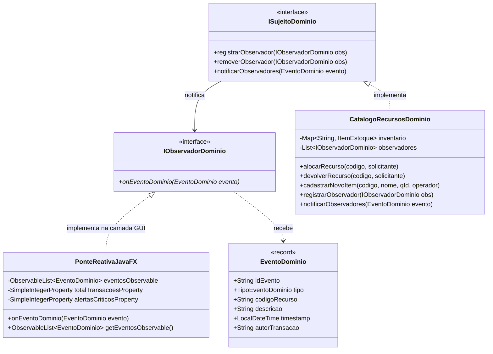
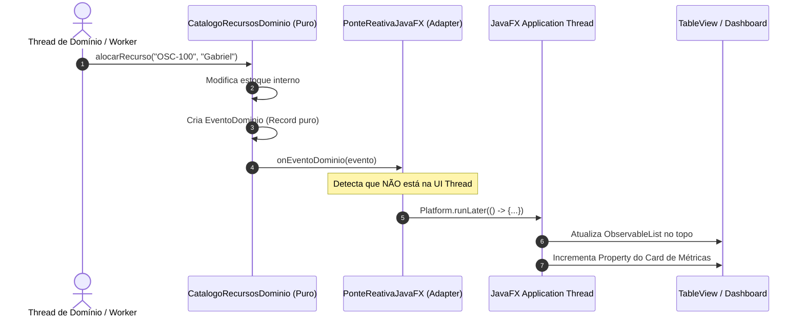

# Guia 36 — Padrão GoF Observer Puro: Desacoplamento de Domínio e Ponte Reativa JavaFX

## 1. O Problema da Fronteira Arquitetural entre Domínio Puro e JavaFX
Um dos erros mais comuns cometidos por estudantes e desenvolvedores ao construir aplicações desktop com JavaFX é misturar conceitos de apresentação gráfica diretamente nas classes de modelo de negócio:

```java
// ❌ ANTI-PATTERN: Entidade de Domínio poluída com imports de Framework UI
package br.edu.ifpb.sistema.modelo;

import javafx.beans.property.SimpleStringProperty;
import javafx.beans.property.StringProperty;
import javafx.collections.FXCollections;
import javafx.collections.ObservableList;

public class EquipamentoPatrimonial {
    // Violação grave de Clean Architecture! O domínio depende do OpenJFX!
    private final StringProperty status = new SimpleStringProperty();
    private final ObservableList<Historico> historico = FXCollections.observableArrayList();
}
```

### O Preço do Acoplamento de Framework no Domínio
1. **Violação da Arquitetura Limpa (Clean Architecture / Hexagonal Architecture):**
   A Regra de Dependência estipula que **o núcleo de domínio e entidades de negócio NUNCA devem depender de camadas externas ou frameworks de interface**.
2. **Inviabilidade Poliglota / Multiplataforma:**
   Se no futuro esse mesmo núcleo de negócio precisar ser executado em um backend web (Spring Boot, Micronaut), em uma rotina CLI ou em uma aplicação Android/Kotlin, o projeto não compilará ou exigirá carregar todo o runtime gráfico do JavaFX no servidor!
3. **Dificuldade de Testes Unitários Puros:**
   Qualquer teste de unidade do modelo passa a exigir inicialização do JavaFX Toolkit (`JavaFX Platform not initialized`), tornando a suíte de testes frágil e lenta.

### A Solução da Engenharia: Padrão GoF Observer Puro + Ponte Reativa
- **No Núcleo de Domínio:** Implementamos o **Padrão GoF Observer Puro** usando classes nativas do Java padrão (`IObservadorDominio`, `ISujeitoDominio`, Records Java 21). Não há **NENHUM** import do pacote `javafx.*`.
- **Na Camada de Apresentação (GUI):** Criamos uma **Ponte Reativa (Adapter / Bridge)** que implementa o contrato `IObservadorDominio`. Ela recebe os eventos emitidos pelo domínio e, de forma segura e transparente, despacha para a `JavaFX Application Thread` usando `Platform.runLater()`, alimentando as `ObservableList` e `Property` da interface visual.

```text
┌─────────────────────────────────────────────────────────────┐
│                 NÚCLEO DE DOMÍNIO PURO                      │
│   (POJO / Java Padrão — ZERO dependências de JavaFX)         │
│                                                             │
│   ISujeitoDominio ─────────► IObservadorDominio (Interface) │
│          ▲                                ▲                 │
│          │                                │                 │
│   CatalogoDominio                  EventoDominio            │
└───────────────────────────────────────────┼─────────────────┘
           FRONTEIRA ARQUITETURAL (Clean)   │ implementa
┌───────────────────────────────────────────┼─────────────────┐
│              CAMADA DE APRESENTAÇÃO       │                 │
│                                           ▼                 │
│                                 PonteReativaJavaFX          │
│                               (Platform.runLater)           │
│                                           │                 │
│                    atualiza reativamente  │                 │
│                                           ▼                 │
│                           TableView / Cards de Métricas      │
└─────────────────────────────────────────────────────────────┘
```

---

## 2. Diagrama de Classes e Arquitetura Conceitual



### Diagrama de Sequência: Notificação Desacoplada e Despacho na UI Thread



---

## 3. O Código Prático e Didático

### 3.1. Contrato e Record de Domínio Puro
Nenhum artefato gráfico do JavaFX entra nesta camada:

```java
public enum TipoEventoDominio {
    RECURSO_CADASTRADO,
    ALOCACAO_CONCLUIDA,
    DEVOLUCAO_CONCLUIDA,
    ALERTA_ESTOQUE_CRITICO
}

public record EventoDominio(
        String idEvento,
        TipoEventoDominio tipo,
        String codigoRecurso,
        String descricao,
        LocalDateTime timestamp,
        String autorTransacao
) {
    public EventoDominio {
        Objects.requireNonNull(idEvento);
        Objects.requireNonNull(tipo);
        Objects.requireNonNull(codigoRecurso);
        Objects.requireNonNull(descricao);
        Objects.requireNonNull(timestamp);
        Objects.requireNonNull(autorTransacao);
    }
}

@FunctionalInterface
public interface IObservadorDominio {
    void onEventoDominio(EventoDominio evento);
}

public interface ISujeitoDominio {
    void registrarObservador(IObservadorDominio observador);
    void removerObservador(IObservadorDominio observador);
    void notificarObservadores(EventoDominio evento);
}
```

### 3.2. A Ponte Reativa na Camada de Apresentação
Esta classe conecta os dois mundos de forma segura:

```java
public class PonteReativaJavaFX implements IObservadorDominio {

    private final ObservableList<EventoDominio> eventosObservable = FXCollections.observableArrayList();
    private final SimpleIntegerProperty totalTransacoesProperty = new SimpleIntegerProperty(0);
    private final SimpleIntegerProperty alertasCriticosProperty = new SimpleIntegerProperty(0);

    @Override
    public void onEventoDominio(EventoDominio evento) {
        Objects.requireNonNull(evento);

        Runnable acaoUi = () -> {
            eventosObservable.add(0, evento); // Adiciona na primeira posição da tabela
            totalTransacoesProperty.set(totalTransacoesProperty.get() + 1);

            if (evento.tipo() == TipoEventoDominio.ALERTA_ESTOQUE_CRITICO) {
                alertasCriticosProperty.set(alertasCriticosProperty.get() + 1);
            }
        };

        // Regra de Ouro: Garante execução segura na JavaFX Application Thread
        if (Platform.isFxApplicationThread()) {
            acaoUi.run();
        } else {
            Platform.runLater(acaoUi);
        }
    }
}
```

---

## 4. Integração Prática com JavaFX Desktop

Na inicialização da aplicação:
```java
CatalogoRecursosDominio dominio = new CatalogoRecursosDominio();
PonteReativaJavaFX ponte = new PonteReativaJavaFX();

// Conexão por injeção
dominio.registrarObservador(ponte);

// A tabela e os cartões de indicadores ligam-se às propriedades da ponte
tabela.setItems(ponte.getEventosObservable());
lblTotalTransacoes.textProperty().bind(ponte.totalTransacoesProperty().asString());
```

Se qualquer operação de negócio for disparada por uma thread de trabalho (Worker Thread, leitor serial de código de barras ou agendador de tarefas):
```java
new Thread(() -> {
    dominio.alocarRecurso("OSC-100", "Dispositivo-RFID-Portaria");
}).start();
```
O evento é processado no domínio e despachado para a tela com zero risco de `Not on FX application thread; currentThread = ...`.

---

## 5. Armadilhas Comuns (*Common Pitfalls*)

1. **Mutar Coleções de UI Fora da JavaFX Application Thread:**
   *Pitfall:* O observador de domínio tentar fazer `observableList.add(evento)` diretamente dentro da thread que chamou a regra de negócio. Isso causa `IllegalStateException: Not on FX application thread`.
   *Solução:* A Ponte Reativa deve sempre checar `Platform.isFxApplicationThread()` e invocar `Platform.runLater()`.
2. **Vazar Exceções do Observador para o Sujeito:**
   *Pitfall:* Um observador mal implementado lança uma `RuntimeException` durante a notificação, cancelando ou abortando o fluxo da transação de negócio de outros observadores.
   *Solução:* Envolva a notificação individual em bloco `try/catch` no sujeito, registrando em log falhas de observadores sem interromper a emissão para os demais.
3. **Lista de Observadores Não Thread-Safe:**
   *Pitfall:* Usar `ArrayList` comum no sujeito observável. Se um observador for adicionado enquanto outro está sendo notificado, ocorre `ConcurrentModificationException`.
   *Solução:* Use `CopyOnWriteArrayList<IObservadorDominio>` para armazenar os observadores.

---

## 6. Perguntas Frequentes em Bancas Avaliadoras

- **Por que não usar o `EventBus` em vez do padrão Observer clássico?**
  - O **Observer clássico** define contratos tipados e explícitos (`IObservadorDominio`), permitindo rastreabilidade formal e checagem em tempo de compilação.
  - O **EventBus** é excelente para desacoplar componentes desconhecidos em tempo de execução, mas pode dificultar o rastreamento estático quando há dezenas de tópicos dinâmicos. Em projetos acadêmicos e arquiteturas limpas, o Observer tipado com contratos de interface é frequentemente a abordagem mais valorizada pelas bancas.
- **Como o Padrão Observer respeita o Princípio Aberto/Fechado (OCP)?**
  - O `CatalogoRecursosDominio` está **fechado para modificação** e **aberto para extensão**: podemos criar observadores de auditoria, observadores de notificação por SMS, observadores de métricas e a ponte JavaFX sem alterar uma única linha do código da classe de domínio.
