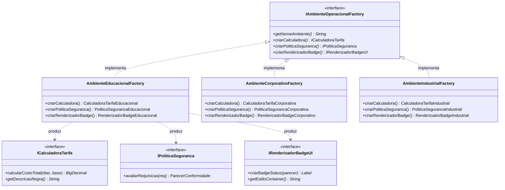
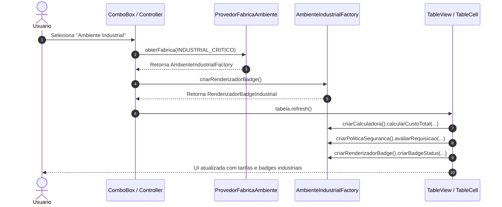

# Guia 37 — Padrões GoF Factory Method & Abstract Factory: Criação Polimórfica e Famílias de Componentes

## 1. O Problema do Acoplamento com Construtores Concretos na UI
Ao construir sistemas desktop, desenvolvedores iniciantes costumam espalhar instanciações diretas (`new`) de regras de negócio, tarifas e componentes visuais diretamente nos controladores JavaFX:

```java
// ❌ ANTI-PATTERN: Controlador acoplado a implementações concretas e regras condicionais espalhadas
public class SolicitacaoController {
    @FXML private ComboBox<String> comboAmbiente;
    @FXML private TableView<Solicitacao> tabela;

    @FXML
    public void onCalcularTarifa() {
        String tipo = comboAmbiente.getValue();
        BigDecimal custo;

        // Cadeia frágil de if/else acoplada a construtores concretos
        if ("EDUCACIONAL".equals(tipo)) {
            CalculadoraEducacional calc = new CalculadoraEducacional();
            custo = calc.calcular(dias);
        } else if ("CORPORATIVO".equals(tipo)) {
            CalculadoraCorporativa calc = new CalculadoraCorporativa();
            custo = calc.calcular(dias);
        } else {
            CalculadoraIndustrial calc = new CalculadoraIndustrial();
            custo = calc.calcular(dias);
        }
        // ...
    }
}
```

### Por que esse anti-pattern degrada a arquitetura?
1. **Violação do Princípio Aberto/Fechado (OCP - Open/Closed Principle):**
   Adicionar um novo ambiente operacional (ex.: *Ambiente Hospitalar / Emergencial*) exige alterar todos os controladores onde existam blocos `if/else` e chamadas `new`.
2. **Inconsistência entre Famílias de Objetos:**
   Em sistemas reais, a escolha de um ambiente ou tema exige a criação simultânea de múltiplos objetos coerentes entre si (ex.: Calculadora de Tarifas, Política de Segurança e Validação, Renderizador de Badges e Estilos Gráficos). Se o controlador instanciar a `CalculadoraEducacional`, mas esquecer de aplicar a `PoliticaSegurancaEducacional`, o sistema entra em estado inconsistente.
3. **Impossibilidade de Inversão de Dependências (DIP):**
   A camada de apresentação passa a depender diretamente de dezenas de classes concretas, impedindo a injeção de dublês de teste (mocks/fakes).

---

## 2. A Solução da Engenharia: Factory Method e Abstract Factory

- **GoF Factory Method (Método Fábrica):** Define uma interface para criar um objeto, mas delega às subclasses ou métodos especializados a decisão de qual classe concreta instanciar.
- **GoF Abstract Factory (Fábrica Abstrata):** Fornece uma interface para criar **famílias completas de objetos relacionados ou dependentes** sem especificar suas classes concretas.

No nosso ecossistema JavaFX, a fábrica abstrata `IAmbienteOperacionalFactory` garante a produção sincronizada de:
1. `ICalculadoraTarifa` (estratégia de custo e subsídio do ambiente)
2. `IPoliticaSeguranca` (regras e limites temporais para alocação)
3. `IRenderizadorBadgeUI` (estilos visuais, cores e componentes `Label` do JavaFX)

---

## 3. Diagramas de Classes e Sequência em Mermaid

### 3.1 Diagrama de Classes da Fábrica Abstrata



### 3.2 Diagrama de Sequência: Troca Dinâmica de Família no JavaFX



---

## 4. Detalhamento da Implementação

### 4.1 Contrato da Fábrica Abstrata (`IAmbienteOperacionalFactory`)
```java
public interface IAmbienteOperacionalFactory {
    String getNomeAmbiente();
    ICalculadoraTarifa criarCalculadora();
    IPoliticaSeguranca criarPoliticaSeguranca();
    IRenderizadorBadgeUI criarRenderizadorBadge();
}
```

### 4.2 Provedor Polimórfico com Pattern Matching (Java 21)
```java
public class ProvedorFabricaAmbiente {
    public static IAmbienteOperacionalFactory obterFabrica(TipoAmbiente tipo) {
        Objects.requireNonNull(tipo, "Tipo de ambiente não pode ser nulo.");
        return switch (tipo) {
            case EDUCACIONAL -> new AmbienteEducacionalFactory();
            case CORPORATIVO -> new AmbienteCorporativoFactory();
            case INDUSTRIAL_CRITICO -> new AmbienteIndustrialFactory();
        };
    }
}
```

### 4.3 Consumo no Controlador JavaFX
O controlador conhece **apenas** a interface `IAmbienteOperacionalFactory`. Quando o usuário troca o ambiente no `ComboBox`, uma única linha substitui a família inteira:

```java
comboAmbiente.setOnAction(e -> {
    TipoAmbiente selecionado = comboAmbiente.getValue();
    if (selecionado != null) {
        this.fabricaAtiva = ProvedorFabricaAmbiente.obterFabrica(selecionado);
        atualizarEstiloCabecalho();
        tabela.refresh(); // Dispara atualização de células consumindo os novos produtos
    }
});
```

---

## 5. Armadilhas Comuns (*Common Pitfalls*)

1. **Misturar Produtos de Famílias Diferentes:**
   Instanciar `new CalculadoraTarifaEducacional()` com `new RenderizadorBadgeIndustrial()`. O padrão Abstract Factory existe justamente para impedir essa aberração, encapsulando a criação conjunta.
2. **Hardcoding de Estilos CSS no Controller:**
   O controlador da interface não deve saber que o ambiente educacional usa verde `#2e7d32` e o corporativo usa azul `#1565c0`. A responsabilidade de fornecer esses estilos é do produto `IRenderizadorBadgeUI`.
3. **Esquecer de Usar `tabela.refresh()` ao Trocar a Fábrica:**
   Como os itens da lista (`ObservableList`) permanecem os mesmos, o JavaFX precisa ser notificado para redesenhar as células que dependem dos novos produtos da fábrica.

---

## 6. Respostas Prontas para Bancas Avaliadoras

- **Qual é a diferença fundamental entre Factory Method e Abstract Factory?**
  *O Factory Method foca na criação de um único produto através de um método polimórfico (frequentemente implementado por herança). Já o Abstract Factory cria uma família inteira de produtos relacionados através de composição e interfaces, garantindo que os clientes utilizem componentes mutuamente compatíveis.*
- **Como o Abstract Factory auxilia no cumprimento do Princípio Aberto/Fechado (OCP)?**
  *Para introduzir um novo ambiente no sistema (ex.: Ambiente Médico/Hospitalar), basta criar uma nova classe `AmbienteHospitalarFactory` implementando a interface `IAmbienteOperacionalFactory` e seus respectivos produtos. Nenhuma linha de código dos controladores ou da TableView precisa ser alterada.*
