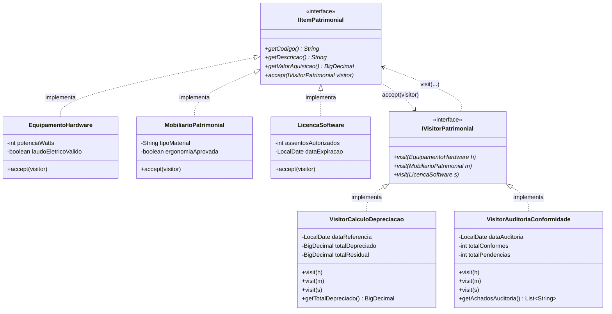
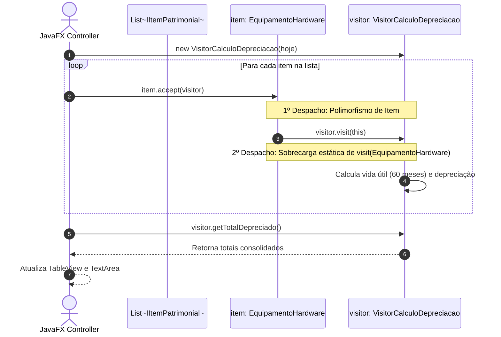

# Guia 38 — Padrão GoF Visitor: Operações Polimórficas Externas e Double Dispatch

## 1. O Problema da Poluição de Entidades com Operações Transversais
Em sistemas de gestão patrimonial e inventário, é comum termos hierarquias heterogêneas de classes (ex.: `EquipamentoHardware`, `MobiliarioPatrimonial`, `LicencaSoftware`). Conforme o sistema cresce, novas demandas de negócio surgem:
- O setor contábil precisa calcular a **depreciação tributária acumulada** de cada item.
- O setor de compliance precisa realizar uma **auditoria de conformidade técnica** (laudos elétricos, ergonomia NR-17, licenças vencidas).
- O setor de TI precisa **exportar dados em formato JSON ou XML**.

Se adicionarmos esses métodos diretamente nas classes de domínio:
```java
// ❌ ANTI-PATTERN: Entidade de domínio acumulando responsabilidades transversais
public class EquipamentoHardware {
    // Domínio puro
    private String codigo;
    private BigDecimal valor;

    // Métodos que NÃO pertencem ao núcleo de domínio:
    public BigDecimal calcularDepreciacaoContabil(LocalDate base) { ... }
    public RelatorioAuditoria auditarConformidadeEletrica() { ... }
    public String exportarParaXmlSpedFiscal() { ... }
    public String gerarPayloadJsonParaApiExterna() { ... }
}
```

### Por que esse anti-pattern viola os princípios de Clean Code?
1. **Violação do Princípio da Responsabilidade Única (SRP):**
   A entidade passa a ter razões para mudar sempre que a receita federal altera regras contábeis ou o formato de exportação muda.
2. **Violação do Princípio Aberto/Fechado (OCP):**
   Cada nova operação exige abrir e recompilar todas as classes da hierarquia de itens.
3. **Alternativa Ingênua — Cascatas Frágeis de `instanceof`:**
   Mover essa lógica para uma classe de serviço usando `if (item instanceof EquipamentoHardware)` gera código rígido, frágil e sujeito a esquecimento de novas subclasses.

---

## 2. A Solução da Engenharia: Padrão GoF Visitor e Double Dispatch

O **Padrão GoF Visitor** permite definir uma nova operação sobre os elementos de uma estrutura de objetos sem modificar as classes desses elementos.

### O Mecanismo do Double Dispatch (Despacho Duplo)
O polimorfismo tradicional do Java resolve métodos com base apenas no tipo do receptor em tempo de execução (`item.metodo()`). O Double Dispatch permite que a execução dependa de dois tipos dinâmicos:
1. **Primeiro Despacho:** O chamador invoca `elemento.accept(visitor)`. O polimorfismo do Java identifica dinamicamente qual subclasse de elemento está executando.
2. **Segundo Despacho:** Dentro do `accept()`, o elemento executa `visitor.visit(this)`. Como `this` possui tipo estático exato dentro de sua classe, o compilador direciona para o método sobrecarregado exato do Visitor!

```text
Chamador ──► elemento.accept(visitor) ──► visitor.visit(this) ──► Executa lógica específica!
 (Nó A)           (1º Despacho)               (2º Despacho)           (Sem nenhum 'instanceof')
```

---

## 3. Diagramas de Classes e Sequência em Mermaid

### 3.1 Diagrama de Classes do Visitor



### 3.2 Diagrama de Sequência: Execução de Double Dispatch em Lote



---

## 4. Detalhamento da Implementação

### 4.1 Método `accept` nas Entidades Concretas
Cada classe concreta implementa exatamente a mesma linha idiomática:
```java
@Override
public void accept(IVisitorPatrimonial visitor) {
    // 'this' aqui é do tipo EquipamentoHardware em tempo de compilação!
    visitor.visit(this);
}
```

### 4.2 O Visitor de Auditoria e Conformidade
```java
public class VisitorAuditoriaConformidade implements IVisitorPatrimonial {
    private final LocalDate dataAuditoria;
    private int totalConformes = 0;
    private int totalPendencias = 0;
    private final List<String> achados = new ArrayList<>();

    @Override
    public void visit(EquipamentoHardware h) {
        if (!h.isLaudoEletricoValido()) {
            totalPendencias++;
            achados.add("CRÍTICO: Hardware [" + h.getCodigo() + "] SEM LAUDO ELÉTRICO.");
        } else {
            totalConformes++;
        }
    }

    @Override
    public void visit(MobiliarioPatrimonial m) {
        if (!m.isErgonomiaAprovada()) {
            totalPendencias++;
            achados.add("ALERTA: Mobiliário [" + m.getCodigo() + "] reprovado na NR-17.");
        } else {
            totalConformes++;
        }
    }

    @Override
    public void visit(LicencaSoftware s) {
        if (dataAuditoria.isAfter(s.getDataExpiracao())) {
            totalPendencias++;
            achados.add("BLOQUEIO: Licença [" + s.getCodigo() + "] EXPIRADA.");
        } else {
            totalConformes++;
        }
    }
}
```

### 4.3 Integração Desacoplada no JavaFX
O controlador pode executar operações inteiras sobre os dados selecionados com um laço elegante de duas linhas:

```java
VisitorCalculoDepreciacao visitor = new VisitorCalculoDepreciacao(LocalDate.now());
catalogo.forEach(item -> item.accept(visitor));

txtRelatorio.setText("Total Depreciado: " + visitor.getTotalDepreciado());
```

---

## 5. Armadilhas Comuns (*Common Pitfalls*)

1. **Tentar Implementar `accept` na Superclasse Abstrata:**
   Se você colocar `public void accept(IVisitor v) { v.visit(this); }` na classe abstrata `ItemPatrimonial`, o Java compilará uma chamada para `visit(ItemPatrimonial)`. O compilador **não** inspeciona a instância em tempo de execução para escolher a sobrecarga! Cada subclasse **deve** implementar seu próprio `accept` explicitamente.
2. **Utilizar o Visitor quando a Hierarquia de Classes Muda Frequentemente:**
   O Visitor é ideal quando a **hierarquia de classes é estável**, mas **novas operações surgem com frequência**. Se você adiciona novas subclasses de elementos toda semana, terá que atualizar a interface `IVisitorPatrimonial` e todos os seus Visitors concretos.
3. **Quebrar o Encapsulamento de Dados:**
   O Visitor precisa ler atributos dos elementos para realizar seus cálculos. Forneça getters somente leitura ou métodos de consulta contextuais, evitando setters públicos nas entidades.

---

## 6. Respostas Prontas para Bancas Avaliadoras

- **O que é Double Dispatch e por que o Java puro precisa dele?**
  *O Java suporta Single Dispatch em chamadas virtuais polimórficas (a escolha do método depende apenas do tipo do objeto receptor em tempo de execução). Quando a operação também depende do tipo do argumento (como no caso de visitadores), o padrão Visitor simula o Double Dispatch combinando a chamada polimórfica `accept()` com a sobrecarga de métodos estática `visit(this)`.*
- **Quando devo preferir o padrão Visitor em vez de polimorfismo tradicional nos próprios objetos?**
  *Devemos preferir o Visitor quando a operação a ser executada não tem relação direta com o conceito de negócio do objeto (como cálculo contábil, auditoria regulatória ou exportação para JSON/XML) e quando desejamos evitar a proliferação de métodos auxiliares que poluiriam as entidades de domínio, violando o SRP e o OCP.*
