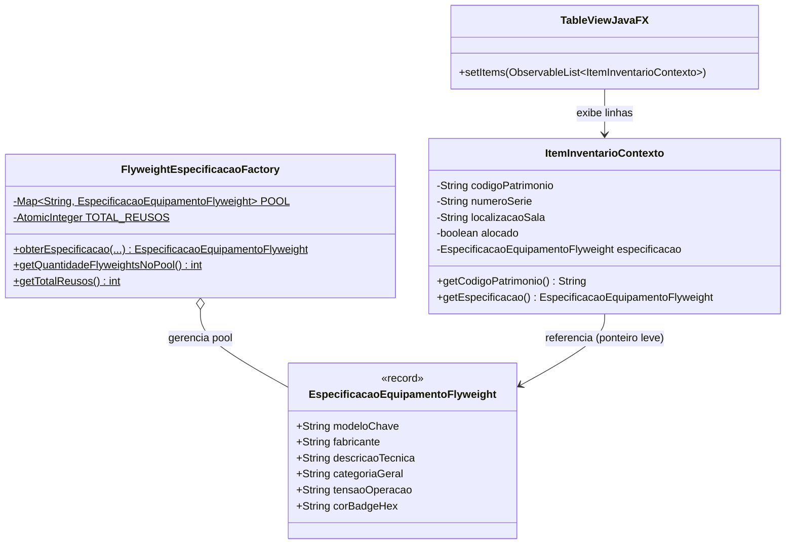

# Guia 39 — Padrão GoF Flyweight: Otimização Extrema de Memória e Estados Compartilhados

## 1. O Problema da Saturação do Heap em Interfaces Desktop
Aplicações desktop em JavaFX frequentemente manipulam catálogos extensos contendo dezenas de milhares de registros (ex.: inventários de peças, componentes eletrônicos, históricos de telemetria ou ativos físicos).
Um erro frequente de modelagem é criar instâncias completas contendo todos os atributos repetidos para cada item:

```java
// ❌ ANTI-PATTERN: Objeto pesado com todos os metadados duplicados em cada linha
public class ItemInventario {
    // Estado Único (Extrínseco)
    private String codigoPatrimonio; // Ex: "PAT-00042"
    private String numeroSerie;      // Ex: "SN-98214"
    private String localizacao;      // Ex: "Bancada 3"

    // Estado Repetitivo Pesado (Intrínseco) — Duplicado 10.000 vezes no Heap!
    private String modelo = "Rigol DS1054Z";
    private String fabricante = "Rigol Technologies Inc.";
    private String descricaoTecnica = "Osciloscópio Digital 4 Canais 50MHz com decodificação I2C/SPI...";
    private String tensaoOperacao = "Bivolt Automático 110V/220V 60Hz";
    private String categoria = "Instrumentação Eletrônica";
    private String corBadge = "#1565c0";
}
```

### O Custo da Duplicação no Heap da JVM
- **Explosão de Objetos no Heap:** Se o acervo contiver 20.000 itens mas apenas 10 modelos distintos de equipamentos, teremos **20.000 strings repetidas de descrição, fabricante e tensão**.
- **Pausas de Coleta de Lixo (GC Stuttering):** A criação e destruição contínua de objetos duplicados obriga a JVM a acionar frequentemente o Garbage Collector (G1GC ou ZGC), provocando microcongelamentos perceptíveis na interface gráfica JavaFX durante rolagem e filtragem de tabelas.

---

## 2. A Solução da Engenharia: Padrão GoF Flyweight

O **Padrão GoF Flyweight (Peso-Mosca)** utiliza compartilhamento para suportar eficientemente grandes quantidades de objetos granulares.

### Segregação Rigorosa de Estados
1. **Estado Intrínseco (Intrinsic State):**
   - Dados independentes do contexto do item, estritamente **imutáveis** e comuns a múltiplas instâncias (ex.: Modelo, Fabricante, Descrição Técnica, Categoria, Cor e Ícone do Badge).
   - Armazenado no próprio objeto Flyweight (`EspecificacaoEquipamentoFlyweight`).
2. **Estado Extrínseco (Extrinsic State):**
   - Dados que variam de item para item e dependem do contexto de negócio (ex.: Código de Patrimônio único, Número de Série, Sala atual, Flag de Alocado).
   - Armazenado no objeto de contexto leve (`ItemInventarioContexto`), que mantém apenas um ponteiro de memória de 64 bits para o Flyweight compartilhado.

```text
SEM FLYWEIGHT (20.000 Objetos Pesados):
┌─────────────────────────────────┐   ┌─────────────────────────────────┐
│ Item 1: PAT-001                 │   │ Item 2: PAT-002                 │
│ Modelo: "Rigol DS1054Z"         │   │ Modelo: "Rigol DS1054Z"         │
│ Fabricante: "Rigol Tech..."     │   │ Fabricante: "Rigol Tech..."     │
│ Descrição: "Osciloscópio..."    │   │ Descrição: "Osciloscópio..."    │
└─────────────────────────────────┘   └─────────────────────────────────┘
... (duplicado 20.000 vezes na memória)

COM FLYWEIGHT (20.000 Contextos Leves + 5 Instâncias Flyweight):
┌────────────────────────┐   ┌────────────────────────┐
│ Item 1: PAT-001        │   │ Item 2: PAT-002        │
│ refEspecificacao ──────┼─┐ │ refEspecificacao ──────┼─┐
└────────────────────────┘ │ └────────────────────────┘ │
                           ▼                            │
        ┌───────────────────────────────────────────┐   │
        │ FLYWEIGHT COMPARTILHADO (Pool em RAM)     │◄──┘
        │ Modelo: "Rigol DS1054Z"                   │
        │ Fabricante: "Rigol Technologies Inc."     │
        │ Descrição: "Osciloscópio Digital 4Ch..."  │
        └───────────────────────────────────────────┘
```

---

## 3. Diagramas de Classes e Arquitetura em Mermaid

### 3.1 Diagrama de Classes do Flyweight



---

## 4. Detalhamento da Implementação

### 4.1 O Flyweight Imutável (Record Java 21)
O Flyweight deve ser estritamente imutável para que alterações em um item não afetem acidentalmente os demais:
```java
public record EspecificacaoEquipamentoFlyweight(
        String modeloChave,
        String fabricante,
        String descricaoTecnica,
        String categoriaGeral,
        String tensaoOperacao,
        String corBadgeHex
) {
    public EspecificacaoEquipamentoFlyweight {
        Objects.requireNonNull(modeloChave);
        Objects.requireNonNull(fabricante);
        Objects.requireNonNull(descricaoTecnica);
    }
}
```

### 4.2 A Fábrica de Flyweights Thread-Safe (`ConcurrentHashMap`)
A fábrica utiliza `compute()` atômico para garantir que duas threads concorrentes não criem cópias duplicadas do mesmo flyweight:
```java
public class FlyweightEspecificacaoFactory {
    private static final Map<String, EspecificacaoEquipamentoFlyweight> POOL = new ConcurrentHashMap<>();
    private static final AtomicInteger TOTAL_REUSOS = new AtomicInteger(0);

    public static EspecificacaoEquipamentoFlyweight obterEspecificacao(
            String modeloChave, String fabricante, String descricao,
            String categoria, String tensao, String corBadge
    ) {
        return POOL.compute(modeloChave, (chave, existente) -> {
            if (existente != null) {
                TOTAL_REUSOS.incrementAndGet();
                return existente; // Retorna a instância já alocada em RAM
            }
            return new EspecificacaoEquipamentoFlyweight(
                    chave, fabricante, descricao, categoria, tensao, corBadge
            );
        });
    }
}
```

### 4.3 Criação de Contextos Leves e Consumo na TableView
```java
// O cliente solicita o flyweight à fábrica e monta o contexto
EspecificacaoEquipamentoFlyweight flyweight = FlyweightEspecificacaoFactory.obterEspecificacao(
        "DS1054Z", "Rigol", "Osciloscópio 4CH", "Medição", "Bivolt", "#1565c0"
);

ItemInventarioContexto item = new ItemInventarioContexto(
        "PAT-00042", "SN-98214", "Laboratório 2", false, flyweight
);
```

---

## 5. Armadilhas Comuns (*Common Pitfalls*)

1. **Permitir Mutabilidade no Flyweight:**
   Se um método setter for colocado no objeto Flyweight (`setDescricaoTecnica()`), alterar a descrição de um osciloscópio alterará instantaneamente a descrição de **todos os outros 5.000 osciloscópios** do sistema! O estado intrínseco **deve** ser 100% imutável.
2. **Confundir Estado Intrínseco com Extrínseco:**
   Colocar o número de patrimônio dentro do Flyweight destruirá o reuso, forçando a fábrica a criar um flyweight para cada item e anulando o benefício do padrão.
3. **Não Proteger a Fábrica contra Concorrência:**
   Utilizar um `HashMap` comum sem sincronização em sistemas com múltiplas threads (`Task<V>`, Workers em background) causará corrupção do pool ou perda de dados. Utilize sempre `ConcurrentHashMap` ou blocos sincronizados.

---

## 6. Respostas Prontas para Bancas Avaliadoras

- **Qual é a principal métrica para avaliar o sucesso do padrão Flyweight?**
  *A relação entre o número total de itens de contexto ativos e o número de instâncias mantidas no pool da fábrica (`pool.size() / totalItens`). Em cenários reais, taxas de economia de instâncias superiores a 95% são comuns, reduzindo expressivamente o footprint de memória RAM e aliviando o Garbage Collector.*
- **Como o Java usa o padrão Flyweight nativamente?**
  *O próprio JDK utiliza o padrão Flyweight internamente em implementações como o pool de Strings literais (`String.intern()`) e o cache de tipos primitivos encaixados (`Integer.valueOf(int)` faz cache de instâncias entre -128 e 127).*
