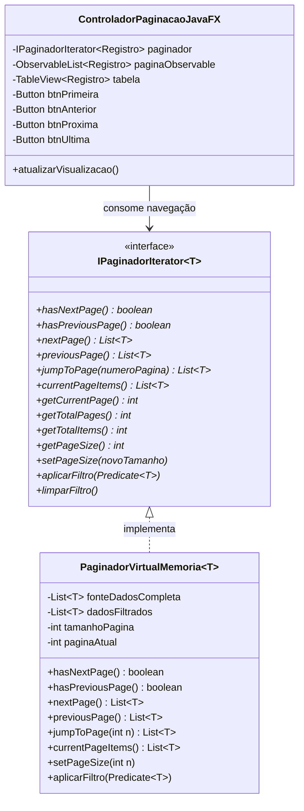
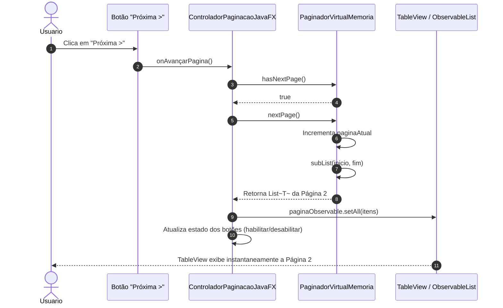

# Guia 40 — Padrão GoF Iterator: Paginação Virtual e Navegação Sob Demanda em JavaFX

## 1. O Problema de Escalar TableViews para Grandes Volumes
Ao desenvolver interfaces desktop corporativas ou educacionais, um dos erros mais frequentes de desempenho é carregar toda a base de dados em memória e vinculá-la diretamente a uma `ObservableList` vinculada à `TableView`:

```java
// ❌ ANTI-PATTERN: Carregar 50.000 itens de uma vez na UI do JavaFX
List<Registro> todosItens = repositorio.buscarTodos(); // 50.000 registros
ObservableList<Registro> observable = FXCollections.observableArrayList(todosItens);
tabela.setItems(observable); // Congela a JavaFX Application Thread durante a renderização!
```

### Sintomas do Colapso de Interface Gráfica
1. **Congelamento da Thread de Apresentação:**
   A criação e vinculação de milhares de nós visuais (`TableRow`, `TableCell`) na JavaFX Application Thread trava a janela principal por vários segundos, transmitindo a sensação de software instável ("Não Respondendo").
2. **Consumo Excessivo e Desnecessário de Memória:**
   O usuário comum visualiza apenas entre 10 e 50 linhas por tela. Manter dezenas de milhares de células ativas no grafo de cena (Scene Graph) desperdiça memória RAM do cliente.
3. **Péssima Usabilidade (UX):**
   Uma barra de rolagem com 50.000 itens torna a navegação manual quase impossível — um toque de 2 milímetros na barra pula milhares de registros.

---

## 2. A Solução da Engenharia: Padrão GoF Iterator com Paginação Virtual

O **Padrão GoF Iterator** tem como propósito fornecer uma maneira de acessar sequencialmente os elementos de um objeto agregado sem expor sua representação interna subjacente.

### Evolução para Paginador Bidirecional Virtual (`IPaginadorIterator<T>`)
Estendemos o conceito clássico do Iterator para suportar navegação por páginas (blocos sob demanda), saltos diretos e redefinição de tamanho de lote em tempo de execução:
- `hasNextPage()` / `hasPreviousPage()`: verificação de fronteiras seguras.
- `nextPage()` / `previousPage()`: avanço e retrocesso atômico.
- `jumpToPage(int n)`: navegação direta com validação de limites.
- `currentPageItems()`: fatiamento virtual (`subList`) contendo apenas as instâncias da página ativa.
- `aplicarFiltro(Predicate<T>)`: recalcula dinamicamente os limites e reseta o cursor com segurança.

```text
CONJUNTO TOTAL DE DADOS (Ex: 50.000 Registros em RAM ou Banco)
[========================================================================]
                           ▲             ▲
                           │             │
        PÁGINA ATUAL (Janela Virtual de 15 itens)
        [---------------]
        Apenas esses 15 itens são entregues à ObservableList da TableView!
        Resultado: 60 FPS estáveis, consumo constante de RAM e zero congelamento.
```

---

## 3. Diagramas de Classes e Sequência em Mermaid

### 3.1 Diagrama de Classes do Iterator Paginado



### 3.2 Diagrama de Sequência: Transição de Página na UI



---

## 4. Detalhamento da Implementação

### 4.1 Cálculo da Janela Virtual (`currentPageItems`)
O método recorta a fatia correta de dados sem clonar arrays desnecessariamente:
```java
@Override
public List<T> currentPageItems() {
    if (dadosFiltrados.isEmpty()) {
        return Collections.emptyList();
    }

    int inicio = (paginaAtual - 1) * tamanhoPagina;
    if (inicio >= dadosFiltrados.size()) {
        paginaAtual = Math.max(1, getTotalPages());
        inicio = (paginaAtual - 1) * tamanhoPagina;
    }

    int fim = Math.min(inicio + tamanhoPagina, dadosFiltrados.size());
    return Collections.unmodifiableList(dadosFiltrados.subList(inicio, fim));
}
```

### 4.2 Reatividade ao Filtrar e Redimensionar
Sempre que um filtro ou novo tamanho de página é aplicado, o cursor é reposicionado com segurança na primeira página para evitar apontar para índices inexistentes:
```java
@Override
public void setPageSize(int novoTamanho) {
    if (novoTamanho <= 0) {
        throw new IllegalArgumentException("Tamanho deve ser positivo.");
    }
    this.tamanhoPagina = novoTamanho;
    this.paginaAtual = 1; // Proteção contra índice órfão
}
```

### 4.3 Integração com a Barra de Navegação JavaFX
```java
private void atualizarVisualizacao() {
    List<RegistroAcervoVirtual> itensPagina = paginador.currentPageItems();
    paginaItensObservable.setAll(itensPagina);

    int totalPaginas = paginador.getTotalPages();
    int paginaAtual = paginador.getCurrentPage();

    lblIndicadorPagina.setText("Página " + paginaAtual + " de " + totalPaginas);

    // Controle dinâmico de habilitação dos botões
    btnPrimeira.setDisable(paginaAtual <= 1);
    btnAnterior.setDisable(!paginador.hasPreviousPage());
    btnProxima.setDisable(!paginador.hasNextPage());
    btnUltima.setDisable(paginaAtual >= totalPaginas);
}
```

---

## 5. Armadilhas Comuns (*Common Pitfalls*)

1. **Retornar Sublistas Mutáveis:**
   O método `subList()` do Java retorna uma visão (*view*) da lista original. Modificar essa sublista altera a coleção de origem. Sempre encapsule o retorno com `Collections.unmodifiableList(subList)`.
2. **Não Tratar o Caso de Lista Vazia após Filtro:**
   Se uma busca por texto não encontrar nenhum item, a coleção filtrada terá tamanho zero. O cálculo de total de páginas deve retornar `1` e `currentPageItems()` deve retornar lista vazia, evitando divisão por zero (`ArithmeticException`) ou estouro de limites.
3. **Fazer `new ObservableList` a Cada Mudança de Página:**
   Substituir a referência inteira da lista na `TableView` (`tabela.setItems(...)`) desfaz seleções e consome mais recursos. A melhor prática é vincular a `ObservableList` **uma única vez** no `initialize()` e usar apenas `observableList.setAll(novosItens)` na troca de página.

---

## 6. Respostas Prontas para Bancas Avaliadoras

- **Por que utilizar o padrão Iterator para paginação em vez de carregar tudo com rolagem contínua?**
  *Porque o padrão Iterator com paginação virtual estabelece uma barreira de desempenho constante O(1) no grafo de cena do JavaFX. Independentemente de o banco ter 1.000 ou 1.000.000 de registros, a memória visual da TableView é sempre limitada a apenas N nós (tamanho da página), garantindo tempo de resposta constante e navegação estável sem sobrecarga no Heap.*
- **Como o princípio de Responsabilidade Única (SRP) é preservado com o Iterator?**
  *O Iterator separa a responsabilidade de armazenamento de dados da responsabilidade de percurso e navegação. A coleção foca apenas em guardar os registros, enquanto o Iterator gerencia índices, limites de páginas, fatiamento e filtros temporários.*
